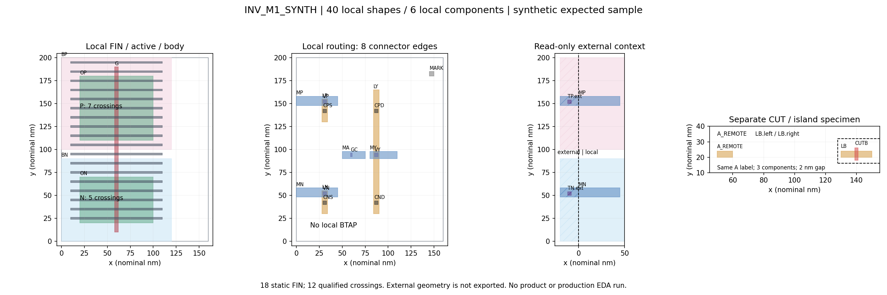
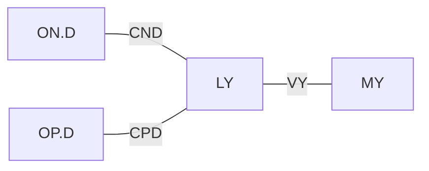

# W003 人工核验清单（PM）

先确认“这套题和答案是否正确、是否是你希望程序处理的样子”，再开始产品实现。例如 N/P 的目标仍为 5/7，程序应保持几何和电路语义，检查全部 toy 规则；即使数字相同，间距错也必须失败。

本页由 PM 维护人工核验记录，来源为 [W003](../W003-m1-fixture-contracts.md) 已独立 review 的固定交付。坐标、规则、格式和错误类别的来源仍是原 fixture/spec/oracle/contracts；下表仅是方便逐项阅读的展示，不是新的 oracle 或产品合同。A2已展示38个原始图形，六根不计数FIN按用户指示略过；A3已展示端子、边、分量及non_edges并解释用途。用户已选择将两个同名A孤岛拆为专门案例，A4.01由未决转需修改，见MR-020；拆分尚未实施。尺寸/精度来源及关键层规则对应需修改，见 MR-002；tech.json 分类文件要求见 MR-004 / B4。上述要求未关闭，A2.04/A2.05及color来源按实际答复记录理解/范围，尚无主项目获完整确认，其余状态保持**待确认**。讨论进度、人工结论与覆盖范围分别记录；待确认只是尚无明确通过结论，不表示必须立即回复、禁止换主题或已有新增修改要求。

2026-09-24新增body使用预期修正：用户说明body由专门tapcell负责，不要求逻辑单元内显式BTAP；当前TN/TP与相关body规则/连通答案须调整，见MR-046。2026-10-09网格讨论经MR-052作阶段范围纠正：W003只需澄清32×16的测试假设、用途及样张引用，不将它冒充完整坐标模型；MR-051中要求本轮补齐全层坐标模型/生成投影验收的扩展已撤回，交后续Stage 2开发。本文旧实物仍绑定指定SHA，未实施修改或确认新版。

## 核验版本与方法

- 2026-10-26 迁移说明：MR-001–MR-054 的原记录与实物版本保持；本次随网页交接文档同步至审核分支。下文各轮“未 commit/push”是当轮历史事实，网页续接范围与版本核对见 [W003 P5](../W003-m1-fixture-contracts.md#p5-网页续接与人工记录同步2026-10-26) 及 [启动 prompt](web-codex-handoff.md)。没有新增人工确认或实施样本修改。

- 2026-09-14 子 PM 本轮核验版本：`codex/w003-manual-review@6d29b511ac415a9ea198d1e5c8978313c5abb6e3`，与用户指定版本一致；启动时 staged/unstaged/untracked 均为空。相对下述材料提交仅有三份 PM 文档的发布说明变化，fixture 与图未变；本页末尾三项展示来源 hash 已核对一致。本轮答复均绑定此 HEAD；本轮仅在本页追加人工记录，不 commit/push。
- 跨平台审核分支：`codex/w003-manual-review`，材料提交 `01535055f5d661a2964443dec76fc7f7f305e3e0` 已推送；本页及其图、原始输入、期望输出、负例、合同与报告均随分支保存。直接按下方链接阅读，不需要本机临时目录或先运行辅助脚本。发布不代表用户已确认。
- 基线：`main@b1f0301cf76b2e1808cb293cfdb4e1bfededde73`。
- 固定接收包：`/private/tmp/layauto-w003-independent-review-i8gqzwtw`；`full.patch` SHA-256 为 `c03a90b4f49c51a2343d54ad110420801d7b39966f6f5b6ec34c7b5b8fd1178f`。
- 独立 review 的 2 项 P2 已修复并复核关闭，0 项未关闭实质 findings；这是本地 synthetic 样本/合同技术结论，用户确认、W003 最终验收及产品运行分别记录。
- 建议依次核验 A → B → C → D；可以回复“编号：确认 / 需修改（期望）/ 未决（疑点）”。“确认一组”只覆盖该组明确列出的项目，不外推到其余材料。
- 无需使用固定确认口令；含义与范围明确的自然语言即可记录。用户可结束当前讨论或先换主题，剩余覆盖及已有修改要求保留到后续；不把讨论结束自动记为通过，也不反复索取已明确的决定。
- 2026-09-17 用户明确要求略过A2.04逐根讲解，理由为已理解；按该最新指示执行，不强行补讲。该组六对象仍保留编号及坐标入口，披露为用户选择略过，不将其记作已逐项核对数值，亦不外推为其余组可抽样。
- 2026-09-22用户将A5剩余项改为委托子PM逐项核对、只提交新增决策点；若无则直接进入B。已依此覆盖剩余T03–T10，未发现新增用户决策点，原修改要求保持，见MR-025。此为本组明确授权的审阅方式调整，不记作用户逐条亲自确认，也不自动扩展到B–D。
- PM 记录答复和受影响版本，执行者解释或修正；有改动先串行修正、复核相关技术证据，再确认受影响项。没有变化的材料不机械重做。

## A. 正常版图、电路与独立答案



图仅辅助阅读。以下逐形状、连通和规则表分别摘自 [spec](../../../tests/fixtures/w003_m1/spec.json) 与 [手写 oracle](../../../tests/fixtures/w003_m1/oracle.json)，技术 review 已另用独立 reader/整数算法核对实物 GDS。

| ID | 需要逐项确认的事实与使用预期 | 用户状态 |
| --- | --- | --- |
| A1 | 同一 inverter，固定 160×200 nm；nominal 1 nm 整数 tick。两器件 single-finger、one-to-one、无归并；NFIN=5/7、NF=1、M=1。W=2n、L=4n、VT=toy 仅为 toy 模型解释。source/target 全部语义相同，允许文字/参数顺序不同 | 需修改：来源说明及规则对应（MR-002）；其余待确认。本轮讨论已结束（MR-005/MR-007） |
| A2 | 下表为现版全部44个drawn rectangles；18根FIN保留，N计F01–F05，P计F07–F13，其余6根不计；qualified面积40/56nm²。TN/TP本地tap图形随MR-046 body场景修改 | A2.04/A2.05确认理解；38形状已展示、6根FIN按指示略过；MR-046新增body相关需修改，不等于A2整体或新版确认 |
| A3 | 现版10条connector边、8端子、6物理分量；旧toy以本地TN/TP把body接rail。用户改为专门tapcell场景，不要求逻辑cell内BTAP，body连接语义及图需调整 | 需修改：MR-046 body/tapcell与相关terminal/component答案；其余按MR-019既有展示/答复范围，不因修改清单而自动整项通过 |
| A4 | 当前CUT把LB分成两个同名A孤岛。用户已选择主正常例移除LB/CUTB及R08/R09，当前场景保留为专门拓扑/覆盖案例；具体要求见MR-020，尚未实施。MARK作为未注释非导体留在主例，保留/不误导通/披露预期已确认 | 需修改：孤岛拆分待执行（MR-020.1）；确认：MARK保留使用预期（MR-022.1）。A4本轮讨论结束，修改完成与新版验收另记 |
| A5 | 下表T01–T10为现版toy必需检查；相同FIN数也须检查，缺context/执行错误不得通过，site不可禁用；body/tapcell场景变化影响T04/T05/T08及关联覆盖 | 需修改：MR-002/MR-004/MR-020保持，后续MR-046新增body要求。MR-025委托核对结论仅保留原版范围，受影响规则需调整/复核，不等于新版通过 |

### A2 的全部形状

坐标顺序 `[x0,y0,x1,y1]`，单位均为 nominal nm；表中 F 编号按原身份排列，非按 y 排序。

| Shape | Layer | 矩形坐标 | FIN 计数归属 |
| --- | --- | --- | --- |
| FRAME | BOUNDARY | `[0, 0, 160, 200]` | — |
| BN | BODY_N | `[0, 0, 120, 90]` | — |
| BP | BODY_P | `[0, 100, 120, 200]` | — |
| ON | OD | `[20, 20, 100, 70]` | — |
| OP | OD | `[20, 110, 100, 180]` | — |
| G | POLY | `[58, 10, 62, 190]` | — |
| F01 | FIN | `[10, 24, 110, 26]` | MN0 |
| F02 | FIN | `[10, 34, 110, 36]` | MN0 |
| F03 | FIN | `[10, 44, 110, 46]` | MN0 |
| F04 | FIN | `[10, 54, 110, 56]` | MN0 |
| F05 | FIN | `[10, 64, 110, 66]` | MN0 |
| F06 | FIN | `[10, 84, 110, 86]` | 不计入器件 |
| F07 | FIN | `[10, 114, 110, 116]` | MP0 |
| F08 | FIN | `[10, 124, 110, 126]` | MP0 |
| F09 | FIN | `[10, 134, 110, 136]` | MP0 |
| F10 | FIN | `[10, 144, 110, 146]` | MP0 |
| F11 | FIN | `[10, 154, 110, 156]` | MP0 |
| F12 | FIN | `[10, 164, 110, 166]` | MP0 |
| F13 | FIN | `[10, 174, 110, 176]` | MP0 |
| F14 | FIN | `[10, 194, 110, 196]` | 不计入器件 |
| F15 | FIN | `[10, 74, 110, 76]` | 不计入器件 |
| F16 | FIN | `[10, 94, 110, 96]` | 不计入器件 |
| F17 | FIN | `[10, 104, 110, 106]` | 不计入器件 |
| F18 | FIN | `[10, 184, 110, 186]` | 不计入器件 |
| LN | LI | `[28, 30, 34, 55]` | — |
| LP | LI | `[28, 130, 34, 155]` | — |
| LY | LI | `[84, 30, 90, 165]` | — |
| LB | LI | `[130, 20, 150, 24]` | — |
| CUTB | CUT | `[139, 18, 141, 26]` | — |
| CNS | CONTACT | `[29, 40, 33, 44]` | — |
| CND | CONTACT | `[85, 40, 89, 44]` | — |
| CPS | CONTACT | `[29, 140, 33, 144]` | — |
| CPD | CONTACT | `[85, 140, 89, 144]` | — |
| VN | VIA0 | `[29, 50, 33, 54]` | — |
| VP | VIA0 | `[29, 150, 33, 154]` | — |
| VY | VIA0 | `[85, 92, 89, 96]` | — |
| GC | GCONTACT | `[59, 92, 61, 96]` | — |
| TN | BTAP_N | `[8, 50, 12, 54]` | — |
| TP | BTAP_P | `[8, 150, 12, 154]` | — |
| MN | M1 | `[0, 48, 45, 58]` | — |
| MP | M1 | `[0, 148, 45, 158]` | — |
| MA | M1 | `[50, 90, 75, 98]` | — |
| MY | M1 | `[80, 90, 110, 98]` | — |
| MARK | MARKER | `[145, 180, 150, 185]` | — |

### A3 的连接与端子

Connector 必须对声明两侧各恰好一个导体有正面积交集，另检查每侧至少 1 nm enclosure。同层只允许正面积重叠或正长度共边产生连接，角接触和网格邻接不导通；网名不生成物理边。

| Connector | 直接连接的两端 |
| --- | --- |
| CNS | ON.S ↔ LN |
| CND | ON.D ↔ LY |
| CPS | OP.S ↔ LP |
| CPD | OP.D ↔ LY |
| VN | LN ↔ MN |
| VP | LP ↔ MP |
| VY | LY ↔ MY |
| GC | G ↔ MA |
| TN | BN ↔ MN |
| TP | BP ↔ MP |

| Device / terminal | 物理 region | Component | Net |
| --- | --- | --- | --- |
| MN0.D | ON.D | C_Y | Y |
| MN0.G | G | C_A | A |
| MN0.S | ON.S | C_VSS | VSS |
| MN0.B | BN | C_VSS | VSS |
| MP0.D | OP.D | C_Y | Y |
| MP0.G | G | C_A | A |
| MP0.S | OP.S | C_VDD | VDD |
| MP0.B | BP | C_VDD | VDD |

| Component | Regions | Net |
| --- | --- | --- |
| C_VSS | ON.S, LN, MN, BN | VSS |
| C_VDD | OP.S, LP, MP, BP | VDD |
| C_Y | ON.D, OP.D, LY, MY | Y |
| C_A | G, MA | A |
| C_A_island_left | LB.left | A |
| C_A_island_right | LB.right | A |

以下每对均**没有直接边**：ON.S ↔ ON.D；OP.S ↔ OP.D；LB.left ↔ LB.right；LB.left ↔ G；BN ↔ BP；BN ↔ ON.S；BP ↔ OP.S。BN 与 ON.S、BP 与 OP.S 仍分别通过共同 rail 间接相连。

### A5 的规则逐项答案

| Rule | 适用对象/答案（全部为 toy 预期 pass） |
| --- | --- |
| T01.frame | all 43 non-frame drawn shapes |
| T02.fin_grid | 18 FIN rectangles |
| T03.recognition | MN0, MP0 |
| T04.body | ON in BN, OP in BP, BN disjoint BP, TN connects BN to MN, TP connects BP to MP；minimum_active_enclosure_ticks=10 |
| T05.contact_enclosure | CNS, CND, CPS, CPD, VN, VP, VY, GC, TN, TP；minimum_enclosure_ticks=1 |
| T06.li_spacing | all 10 unordered pairs of 5 effective LI rectangles, geometry_only, no same-net exemption；minimum_distance_ticks=2 |
| T07.m1_spacing | all 6 unordered pairs of 4 M1 rectangles, geometry_only；minimum_distance_ticks=5 |
| T08.terminal_graph | 8 terminals, 10 connector edges, 6 components and listed non-edges |
| T09.lifecycle | all 44 drawn records; no ECO; preserve/frame equality |
| T10.coverage | all drawn/effective regions |

## B. 正常文件链、格式与单位

[文件合同](contracts.md) 定义双方 owner 和支持/拒绝子集；[fixture README](../../../tests/fixtures/w003_m1/README.md) 定义具体语法，不能只看示例恰好读通。所有原始文件均可从以下链接展开；本组与 C 共同覆盖75个fixture文件。

| ID | 文件入口 | 核验与待确认的预期 | 用户状态 |
| --- | --- | --- | --- |
| B1 | [source.gds](../../../tests/fixtures/w003_m1/source.gds)<br>[source.cdl](../../../tests/fixtures/w003_m1/source.cdl)<br>[target.cdl](../../../tests/fixtures/w003_m1/target.cdl) | 单cell、flat、仅含BOUNDARY矩形的GDS；完整 CDL top/pins/D G S B/model/NFIN/NF/M/L/W/VT。当前拒绝 hierarchy/property/TEXT/非矩形及 CDL include/表达式等，不静默丢弃或猜值 | 确认：B1.02允许格式差异、比较完整CDL语义的预期（MR-028.1）；其它范围不外推确认。用户指示继续B2，未批准扩大子集、忽略继续或MR-026新增建议 |
| B2 | [query/raw/instance_xref.txt](../../../tests/fixtures/w003_m1/query/raw/instance_xref.txt)<br>[query/raw/net_xref.txt](../../../tests/fixtures/w003_m1/query/raw/net_xref.txt)<br>[query/raw/device_regions.txt](../../../tests/fixtures/w003_m1/query/raw/device_regions.txt)<br>[query/raw/net_regions.txt](../../../tests/fixtures/w003_m1/query/raw/net_regions.txt) | 当前四capability数量2/4/2/10，链接仍为旧W003_QUERY合成文本。最新要求MR-034.2：以legacy所依据的Calibre query格式替换自定义raw方言，离线/真实输入共用选定方言，不再并行维护W003_QUERY路径；实际文件清单按所选方言组织 | 确认：B2.02器件区域使用方式、B2.03 R00–R07对应及B2.04完整性原则（MR-032.1/MR-033.1/MR-034.1）；需修改：MR-034.2替换raw方言、MR-020孤岛拆分。旧版正文/语法已展示，新版未实现或验收 |
| B3 | [query/header.json](../../../tests/fixtures/w003_m1/query/header.json)<br>[query/normalized/instance_xref.yaml](../../../tests/fixtures/w003_m1/query/normalized/instance_xref.yaml)<br>[query/normalized/net_xref.yaml](../../../tests/fixtures/w003_m1/query/normalized/net_xref.yaml)<br>[query/normalized/device_regions.yaml](../../../tests/fixtures/w003_m1/query/normalized/device_regions.yaml)<br>[query/normalized/net_regions.yaml](../../../tests/fixtures/w003_m1/query/normalized/net_regions.yaml) | 从唯一选定raw方言重解析并核对normalized；header绑定同源bytes/top/closure/version，synthetic/not_run与未知值如实呈现。MR-030.2改善可读结构、保留raw来源与精确值；MR-034同步多文件manifest及新编号来源，不为保留旧007而扭曲方言 | 确认：B3.02冲突处理（MR-038.1）、B3.03读取校验原则（MR-039.1）；需修改：MR-030.2可读性及MR-034迁移绑定。B3本轮转B4，不等于全部细节/新版验收，B3.01只按已记录范围保留 |
| B4 | [tech.json](../../../tests/fixtures/w003_m1/tech.json)<br>[site_config.yaml](../../../tests/fixtures/w003_m1/site_config.yaml)<br>[export_policy.json](../../../tests/fixtures/w003_m1/export_policy.json)<br>[validation_policy.json](../../../tests/fixtures/w003_m1/validation_policy.json)<br>[limitations.json](../../../tests/fixtures/w003_m1/limitations.json) | 按MR-052收敛到样本物理语义、参数/来源、适用范围、文件引用及预期结果；B4.03a/b的registry/函数/算法组织留后续；grid仅核对本例假设与表达边界 | 既有明确确认保持；MR-046/MR-004/MR-002及样本层面的MR-051澄清待改，MR-040未决。不要求W003完成通用坐标生成/规则执行器，剩余样本材料仍按A–D覆盖 |
| B5 | [expected/output.gds](../../../tests/fixtures/w003_m1/expected/output.gds)<br>[expected/output.cdl](../../../tests/fixtures/w003_m1/expected/output.cdl)<br>[expected/layout.json](../../../tests/fixtures/w003_m1/expected/layout.json)<br>[expected/unit-provenance.json](../../../tests/fixtures/w003_m1/expected/unit-provenance.json) | 输出语义保真而不强制 GDS bytes 相等；REAL8 half-ULP 仅解释单位编码，不能移动 XY。expected GDS 原 KLayout UNITS 曾超界，仅 UNITS 被规范化且原始值留档；layout JSON 是最小 component/fragment 展示，后续产品必须生成完整 snapshot，不能照样张删省 | 待确认 |
| B6 | [README.md](../../../tests/fixtures/w003_m1/README.md)<br>[spec.json](../../../tests/fixtures/w003_m1/spec.json)<br>[oracle.json](../../../tests/fixtures/w003_m1/oracle.json) | 本页 A 的全部 shape/crossing/graph/rule 展示与源表一致；spec 是制作说明、oracle 是手写答案，均不作为 future runtime 绕过真实输入链的最终状态 | 待确认 |

## C. 全部22个输入反例

每例以正常fixture为底，严格应用 [cases.json](../../../tests/fixtures/w003_m1/failures/cases.json) 的 `replacement_files` 和 `remove_files`；链接目录可查看全部替换输入。19例已重绑定配套header/raw/cache，只有 raw_byte_drift、header_top_mismatch、normalized_cache_drift 故意保留绑定错误。无需每例重复核对未改形状，但须核对全部替换/删除项及错误原因。

所有案例的**未来产品**断言均为 terminal reject、0 个 ECO commit、无正常 export manifest。P=pre_context（未seal，无正常几何导出）；S=sealed_no_publication（保留稳定baseline，无ECO/正常几何导出）；E=export（保留既有no_change RunRecord和snapshot，导出失败不生成成功manifest）。这些是未来断言，当前辅助检查并未运行产品失败管线。

| ID / case | 人工检查的局部差异 | 期望问题 / phase | 用户状态 |
| --- | --- | --- | --- |
| C01 / [unit_mismatch](../../../tests/fixtures/w003_m1/failures/unit_mismatch/) | source GDS unit改成2nm，与声明的1nm源单位不符；配套header已重绑定 | `UnitScaleMismatch` / P | 待确认 |
| C02 / [missing_terminator](../../../tests/fixtures/w003_m1/failures/missing_terminator/) | instance raw删END；删除旧normalized缓存，失败样张也引用此坏raw | `MissingTerminator` / P | 待确认 |
| C03 / [wrong_count](../../../tests/fixtures/w003_m1/failures/wrong_count/) | net xref实际4条，COUNT写5；删除旧缓存 | `CountMismatch` / P | 待确认 |
| C04 / [dialect_drift](../../../tests/fixtures/w003_m1/failures/dialect_drift/) | device region的RECT改BBOX，不得当作精确矩形接收；删除旧缓存 | `UnsupportedGeometryToken` / P | 待确认 |
| C05 / [unknown_unit](../../../tests/fixtures/w003_m1/failures/unknown_unit/) | net region单位nm改mystery；删除旧缓存 | `UnitBindingMismatch` / P | 待确认 |
| C06 / [raw_byte_drift](../../../tests/fixtures/w003_m1/failures/raw_byte_drift/) | net raw索引042改043，header/hash不更新（故意错误） | `RawHashMismatch` / P | 待确认 |
| C07 / [header_top_mismatch](../../../tests/fixtures/w003_m1/failures/header_top_mismatch/) | header source top改WRONG_TOP（故意错误） | `TopBindingMismatch` / P | 待确认 |
| C08 / [mapping_many_to_one](../../../tests/fixtures/w003_m1/failures/mapping_many_to_one/) | Q17/Q93都映射MN0，违反一对一 | `UnsupportedDeviceCardinality` / P | 待确认 |
| C09 / [multifinger](../../../tests/fixtures/w003_m1/failures/multifinger/) | MN0 NF=1改NF=2 | `UnsupportedFingerCount` / P | 待确认 |
| C10 / [device_reduction](../../../tests/fixtures/w003_m1/failures/device_reduction/) | 增加Q18→MN0的第三条映射，需归并解释 | `UnsupportedDeviceReduction` / P | 待确认 |
| C11 / [cdl_expression](../../../tests/fixtures/w003_m1/failures/cdl_expression/) | NFIN=5改成NFIN={2+3}；数值等价也不支持表达式 | `UnsupportedCdlExpression` / P | 待确认 |
| C12 / [cdl_include](../../../tests/fixtures/w003_m1/failures/cdl_include/) | 添加.INCLUDE private_model.cdl；本例是合成字符串，没有私有文件 | `UnsupportedDependencyDirective` / P | 待确认 |
| C13 / [unsupported_target](../../../tests/fixtures/w003_m1/failures/unsupported_target/) | target MN0 L=4n改5n；5/7不变也不是no_change | `UnsupportedTargetAxis` / S | 待确认 |
| C14 / [count_correct_rule_wrong](../../../tests/fixtures/w003_m1/failures/count_correct_rule_wrong/) | MY左边80改79，M1间距5→4nm；FIN仍5/7 | `MandatoryRuleViolation:T07.m1_spacing` / S | 待确认 |
| C15 / [via_enclosure](../../../tests/fixtures/w003_m1/failures/via_enclosure/) | VN由[29,50,33,54]移到[33,50,37,54]，超出LN enclosure | `MandatoryRuleViolation:T05.contact_enclosure` / S | 待确认 |
| C16 / [extraction_mismatch](../../../tests/fixtures/w003_m1/failures/extraction_mismatch/) | ON上边70改64，物理N计数4而CDL仍5；P仍7 | `ExtractionCountMismatch` / S | 待确认 |
| C17 / [gds_text](../../../tests/fixtures/w003_m1/failures/gds_text/) | 加入当前子集不支持的TEXT记录，不能丢弃 | `UnsupportedGdsElement:TEXT` / P | 待确认 |
| C18 / [gds_nonrectangle](../../../tests/fixtures/w003_m1/failures/gds_nonrectangle/) | 加入非矩形几何，不能使用bbox冒充保真 | `UnsupportedNonrectangle` / P | 待确认 |
| C19 / [output_nonrepresentable](../../../tests/fixtures/w003_m1/failures/output_nonrepresentable/) | 输出DBU选择2nm，源中奇数坐标无法精确表达；不round | `OutputCoordinateNotRepresentable` / E | 待确认 |
| C20 / [output_overflow](../../../tests/fixtures/w003_m1/failures/output_overflow/) | 输出DBU选择1e-9nm，坐标超GDS 32-bit范围；不截断 | `OutputCoordinateOverflow` / E | 待确认 |
| C21 / [normalized_cache_drift](../../../tests/fixtures/w003_m1/failures/normalized_cache_drift/) | 仅缓存中A改Y，raw不变（故意错误） | `NormalizedCacheMismatch` / P | 待确认 |
| C22 / [missing_body_operator](../../../tests/fixtures/w003_m1/failures/missing_body_operator/) | 从tech删除body/1必需算子 | `RequiredBodyOperatorUnavailable` / P | 待确认 |

覆盖核对：B列出24个正常/说明文件，C包含索引及全部替换输入；去重后恰为75个实存fixture文件，无遗漏或额外文件。C的错误类别拼写沿用cases.json，产品enum尚未由本页发布。

## D. 共享记录、正常产物与失败报告

这组检查“需要看到什么”和“失败时不能看到什么”。20条正常记录、8类失败组合以及人机报告全部是 expected/example，尚无产品 run。它们不是另外8个几何fixture，也不能当作已经运行出来的日志。

| ID | 核验对象与使用预期 | 用户状态 |
| --- | --- | --- |
| D1 | [schema](examples/schema.json) 与 [contracts](contracts.md)：owner、typed id/ref、必需/可选/禁止字段、exact值编码、哈希对象。仅作为实现前样张；产品CLI/wire发布需下一任务明确，不把阅读认可扩展为生产API冻结 | 待确认 |
| D2 | 下表20条 [records](examples/records.json)，逐条能沿ref找到前因后果；create-attempt摘要绑定run/head/实际输入选择，未seal不提前声称canonical context；baseline初始化与ECO分开 | 待确认 |
| D3 | [人读报告](examples/report.expected.md)、[机器报告](examples/report.expected.json) 与B5的GDS/CDL/JSON：能解释输入、5/7、几何/拓扑/规则、没有ECO、bytes与语义差异、未覆盖项与requires_review；不能只列edit数量 | 待确认 |
| D4 | 下表8类 [failures](examples/failures.json)，逐条核对允许/禁止的记录及artifact。Required fail/error/export/report failure始终reject；只有manifest不能认定生产可消费 | 待确认 |

### D2 的20条记录

| 序号 | Kind / variant | 样张ID | 用户状态 |
| --- | --- | --- | --- |
| D2.01 | ToolRunResult | fixture-read | 待确认 |
| D2.02 | ParseResult | query-parse | 待确认 |
| D2.03 | EvidenceRecord | evidence | 待确认 |
| D2.04 | ImmutableContext | context | 待确认 |
| D2.05 | LifecycleAuditRecord | lifecycle | 待确认 |
| D2.06 | ProposedInitialState | proposed | 待确认 |
| D2.07 | RunAttempt / unsealed | attempt-unsealed | 待确认 |
| D2.08 | PreparedBaseline | prepared | 待确认 |
| D2.09 | Snapshot | baseline-0 | 待确认 |
| D2.10 | InitializationEvent | init | 待确认 |
| D2.11 | RunAttempt / sealed_open | attempt-sealed | 待确认 |
| D2.12 | PlanningAuditRecord | planning | 待确认 |
| D2.13 | ConstraintAuditRecord | mandatory | 待确认 |
| D2.14 | NoChangePlanningResult | no-change | 待确认 |
| D2.15 | RunRecord / no_change | run-record | 待确认 |
| D2.16 | Stage5Closure / with_run_record | closure | 待确认 |
| D2.17 | ArtifactManifest | manifest | 待确认 |
| D2.18 | ValidationResult | validation | 待确认 |
| D2.19 | ReportingResult | reporting | 待确认 |
| D2.20 | PipelineResult | terminal | 待确认 |

### D4 的8类失败组合

| ID / variant | 必须看见的结果 / 不得伪造的结果 | 用户状态 |
| --- | --- | --- |
| D4.1 / pre_context | 最小failure RunRecord、StageFailure与已完成audit；缺terminator引用真实坏raw；无canonical context/ECO/正常geometry/ValidationResult | 待确认 |
| D4.2 / sealed_no_publication | failure RunRecord、StageFailure，稳定baseline按阶段可有；无ECO，只可diagnostic report | 待确认 |
| D4.3 / run_record_freeze | Stage5Closure记录freeze failure；唯一允许无RunRecord的例外，无正常export/ValidationResult，不编造RunRecord | 待确认 |
| D4.4 / export_failure | 原frozen no_change RunRecord和snapshot保留，可有orphan/staging；核心产物不全则无成功Manifest/正常validation | 待确认 |
| D4.5 / check_fail | 原RunRecord+Manifest+ValidationResult+StageFailure，检查确认为fail，required则reject | 待确认 |
| D4.6 / check_error | 记录检查执行error，不能当fail/pass或以golden匹配掩盖，required则reject | 待确认 |
| D4.7 / reporting_failure | 保留既有检查结果，加ReportingResult/StageFailure；required报告失败则reject | 待确认 |
| D4.8 / terminal_storage_failure | best-effort失败诊断；不能声称terminal pointer已发布，不能编造accept或断电恢复证明 | 待确认 |

## 确认记录与下一步

| 批次 | 状态 | 答复/决定与受影响版本 |
| --- | --- | --- |
| A 正常例与独立答案 | 部分需修改；A2.04/A2.05确认理解；孤岛拆分待执行、MARK已确认；A5原版委托核对已结束；body场景新增修改 | MR-002来源/规则、MR-020孤岛及MR-046 tapcell/body要求待执行；A2.04/A2.05见MR-010/MR-011，MARK见MR-022.1。MR-025仅保留原版委托核对范围；受body修改影响的几何/端子/连接/规则另行复核，不记新版通过 |
| B 文件链与格式 | 部分需修改；既有确认保持；MR-052纠正过度展开的runtime设计审查 | 当前B保留文件/样本语义及最小合同；MR-051只保留粗索引假设/示例引用不误导的修正，完整坐标模型和生成验证留后续。MR-046/MR-034/MR-030.2/MR-002/MR-004保持，MR-040未决；其余B/C/D覆盖未完成 |
| C 全部22负例 | 待确认 | 尚无用户答复；以C01–C22为范围，不按抽样通过 |
| D 记录与报告 | 待确认；坐标引用的示例范围按MR-052澄清 | D2/D4仍需全部覆盖owner/id/ref/样张一致性及预期失败组合；coordinate_ref不声明完整runtime坐标模型已交付，不为填示例提前实现完整模型/DTO/codec/CAS |

全部组确认且相关修正经review后，PM才决定W003最终验收及后续M1 parser/输入绑定任务。这里不创建或授权实现任务；W003辅助reader不作为产品parser上传。平台、Python/离线依赖、可外传信息和内网真实验收回执由PM另行协调，不用本地synthetic结论代替。

### 人工核验恢复点（子 PM，更新于2026-10-10）

- 会话初始记录编号 `MR-001`，首轮主题 **A1：同一 inverter 的 no_change 含义、固定尺寸及完整参数语义**。版本为 `6d29b511ac415a9ea198d1e5c8978313c5abb6e3`；图与原输入/期望输出均来自该版本。当前恢复点见下方 MR-054。
- 本轮展示依据：[坐标图](fixture-layout.png)左图、[spec](../../../tests/fixtures/w003_m1/spec.json)的 FRAME/G/FIN 坐标与 Q17→MN0、Q93→MP0 映射、[source CDL](../../../tests/fixtures/w003_m1/source.cdl)、[target CDL](../../../tests/fixtures/w003_m1/target.cdl)、[expected CDL](../../../tests/fixtures/w003_m1/expected/output.cdl)、[toy model](../../../tests/fixtures/w003_m1/tech.json)的 `cdl_dialect.models`。讲解范围为 160×200 nm、nominal 1 nm tick、NFIN=5/7、NF=M=1、W=2n/L=4n/VT=toy、top/pin/端子/model/参数语义保持，以及文字顺序不同仍可 no_change。
- 子 PM 阅读疑点 `MR-001-Q1`（用户未表态，不作为用户“未决”答复）：上述版本的 [fixture README](../../../tests/fixtures/w003_m1/README.md) 将 L=4n 写为 `channel width`，而 tech 的 N/P 模型均定义为 `channel_length`；坐标共同指向 gate 的 x=58..62，未发现数值矛盾。交总 PM 的具体措辞修改建议：将该句统一为 `toy channel length (the gate's x extent), 4 nm`，并保留 W=2n 为 FIN width 的说明，避免 L/W 解释混淆。预期仅澄清措辞，不改几何、参数或模型语义；影响 A1 的解释来源及 B6 的说明文件。当前只登记待交接建议，子 PM 未修正文档，未重开技术 review。
- 首轮 MR-001 展示结束时尚无用户明确答复，未勾选任何项目。随后用户提出尺寸/精度来源问题，明确要求关键层尺寸与 DRC 有对应，记录为下方 MR-002 的两项需修改；这不表示用户确认或否定现有数值，也不表示用户选择坐标 GCD 作为算法。
- **当前恢复点：MR-054 / B4.03d追问，文件DBU与网格精度的关系。** 用户询问为何涉及“刻度”、是否与网格精度有关；已澄清该词指GDS整数坐标的数据库单位，区别于工艺合法位置与算法track/cell网格。当前没有通过答复，先继续处理这一疑问；之后按用户指示再进入B4.04a三项必需导出产物及完整性。MR-052范围纠正有效，不展开grid/CSP/registry实现设计；MR-002单位来源仍需修改，REAL8细节留B5。B4.03c.2未确认、MR-040未决及其它既有修改保持；export其余字段、validation、limitations、B5/B6、C全部22例与D全部明细仍须覆盖。仅本页更新，未改fixture/架构/reviewer或派发实现。
- 如用户指出问题，先在本页形成带编号、当前值、期望值、理由、受影响项和版本的具体修改要求，交回总 PM；子 PM 不修改 fixture、架构或 reviewer 原文。本轮只有人工清单记录，未开始产品实现，未 commit/push；W003 仍待最终人工验收。

### MR-002：尺寸、精度来源与关键层规则对应（2026-09-14）

用户原话：“nomial 1nm是来自config还是版图精度最大公约数？我认为不应该是一个没有来源的魔法数字；fin/gate等关键层图形的spacing/width类似，应来自drc、有对应”。以下两项据该明确要求记录为需修改；不外推为全部 A1、A2、A5 或 B 组的答复。受影响材料版本均为 `6d29b511ac415a9ea198d1e5c8978313c5abb6e3`。

| 编号 / 状态 | 用户要求与理由 | 当前事实 / 交总 PM 的具体修改要求 |
| --- | --- | --- |
| MR-002.1 / 需修改 | 单位和精度必须有可追溯来源，不能只给无出处的 1 nm | 当前 `tech.json.unit_scale_contract` 明定 source nominal=1 nm、canonical=1 nm；site 只选择 tech。生成辅助 `gds_bytes(unit_nm=1)`、KLayout `dbu=0.001` 和校验辅助的 nominal 候选均为固定 toy 值，未从坐标 GCD 推导，也不是已核实的生产精度。要求补充单位来源链：GDS 原始 UNITS 与 XY、versioned tech/format nominal 依据、两者的精确绑定、canonical DBU 的选择依据及可表示性；明确 source DBU、canonical tick、工艺合法网格与索引网格的区别，列出缺来源/单位冲突/不可表示的处理。若讨论 GCD，只能作为经绑定物理量的精确表示方案候选，不能取代源单位或工艺规则。固定辅助常量须标明样本版本/对应条款，不能作为产品默认1nm继承。 |
| MR-002.2 / 需修改 | FIN/gate 等关键层 width/spacing 须有 DRC 对应与来源 | 当前 FIN width=2、pitch=10 由具名 toy T02 定义，source=`hand_authored_synthetic`；实际 FIN 间隙8=10−2，没有独立 minimum-spacing rule。Gate x向尺寸4由 G坐标、CDL L与T03识别一致性对应，没有独立 gate width 限值；gate pitch/spacing 没有规则或对象对覆盖。要求逐项提供“实际几何值—规则ID/类型/允许值—方向/单位/适用条件—来源类别/版本—模型或PCell/track关联—独立判据”的对应表；区分实际尺寸、设计选值和规则下限/精确值，不能把几何GCD、实测间距或CDL参数冒充DRC。由总 PM 安排补充有来源的 toy 规则/适用正负例及受影响复核；当前没有的 gate spacing 等数值保留缺项，不由子 PM 杜撰。真实 DRC/PDK 的来源仍未核实，本条不授权获取生产材料或把synthetic改标真实。 |

本轮只读核对说明：按 [architecture](../../architecture.md) §2.2、§12.2、§12.5 核对相关合同、tech、spec/oracle、CDL和辅助源码。用指定 Python `-B` 的 stdlib `struct/Fraction` 读取当前 source GDS，UNITS bytes 为 `3e4189374bc6a7f03944b82fa09b5a53`；全部原始 XY 整数的 GCD 恰为1，但它无物理单位，不能据此推出1nm或合法工艺网格。此为来源解释，不是重新运行产品/fixture技术验收。

影响与交接：直接影响 A1 的来源说明，关联 A2/A5、B4/B5/B6；D 的报告披露是否随修正调整由总 PM 核对。总 PM 接收以上两条要求后安排执行者修正与 reviewer 复核，返回新版本和受影响项；子 PM 继续逐项人工确认。未规定必须采用GCD、未确认1nm为产品通用精度、未要求所有实际尺寸等于DRC最小值、未确认真实规则来源，也未取消独立oracle。此页为可交总 PM 的编号交接记录，尚未声称总 PM 已接收。

### MR-003：规则构建路径与 legacy 现状追问（2026-09-14）

用户问题：“关于drc这点，架构或者规划有提及如何从pdk/人工配置规范构建能被项目读取使用的尺寸规则吗？legacy在相关部分是怎么做的”。本轮是解释追问，未新增确认／需修改／未决答复；MR-002 的状态不变。以下只读事实绑定 `6d29b511ac415a9ea198d1e5c8978313c5abb6e3`，未运行 legacy、测试或生成器。

- **v2 已规定的合同：**[architecture](../../architecture.md) §4.8、§12.2 要求结构化 rule records，含规则ID/类型、层、精确单位/参数、条件/关系、source及版本/可审计引用；§11.10、§11.1、§11.7 将 config importer → validated immutable tech RuleRecord → constraints predicate 的职责分开，并要求未知/缺失必需规则或算子拒绝。规划 [R08/R16](../../roadmap.md) 覆盖加载和执行；[W002 G2/G4、E6](../W002-first-input-admission.md) 要求取得规则来源/版本并与schema/operator对账。尚未展开 PDK/DRM/SVRF 原文如何人工摘录或自动转换、逐条语义复核、构建版本化规则包的具体执行流程，也没有自动转换器的交付承诺。当前 v2 config/rules 模块仍为 placeholder。
- **legacy 已实现的部分：**[drc_rules.yaml](../../../legacy_mvp/tech/drc_rules.yaml) 预写具名记录，process明确为 `dummy_7nm_finfet`；开头仅说未来可将foundry DRM解析成此格式。[TechConfig](../../../legacy_mvp/tech/config_loader.py) safe-load后按ID建立字典，属性通过 `_rule_value` 读取；例如 FIN.P.1=25、FIN.W.1=7 → FIN_PITCH/FIN_WIDTH → [create_mvp_grid](../../../legacy_mvp/core/grid.py) 的FIN层pitch/min_width，以及dummy生成器的实际绘图值。`.layermap` parser只覆盖GDS层号映射，不转换尺寸规则。相关源码未定位到DRM/SVRF/TVF→规则YAML转换器或逐条真实PDK出处。
- **legacy 消费链的限制：**[build_drc_rules(config)](../../../legacy_mvp/tech/drc_rule_deck.py) 能从config构建部分间距/enclosure参数表，但本轮在legacy Python源码中仅找到其定义，未找到调用；实际[solver](../../../legacy_mvp/core/solver.py)注册的是[create_mvp_drc_rules()](../../../legacy_mvp/core/drc_constraints.py)，其中M1/LI等仍有硬编码1-track/1-ortho值，且明确省略LI跨轨间距。不能把“YAML可读取”解释为“所有DRC随YAML自动改变”。本轮仅定位这些断点，不重开legacy全面审计或修改归档代码。
- **给总 PM 的补充依据（不是新增已批准方案）：**MR-002.2应追溯到实际规则消费者；建议将“来源原文→人工/专用适配整理→规范化规则包→加载/单位/层/条件校验→参数化predicate及正反例→独立来源对账”的首个具体样本交付展开，明确人工规则的作者/版本/理由及真实规则的出处。不得从legacy的名义min_pitch/min_width直接推定所有设计必须取该值，或把未接入的规则表当完成证据。是否采用人工优先或自动转换、如何拆任务由总 PM 处理，当前未授权产品实现。

### MR-004：tech 按职责分文件，便于人工 review（2026-09-14）

| 编号 / 状态 | 用户答复与理由 | 对应版本 / 范围 |
| --- | --- | --- |
| MR-004 / 需修改 | 用户原话：“看起来tech json变成了包含相关内容的大杂烩 我希望能够有类似legacy那样清晰的分类型文件结构便于review”。要求采用可直接逐类审阅的文件组织，不继续以一个混合多类事实的 tech.json 作为唯一人工入口。 | `6d29b511ac415a9ea198d1e5c8978313c5abb6e3`；直接影响 B4，关联 A1/A2/A3/A5、B3/B5/B6、C/D 的引用与来源身份；这些关联项不自动获得用户确认。 |

原则：每类事实有明确、唯一的权威文件，tech bundle 负责组合引用。比如审FIN宽度先定位规则文件中的规则/来源，再沿引用查对应层和器件解释；不需在同一文件中跨越CDL语法、单位和连接算子。现行 [architecture](../../architecture.md) §12.2–12.4 已分别定义 drc_rules、layer_map、calibre_layer_map 的职责；§4.8、§11.1、§12.1/12.5另规定tech bundle、模型/算子与单位边界。本项落实文件组织预期，不自行修改架构。

下表是交总 PM 的具体拆分建议，路径以 fixture 下的 `tech/` 为例。用户已明确要求分类；具体文件名、YAML选择、字段schema及新产品wire尚未由该答复冻结，不能宣称已经实现。后续MR-040提出复杂度审查：下表八类不自动等于必须八个物理文件，也不要求把固定实现不变量全部暴露成配置；用户的可读分类要求保留，具体精简方案仍待决定。

| 建议文件 | 唯一职责 / 现有内容归属 |
| --- | --- |
| `bundle.yaml` | bundle身份、schema/profile版本、synthetic/production来源分类和各分类文件引用；不重复完整规则、尺寸、模型、算子正文 |
| `drc_rules.yaml` | 具名规则、精确参数/单位、来源、条件/关系、mandatory规则要求；接收 `rules` / `mandatory_rule_policy`，算子按ID引用 |
| `layer_map.yaml` | drawn层/stream key、坐标projection、连接/切割/逐层生命周期policy与算子引用；接收 `layers` / `coordinate_projection`，规则阈值按规则ID关联 |
| `calibre_layer_map.yaml` | derived registry、携带的annotation、trim/匹配容差/冲突与来源；接收 `derived_registry`。annotation空间容差归这里，不归单位编码合同 |
| `units.yaml` | GDS raw/nominal binding、canonical/output单位合同及出处；接收 `unit_scale_contract` 的单位内容，保留与几何snap、annotation空间容差的区分 |
| `format_profiles.yaml` | GDS支持子集、CDL词法/语法/数值表示及输入读取限制；接收 `geometry_capability`、`cdl_dialect`的语法部分与 `limits`；模型语义、物理单位按ID引用 |
| `device_profiles.yaml` | 模型/端子/参数轴映射、FIN计数、器件/体区提取合同；接收 `cdl_dialect.models`、`fin_count_profile`、`device_extraction_contract`；引用层/规则/算子，不复制规则阈值 |
| `operators.yaml` | Boolean/contact/body/spacing/lifecycle等具名算子语义、版本、依赖以及本profile的能力/必需算子声明；接收 `operators` / `capabilities` / `required_operator_refs`，避免把跨层算子全部塞进器件文件 |

后续分类澄清见MR-023：上表把现有全部`rules/mandatory_rule_policy`迁往`drc_rules.yaml`的建议过粗。T01–T10还包含profile、提取、连接、保真和覆盖合同，不能仅因当前同在rules数组就全归为DRC；应按职责细化归属与引用。用户已定的是清晰分类与实际消费，未批准该草案的全部字段归属或冻结schema。

给总 PM 的实施与回交要求：

1. 交付全部旧字段→分类文件的映射和简短阅读导航。处理当前 FIN width/pitch/offset 的多处定义与单位合同内的annotation容差归属，按原有语义建立唯一来源/引用；独立oracle仍保留自己的手写答案，不能因去重变成由同一生产者自证。实际几何值、模型参数、DRC最小值/精确值不得混成同一含义。
2. 分类文件必须是实际被样本辅助读取/校验的输入，不能只生成便于阅读的副本而另留可漂移的大JSON真源。入口只组合引用，`site_config`仍只选择tech与运行策略；引用必须唯一可解析、单位/版本一致，缺项明确失败。
3. 同步修正site入口、header的完整tech依赖闭包与hash、全部22负例overlay/绑定（尤其C22的body算子删除目标）、生成/核验辅助、records/schema涉及的文件ref与JSON pointer、expected/layout来源、报告和contracts/manual链接。重新核对文件覆盖数量，拆分后不能继续机械声称仍是75文件。
4. 文件组织调整与MR-002的规则补充分别列明实际变化；新版本需有完整材料身份及受影响技术复核。几何/CDL语义未改时提供相等证据，不把重新绑定hash误报为物理修改；若确需改变规则或样本语义，按具体要求和版本回到人工确认。旧review原文保留。

子 PM 本轮只登记要求及建议、更新恢复点；未拆分fixture、修改辅助/架构/reviewer、启动产品实现或commit/push。总 PM 尚未在本清单记录接收；收到新版本后仍按A–D逐项恢复人工核验。

### MR-005：暂结束 A1 讨论，进入 A2（2026-09-15）

用户原话：“a1 review到这里 接下来看a2吧？”按继续核验的明确指示执行；这不是 A1 确认，也不撤回 MR-002/MR-004。A1 与B4既有状态保持；本轮不新增确认／需修改／未决结论。实际 branch/HEAD 再次核对为 `codex/w003-manual-review@6d29b511ac415a9ea198d1e5c8978313c5abb6e3`，既有未提交改动只有本页。

A2 按以下小组逐项覆盖全部44个原始矩形；表中分组只组织阅读，不重定义shape身份或oracle。每组收到明确答复后再记录状态、理由和版本；展示/技术核对均不等于用户确认。

| 小主题 | 完整对象集合 | 数量 | 用户状态 |
| --- | --- | --- | --- |
| A2.01 外框、体区、active与gate | FRAME、BN、BP、ON、OP、G | 6 | 待确认；已展示并解释，本轮讨论已结束（MR-007） |
| A2.02 N器件的有效FIN | F01、F02、F03、F04、F05 | 5 | 待确认；已逐项展示，用户答“好的，可以继续下一个”，本轮讨论结束（MR-009） |
| A2.03 P器件的有效FIN | F07、F08、F09、F10、F11、F12、F13 | 7 | 待确认；已逐项展示，本轮讨论结束（MR-009/MR-010） |
| A2.04 保留但不计入器件的FIN | F06、F14、F15、F16、F17、F18 | 6 | 确认：已理解原理，按用户指示略过逐根讲解；未记录逐项数值确认（MR-010） |
| A2.05 LI与M1线条 | LN、LP、LY、LB、MN、MP、MA、MY | 8 | 确认：已理解本组展示内容并继续；不扩大至规则来源或完整拓扑验收（MR-011） |
| A2.06 各类contact/via/body tap | CNS、CND、CPS、CPD、VN、VP、VY、GC、TN、TP | 10 | 待确认；已逐项展示，用户答“ok继续吧”，本轮讨论结束（MR-012） |
| A2.07 CUT与marker | CUTB、MARK | 2 | 待确认；已展示及解释必要性，color来源暂限layout已确认（MR-012至MR-014）；不等于本组整体通过 |

本轮 A2.01 展示 [spec](../../../tests/fixtures/w003_m1/spec.json) 首六矩形及[坐标图](fixture-layout.png)左图：FRAME `[0,0,160,200]`；BN `[0,0,120,90]`；BP `[0,100,120,200]`；ON `[20,20,100,70]`；OP `[20,110,100,180]`；G `[58,10,62,190]`。坐标仍按该冻结toy的nominal nm解释，单位/尺寸来源问题另保留MR-002。说明ON/OP分别位于对应体区内，BN/BP之间y=90..100为10nm几何间隙；G与ON/OP的交集分别为`[58,20,62,70]`和`[58,110,62,180]`，是后续FIN计数的channel窗口。仅说明本组空间关系；体区重叠不直接产生电连接，连接语义另在A3逐项核验。

下一步先回答用户对A2.01的疑问并记录明确答复，再进入A2.02；A2.02–A2.04仍须逐根核对FIN身份、坐标、完整crossing及面积，不能只认可5/7总数。本轮未运行产品或legacy/fixture回归，未修改图、fixture、架构或reviewer原文，未commit/push。

### MR-006：A2.01 生成依据及额外配置关系追问（2026-09-15）

用户问题：“它们的生成是依据什么配置的？我理解关于drc等部分也会有我们之前a1里遇到的问题，除去重合问题外还有别的配置相关需要注意的吗”。本轮为解释追问，不新增用户确认／需修改／未决结论；A2.01仍待确认。读取版本仍为 `6d29b511ac415a9ea198d1e5c8978313c5abb6e3`，只保留人工清单未提交改动。

**生成路径事实：**六个原始bbox直接写在 [spec.json](../../../tests/fixtures/w003_m1/spec.json) 的 `shapes`。生成辅助 [gds_bytes](../../../tests/support/w003_generate.py) 取每个bbox的整数坐标构造闭合BOUNDARY；tech提供层号映射，单位路径见MR-002，并未由DRC、NFIN或模板参数计算这六个bbox。`generate`另从spec的xref/region表生成raw/normalized，source/target CDL与oracle为固定手写输入。当前是固定样本序列化与核对，不是参数化cell生成器。按 [architecture](../../architecture.md) §12.5，未来产品应从source GDS读取这些坐标，不能把fixture制作说明作为运行时几何配置或绕过输入链。

除MR-002/MR-004的单位/规则来源与文件组织之外，本轮指出以下核验点；它们分别标明已有事实及尚需说明之处，不把阅读建议自动记成用户修改决定：

| 核验点 | 本例证据与需要区分的内容 |
| --- | --- |
| 单元设计选值及相对锚点 | FRAME=160×200、BN/BP边界、G中心x=60及端点y=10/190均由手写spec选定，未见能从规则唯一推导这些值的参数化配置。ON相对BN四边留量均20nm，而T04只要求至少10nm；因此规则约束合法范围，不唯一决定坐标。建议制作说明标出各边是固定模板边界、相对锚点/选定留量，还是规则推导；cell-specific坐标不并入通用tech。BN/BP间隙10nm也不能仅凭实物值当作已定义的body最小间距。 |
| 层与物理角色的映射 | 当前tech明确BOUNDARY/BODY_N/BODY_P/OD/POLY的stream key、role及body/terminal解释；BODY_N/BODY_P是toy类型，不据名字推定真实well/substrate定义。需要把GDS层→canonical角色→model/body/operator的关联展示清楚；真实层/体区来源未核实的状态保持。图形相交本身不生成电连接，A3仍需逐项核验。 |
| 几何、模型和query必须同时一致 | 本例G与ON/OP交集分别为两个channel，xref把Q17/Q93关联到MN0/MP0；这些region/xref表与source/target CDL、oracle不是根据任意新bbox自动重算。举例ON上边70→64会使F05不再贡献正面积channel交叉，物理N计数降为4，不能仍按CDL的5判no_change（对应既有C16的原因，未因此确认C16）。更改样本时须核对相关CDL/region/独立答案及bindings，不能只更新hash声称语义一致。 |
| 几何保留与允许修改的边界 | 当前FRAME/BN/BP/G为frame_static/no_direct_edit，ON/OP为preserve_drawn且fixed_for_this_no_change_capability；本次六形状都保持。未来是否允许改OD须由对应capability决定，不能仅凭OD层名启用编辑；也不能把本例N下P上、gate居中或某条边的位置写成通用方向/default。此类属性与实际坐标、DRC阈值分别归属。 |

交总 PM 的补充阅读建议：在MR-004分类和MR-002来源说明中区分“工艺允许范围、单元/fixture设计选值、实际source几何、计算所得视图”，给A2.01六形状一份边界/锚点来源说明及跨文件关联；不要求所有坐标都由DRC唯一生成，也不取消独立手写oracle。本轮未确定新的生成算法或产品配置格式、未修改fixture/架构/reviewer、未运行测试或生成器、未commit/push。下一步仍在A2.01回答疑问并等待明确答复。

### MR-007：结束 A2 本轮讨论，澄清进度、结论与覆盖（2026-09-16）

用户原话：“你说a2.01需要回复意思是？我觉得a2 目前可review到这里，我看你前面提到a1 review结束你也没有标为已确认，意思是后续需要迭代w003还是指目前cover范围的有限性？”本轮明确指示是A2讨论暂到这里；不要求用户另说确认才能停止或换主题。本条记录讨论进度，不新增人工确认／需修改／未决结论，也不将尚未表态解释为用户选择“未决”。版本核对仍为 `codex/w003-manual-review@6d29b511ac415a9ea198d1e5c8978313c5abb6e3`。

- **A1：本轮讨论结束，已有修改要求仍有效。** MR-002的单位/精度与尺寸规则来源、MR-004的tech分类文件要求需要由总PM安排落实到W003相关材料，再复核受影响项；未据此要求重做整个W003或启动产品实现。结束讨论不撤销这些明确要求，亦没有足够依据把其余全部内容记为用户通过。
- **A2：本轮讨论结束，覆盖和结论尚未闭合。** 已逐项展开A2.01的6个矩形及其生成/配置关系；其余38个虽列在总表和图中，尚未逐项讲解核验，不能把“表中存在”计作人工确认。MR-006的额外说明并非用户已批准的新修改清单；当前不据此增加必须修订的项目。
- **对先前措辞的更正：** MR-005/MR-006的“答复后再进入下一组／等待明确答复”不应作为讨论推进门槛，现由本条恢复指示替代。用户可先结束或切换主题；只有把某范围记成“确认通过”时，才需要含义和范围明确的答复，无需固定词句。原始A–D全覆盖要求保持，未展开项以后补齐；既有决定不反复索取。

本轮只更新人工清单及准确恢复点；未修改fixture、架构、reviewer原文，未启动执行/修订或产品任务，未commit/push。总PM尚未被声称已接收或执行这些要求。

### MR-008：A2.01讨论到此，继续A2.02五根N侧有效FIN（2026-09-16）

用户原话：“我认为a2.01可review到这 继续吧”。按该推进决定结束A2.01讨论，并依既定顺序进入A2.02；这也明确了MR-007之后当前暂停范围是A2.01，而非跳过A2剩余部分。未新增用户确认／需修改／未决结论。版本仍为 `codex/w003-manual-review@6d29b511ac415a9ea198d1e5c8978313c5abb6e3`；已有改动仅本页，均保留。

**简单原理：**本toy中，一根FIN在x方向完整横跨channel，且其y方向宽度完整落在active范围内，才按其独立身份计1。N侧ON=`[20,20,100,70]`与G=`[58,10,62,190]`相交形成channel=`[58,20,62,70]`。例如F01从x=10跨到110，覆盖channel的x=58..62，其y=24..26全部处于ON的y=20..70内，因此计1，交叉面积4×2=8nm²。FIN伸出OD左右边界的部分仍属于保留的原始图形，不能把“有效交集”当作应裁剪输出的FIN。

以下逐根来自[spec](../../../tests/fixtures/w003_m1/spec.json)，资格定义来自[tech的fin_count_profile](../../../tests/fixtures/w003_m1/tech.json)，与[独立手写oracle](../../../tests/fixtures/w003_m1/oracle.json)的MN0 crossing条目对应。单位仍为冻结toy的nominal nm，MR-002来源要求未关闭。

| FIN | 完整原始bbox | FIN∩ON∩G | 面积nm² | 本toy几何判据所得计数（非用户确认） |
| --- | --- | --- | --- | --- |
| F01 | `[10,24,110,26]` | `[58,24,62,26]` | 8 | MN0 +1 |
| F02 | `[10,34,110,36]` | `[58,34,62,36]` | 8 | MN0 +1 |
| F03 | `[10,44,110,46]` | `[58,44,62,46]` | 8 | MN0 +1 |
| F04 | `[10,54,110,56]` | `[58,54,62,56]` | 8 | MN0 +1 |
| F05 | `[10,64,110,66]` | `[58,64,62,66]` | 8 | MN0 +1 |

五根长度均100、宽度均2，中心y=25/35/45/55/65，pitch=10，实际边间隙8。五个独立合格身份得到NFIN=5，总交叉面积40nm²另作几何证据；不能用面积除以8替代完整crossing和身份核对，也不按画出的全部FIN总数18计入MN0。[source CDL](../../../tests/fixtures/w003_m1/source.cdl)与[target CDL](../../../tests/fixtures/w003_m1/target.cdl)均声明MN0的NFIN=5、NF=M=1、L=4n、W=2n；本例符合这些toy参数解释。本次no_change保留F01–F05完整原始bbox。若FIN只部分落入active，当前profile声明unsupported，不四舍五入凑整根。

本轮只读对应材料并维护人工清单，未运行测试/生成器、未改fixture/架构/reviewer、未commit/push。A2.02本轮展示结束后保留供用户提问或明确答复；后续小主题为A2.03，不在本轮替用户确认或提前覆盖。

### MR-009：继续A2.03七根P侧有效FIN（2026-09-17）

用户在A2.02展示后答复：“好的，可以继续下一个”。按继续指示结束A2.02本轮讨论，依次进入A2.03；本条保留原话与范围，不把推进答复扩大为完整验收或关闭既有修改要求。未新增用户确认／需修改／未决结论。核对仍为 `codex/w003-manual-review@6d29b511ac415a9ea198d1e5c8978313c5abb6e3`；本轮前已有人工清单和根`.DS_Store`修改，保留后者不动，仅更新本页。

**简单原理与例子：**沿用A2.02的完整crossing判据，但在P器件自己的channel内逐根计算。OP=`[20,110,100,180]`与G=`[58,10,62,190]`相交得到channel=`[58,110,62,180]`。最上侧有效FIN F13的x=10..110完整跨过channel的x=58..62，y=174..176完整落在OP的y=110..180内，距active上边仍有4nm，因此计1，交叉面积4×2=8nm²；不是仅因它画在图的上半部就归为P器件。

逐根坐标来自[spec](../../../tests/fixtures/w003_m1/spec.json)，资格定义来自[tech的fin_count_profile](../../../tests/fixtures/w003_m1/tech.json)，答案对应[独立手写oracle](../../../tests/fixtures/w003_m1/oracle.json)的MP0 crossing条目。单位沿用本版本nominal nm，MR-002来源要求未关闭。

| FIN | 完整原始bbox | FIN∩OP∩G | 面积nm² | 本toy几何判据所得计数（非用户确认） |
| --- | --- | --- | --- | --- |
| F07 | `[10,114,110,116]` | `[58,114,62,116]` | 8 | MP0 +1 |
| F08 | `[10,124,110,126]` | `[58,124,62,126]` | 8 | MP0 +1 |
| F09 | `[10,134,110,136]` | `[58,134,62,136]` | 8 | MP0 +1 |
| F10 | `[10,144,110,146]` | `[58,144,62,146]` | 8 | MP0 +1 |
| F11 | `[10,154,110,156]` | `[58,154,62,156]` | 8 | MP0 +1 |
| F12 | `[10,164,110,166]` | `[58,164,62,166]` | 8 | MP0 +1 |
| F13 | `[10,174,110,176]` | `[58,174,62,176]` | 8 | MP0 +1 |

七根长度均100、宽度均2，中心y=115/125/135/145/155/165/175，相邻pitch=10、实际边间隙8；首根下边114与OP下边110相距4，末根上边176与OP上边180相距4。由七个合格的独立身份得到MP0的NFIN=7，总交叉面积56nm²；不以面积除8或active高度直接代替逐根判定。[source CDL](../../../tests/fixtures/w003_m1/source.cdl)与[target CDL](../../../tests/fixtures/w003_m1/target.cdl)中MP0均为TOY_P、NFIN=7、NF=M=1、L=4n、W=2n。预期no_change保留这七个完整原始bbox，不裁成channel交集；这里不是产品运行结果。

本轮只读核对并维护本页，未跑测试/生成器、未修改fixture/架构/reviewer、未commit/push。当前只展示A2.03，未提前覆盖A2.04；恢复时先处理本组疑问或答复，下一小主题为六根保留但不计数FIN。

### MR-010：A2.04已理解、略过讲解，继续A2.05布线图形（2026-09-17）

| 编号 / 状态 | 用户答复与理由 | 范围与版本 |
| --- | --- | --- |
| MR-010.1 / 确认（理解原理及略过讲解决定） | 用户在A2.03展示及A2.04预告后答复：“你说的下一个也可以跳过，我已理解。”据此略过A2.04逐根讲解，不重复要求批准。 | A2.04：F06、F14、F15、F16、F17、F18的“保留但不计数”主题；`6d29b511ac415a9ea198d1e5c8978313c5abb6e3`。不宣称六个bbox已逐项核对，不扩大到来源问题或A2整体通过。 |

这是用户对原先逐项讲解方式的明确局部调整；六对象保留在本页A2总表及[spec](../../../tests/fixtures/w003_m1/spec.json)，覆盖状态记为用户略过，不用技术通过补成人工通过，也不自动恢复为必须重讲的待办。其它A–D条目仍按既有范围推进。A2.03本轮讨论结束；本轮继续A2.05，仅对下列八条图形作新展示。

**简单原理与例子：**本toy的LI和M1是两类布线层。图上叠在同一位置，还须有声明连接这两层的connector，才形成跨层电连接。例如竖向LN与横向MN在平面上交叠，独立答案通过VN将二者连接；当前先认识布线图形，具体connector及拓扑分别在A2.06/A3逐项核验。对应[坐标图](fixture-layout.png)中间面板的橙色LI、蓝色M1。

| 对象 / 层 | 完整原始bbox | x向长度×y向长度（nominal nm） | 当前toy中的用途（按独立答案说明） |
| --- | --- | --- | --- |
| LN / LI | `[28,30,34,55]` | 6×25 | N侧source局部连接线，经CONTACT与VIA0进入VSS路径 |
| LP / LI | `[28,130,34,155]` | 6×25 | P侧source局部连接线，经CONTACT与VIA0进入VDD路径 |
| LY / LI | `[84,30,90,165]` | 6×135 | 沿右侧跨N/P区域的输出Y局部线，经各自CONTACT连接两侧drain |
| LB / LI | `[130,20,150,24]` | 20×4 | 右下独立样本线；drawn是一矩形，CUT处理后的两片及孤岛预期另见A2.07/A4 |
| MN / M1 | `[0,48,45,58]` | 45×10 | 下方VSS rail |
| MP / M1 | `[0,148,45,158]` | 45×10 | 上方VDD rail |
| MA / M1 | `[50,90,75,98]` | 25×8 | 输入A的金属接入段，经GCONTACT接gate |
| MY / M1 | `[80,90,110,98]` | 30×8 | 输出Y的金属接入段，经VY接LY |

坐标来自[spec](../../../tests/fixtures/w003_m1/spec.json)；用途、net与connector对应来自[oracle](../../../tests/fixtures/w003_m1/oracle.json)的components/edges，不由名字或重叠自行推断。[tech](../../../tests/fixtures/w003_m1/tech.json)声明LI/M1为interconnect，VIA0连接LI↔M1，CUT对LI作rectangle_set_difference；LI/M1在本次no_change均preserve_drawn/fixed。八个完整原始bbox均应保持，不能因提取了有效片段或有cut就将导出图形重画。实际尺寸与工艺规则值的来源问题继续归MR-002，不把本表尺寸当DRC最小值；A2.05用途说明也不代替A3全部连接及A4孤岛使用预期的人工核验。

本轮版本核对仍为指定branch/HEAD；只编辑人工清单，根`.DS_Store`既有修改未动。未跑测试/生成器、未改fixture/架构/reviewer、未commit/push。A2.05展示后处理用户疑问或明确答复；下一小主题为A2.06。

### MR-011：A2.05已理解，继续A2.06十个连接件（2026-09-17）

| 编号 / 状态 | 用户答复与理由 | 范围与版本 |
| --- | --- | --- |
| MR-011.1 / 确认（已理解本组展示内容） | 用户在A2.05八条布线图形的坐标、尺寸、用途及跨层连接原理展示后答复：“可以 我已理解 继续”。按原话记录理解及继续决定，不重复要求固定口令。 | A2.05：LN、LP、LY、LB、MN、MP、MA、MY；`6d29b511ac415a9ea198d1e5c8978313c5abb6e3`。不扩大为MR-002/MR-004关闭、A3完整拓扑通过或A4孤岛使用预期确认。 |

**简单原理与例子：**连接件像一座只连接指定两类导体的桥。本toy的CONTACT连接OD↔LI，VIA0连接LI↔M1，GCONTACT连接POLY↔M1，BTAP_N/P分别连接对应BODY↔M1；不会把图上所有重叠层一起短接。每侧须恰好对应一个有效导体区域并有正面积交叠，T05另要求两侧图形各自四边至少包围连接件1nm。

例如LN=`[28,30,34,55]`与MN=`[0,48,45,58]`的交叠区为`[28,48,34,55]`，其中VN=`[29,50,33,54]`作为VIA0建立LN↔MN连接。按左/下/右/上顺序，LN对VN的留量为1/20/1/1nm，MN对VN为29/2/12/4nm，均满足本toy的至少1nm；“相交”与“包围量足够”是分别核对的条件。

以下十个原始bbox来自[spec](../../../tests/fixtures/w003_m1/spec.json)，类型与层对来自[tech](../../../tests/fixtures/w003_m1/tech.json)，直接边来自[独立oracle](../../../tests/fixtures/w003_m1/oracle.json)的edges。S为source、D为drain，ON/OP的S/D是有效OD扣除channel后的分区，不是额外drawn矩形；单位沿用本版本nominal nm。

| 连接件 / 类型 | 完整原始bbox | 直接连接的两侧 |
| --- | --- | --- |
| CNS / CONTACT | `[29,40,33,44]` | ON.S ↔ LN |
| CND / CONTACT | `[85,40,89,44]` | ON.D ↔ LY |
| CPS / CONTACT | `[29,140,33,144]` | OP.S ↔ LP |
| CPD / CONTACT | `[85,140,89,144]` | OP.D ↔ LY |
| VN / VIA0 | `[29,50,33,54]` | LN ↔ MN |
| VP / VIA0 | `[29,150,33,154]` | LP ↔ MP |
| VY / VIA0 | `[85,92,89,96]` | LY ↔ MY |
| GC / GCONTACT | `[59,92,61,96]` | G ↔ MA |
| TN / BTAP_N | `[8,50,12,54]` | BN ↔ MN |
| TP / BTAP_P | `[8,150,12,154]` | BP ↔ MP |

GC为2×4nm，其余九个均4×4nm；这些是当前样本选值，尺寸/规则来源要求仍归MR-002。TN/TP连接body到对应rail，不将body与重叠active隐式相连；GCONTACT的POLY↔M1直连也是本toy显式定义，不冒充真实PDK层叠结构。当前十对象均preserve_drawn/fixed，no_change预期保留完整坐标。本轮展示覆盖十个drawn对象及十条直接边的内容，但未收到用户对该组答复；A3的八端子、六分量和禁止直接相连关系仍须展开，已讲内容按关联复用。

恢复点为A2.06，下一组是A2.07的CUTB/MARK。版本仍为指定branch/HEAD；本轮只维护清单，保留根`.DS_Store`既有修改。未运行测试/生成器、未改fixture/架构/reviewer、未commit/push。

### MR-012：继续A2.07的CUTB与MARK（2026-09-22）

用户在A2.06展示后答复：“ok继续吧”。按继续指示结束A2.06本轮讨论并进入A2.07，保留原话及范围，不将其扩大为A2全组或A3完整拓扑验收；未新增用户确认／需修改／未决结论。再次核对branch/HEAD仍为 `codex/w003-manual-review@6d29b511ac415a9ea198d1e5c8978313c5abb6e3`；工作区仅根`.DS_Store`和本页有既有修改，均保留，本轮只编辑本页。

**简单原理：**CUT在声明的目标导体层上执行几何减法，以剩余导体判断连通；MARKER在本toy是已知非导体，保留原图形并披露未注释状态，不产生电连接。二者都属于输入drawn图形，不能因不计入器件或不导通就丢弃。

| 原始对象 / 层 | 完整bbox（nominal nm） | x尺寸×y尺寸 | 作用 |
| --- | --- | --- | --- |
| CUTB / CUT | `[139,18,141,26]` | 2×8 | tech声明目标为LI，对相交的LB执行rectangle_set_difference |
| MARK / MARKER | `[145,180,150,185]` | 5×5 | 已知非导体，projection_kind=none；保留并披露unannotated_nonconductor |

**具体输入输出：**LB原始矩形为`[130,20,150,24]`。CUTB的y=18..26覆盖LB的整个y=20..24，在x=139..141切去中间2nm宽度。因此计算所得有效LI为：

| 有效片段 | bbox（nominal nm） | 面积 |
| --- | --- | --- |
| LB.left | `[130,20,139,24]` | 9×4=36nm² |
| LB.right | `[141,20,150,24]` | 9×4=36nm² |

两片之间有2nm间隙，没有直接导通；原始LB面积80nm²减去实际重叠的CUT面积8nm²，剩72nm²。不能把整个CUTB的16nm²都从LB扣除，因为其上下各伸出LB 2nm。两片虽标同一网名A，标签不创建物理连接；是否认可带这些孤岛的工程正例定位仍留A4，不在本轮自动接受。

有效片段用于连接/规则计算；本次no_change导出应继续保留原始LB、CUTB、MARK，不能把LB改画成两片后删除CUT。MARK没有电连接或net注释不等于未知层或可丢弃；本toy已显式定义MARKER角色，T09要求drawn保留、T10披露未注释非导体。

来源为[spec](../../../tests/fixtures/w003_m1/spec.json)的LB/CUTB/MARK、[tech](../../../tests/fixtures/w003_m1/tech.json)的CUT/MARKER/lifecycle定义和[oracle](../../../tests/fixtures/w003_m1/oracle.json)的LB片段/T09/T10；图可看[fixture-layout](fixture-layout.png)右侧CUT放大图及中间面板右上MARK。此处为固定toy坐标解释，单位与规则来源要求仍保留MR-002。

A2展示进度至此为38个原始对象逐项展开，另外6根FIN按用户明确要求略过讲解；不是44项全部人工确认。本轮A2.07暂无用户答复，恢复时先处理本组疑问或答复，随后按顺序进入A3。未跑测试/生成器、未修改fixture/架构/reviewer、未commit/push。

### MR-013：MARK必要性及metal cut／metal color范围追问（2026-09-22）

用户原话：“这里mark的必要性是？以及是否需要加入Metal cut和Metal color”。这是解释/范围评估问题，尚未明确要求删除MARK或增加样本；本条不新增用户确认／需修改／未决结论。来源及建议绑定 `codex/w003-manual-review@6d29b511ac415a9ea198d1e5c8978313c5abb6e3`，只维护人工清单。

后续范围修正见MR-014：用户明确color暂限layout本身，故下方P3已按该决定收窄；本节介绍的query mask字段仅为架构预留，不表示当前用户的Calibre query具备此数据。

**MARK的作用与局限：**当前MARK是一个已知MARKER层、无net/device query注释的非导体矩形，用来提供“无电路注释也保留原始几何、不伪造标签、不误接入导体图、在覆盖报告中披露”的最小见证。具体错误例：若reader/exporter只保留能匹配CDL/net的对象，MARK可能丢失，器件5/7计数不变却已经破坏no_change保真。其必要性来自W003文件保真/coverage目标，不来自反相器电路功能。[tech](../../../tests/fixtures/w003_m1/tech.json)的MARKER/T09/T10与[oracle](../../../tests/fixtures/w003_m1/oracle.json)声明这些预期；不声称产品运行已经验证。建议保留一个最小样例，不需为数量堆更多同义marker。[architecture](../../architecture.md) §4.4/§5.8同时指出真实辅助层可能影响识别、DRC或waiver，须按各自policy/hook解释；当前MARK不能代表所有真实marker，也不能用于替代cut或mask颜色样例。

**当前事实与架构边界：**

- 现有CUT明确`cut_target=LI`，辅助核验也对LI作减法，M1目前直接作为有效导体使用；已有通用cut-effect见证，但没有M1专用cut目标/多类cut共存测试或真实metal cut-mask验证。不能把LI等同于某PDK的M0，也不能把CUTB通过外推为全部金属层CUT支持。架构§4.7明确CPO/M0_CUT/FIN_CUT各自按目标与Boolean recipe解释，不共享隐式语义。
- 在本轮检索的W003文本fixture与文件合同中未找到`drawn_mask_color`、`annotated_mask_color`、`multi_patterning`、`mask_property`或coloring样例。[绘图辅助](../../../tests/support/w003_plot.py)中的蓝色M1、橙色LI是固定展示配色，不是工艺mask证据。当前未验证metal color的保真、来源对账或规则消费。
- 架构§4.8/§5.2/§12.3–12.4已将GDS证据的`drawn_mask_color`、query证据的`annotated_mask_color`及纯UI `display_color`分开；前两者按policy对账，形成供规则使用的color信息，冲突须显式处置。Drawn映射归layer_map，query映射归calibre_layer_map，颜色相关规则阈值/条件归drc_rules，沿用MR-004的分类诉求。
- 架构§1.4及[roadmap D06](../../roadmap.md)延期的是完整金属栈、多重图形化/cut-mask/coloring的完整signoff语义；基础字段保真、显式不支持与小样例并不因此免除。§8.3/§12.2明确当前capability触及的mandatory规则不能降级给未来signoff；缺必要mask context或evaluator不能按通过处理。

**交总PM评估的具体补充建议（非已批准修改要求）：**

| 建议编号 | 最小交付与判据 | 范围限制 |
| --- | --- | --- |
| MR-013-P1 | 保留当前MARK，清楚绑定原始几何保留、未注释披露及不参与导体图三类预期；若补负例，删除/改变MARK应被保真检查发现 | 不把toy MARK推广为所有生产辅助层均无物理意义 |
| MR-013-P2 | 单独增加最小M1-cut补充样本/variant：显式目标M1与operator；M1被切成两片、同xy的非目标LI不被误切；核对有效片段/连接/相关via和规则结果；no_change仍保留原始metal+cut。配目标误映射或缺operator的拒绝样例，手写独立答案 | CUT已存在于输入，不启用ECO插cut/reroute或完整cut-mask signoff；具体数值、层号、规则须有toy来源/版本或已核实PDK依据 |
| MR-013-P3（按MR-014收窄） | 最小metal-mask合同/variant建议仅以layout已有mask信息为源：两种显式mask身份可从已声明GDS表示无损读取/导出，按layer_map解释，纯展示配色改变不影响物理答案。当前不要求query提供mask、不安排双来源颜色一致/冲突样例。对声明需要layout mask的规则，layout侧缺失或映射不明不能伪装通过；可用具名toy同色/异色spacing规则及独立正反例验证消费者确实使用mask | 不承诺自动分色、重着色、stitch或完整多重图形化求解。具体layout颜色编码及支持子集仍待来源核对，不从用户的范围决定推定某个layer/datatype/property约定；不因此启用当前flat-rectangle子集以外的property语法 |

颜色规则的解释例仅使用符号：若具名规则声明同mask阈值S_same大于异mask阈值S_diff，则S_diff≤实际间距d<S_same时，异mask可满足而同mask不满足；阈值及适用条件来自规则文件，不能从图中显示色或几何实测反推。此例不是当前W003已有规则或真实PDK结论。

建议以补充小样例明确覆盖而非将所有能力塞进当前44形状正例；若采纳，由总PM安排配置分文件/来源说明、样例与独立oracle、输入/输出/closure/hash、报告limitation及受影响技术review一起更新，不重用旧文件数/身份声称新版已审。现有limitations尚未逐项列明M1-cut与mask-color缺项，建议在覆盖表中明确已覆盖/未覆盖/不支持，不能仅靠real_pdk_unknown笼统表达。当前未删除MARK、未增加layer/cut/color、未改fixture/架构/reviewer，未跑测试/生成器，未commit/push；用户仍在A2.07追问，尚未进入A3。

### MR-014：当前color暂限layout本身，不要求query mask证据（2026-09-22）

| 编号 / 状态 | 用户答复与理由 | 范围与版本 |
| --- | --- | --- |
| MR-014 / 确认（当前color事实来源范围） | 用户原话：“annotated_mask_color：query 提供的 mask 证据 这个我从自己用calibre lvs对layout的parse来看，应该是没有区分的，所以color暂时只理解为layout本身图形里涉及的吧。”依据用户实际使用经验，当前讨论的工艺color暂限定为layout本身携带的信息，不要求LVS query提供颜色。 | `6d29b511ac415a9ea198d1e5c8978313c5abb6e3`；直接约束MR-013-P3，关联B3/B4/B5的来源、格式及规则消费边界。不表示确认所有Calibre版本/deck/query均不支持mask，也不表示实际layout颜色编码已核实。 |

**本轮澄清与按决定收窄的内容：**

1. `drawn_mask_color`作为当前候选事实来源：从输入layout已声明支持的表示读取，并由`layer_map`解释为工艺mask身份，保留原始表示及来源。可能涉及layer/datatype或属性等不同编码，但用户尚未提供具体编码，不能猜定；若真实表示超出当前GeometryCapability，应另行说明支持/拒绝范围。
2. `annotated_mask_color`属于架构预留的derived evidence能力，前轮说明未充分突出它不是当前已取得的query字段。本期不声明query carries mask，不补造该字段，也不为“query没有颜色”单独制造缺失失败；MR-013-P3原先“若提供query颜色则检查一致/冲突”的本期样例建议撤回，暂不设置双来源颜色对账的验收前提。
3. `display_color`仍仅用于绘图，不成为工艺mask事实。若一条已启用的mandatory规则需要mask，应使用layout来源；layout未提供或映射不明时仍按该规则与capability处理，不能靠显示色或query身份推断补齐。Query不提供mask与layout缺少规则必需mask是两个不同情况。
4. 当前只确认color来源范围，不自动批准新增所有MR-013样例、删除MARK或修改当前fixture；MR-002来源/规则对应、MR-004分类文件要求保持。后续若有实际query输出明确携带mask，再另行评估该扩展，不预设其存在。

**交总PM的具体澄清要求：**[architecture](../../architecture.md) §12.4把mask列为`carries`的可携带字段，而§4.8目前写Stage2比较两种颜色。请总PM在后续范围/架构处置中明确“当前profile为layout-only；query mask不支持/不提供时无双来源比较；仅当两类证据实际存在且profile声明时才按reconciliation policy对账”，避免缺少一个本就未声明的query字段误阻断输入。子PM只登记用户决定和受影响条款，未自行修改规范正文或宣称该文字已完成规范修订。

版本核对仍为指定branch/HEAD，只有人工清单和根`.DS_Store`既有改动；本轮只维护清单，未改fixture/架构/reviewer，未跑测试/生成器、未commit/push。恢复点仍为A2.07追问；可继续答疑或按用户指示转A3，无需重复确认本条layout-only决定。

### MR-015：继续A3.01，八个器件端子的归属（2026-09-22）

用户在MR-014的layout-only color澄清后答复：“好我们继续吧”。按继续指示进入A3，不重复确认该已定范围，也不将推进指示扩大为A2全组验收或批准所有补充样例；本轮不新增用户确认／需修改／未决结论。核对仍为 `codex/w003-manual-review@6d29b511ac415a9ea198d1e5c8978313c5abb6e3`，本页与根`.DS_Store`已有修改保留。

A3按以下小主题组织完整覆盖，不增加新的oracle或替代原A3清单：

| 小主题 | 覆盖范围 | 状态 |
| --- | --- | --- |
| A3.01 端子归属 | MN0/MP0各D/G/S/B，共八端子，region/net及模型顺序 | 待确认；已展示，用户答“好继续吧”，本轮讨论结束（MR-016） |
| A3.02 物理分量 | 六个物理连通分量及十条connector边如何组合；直接边坐标复用MR-011 | 同名A孤岛合理性未决，用户指定转A4再看；其余待确认（MR-017） |
| A3.03 无直接边 | A3清单列出的七对non_edges；直接相连、间接同网及器件关系的区别 | 待确认；本轮逐对展示（MR-017） |

**简单原理与例子：**端子是器件的接口，net是接口接到的网络；两个端子接同一网仍保留各自角色。当前toy的TOY_N/TOY_P都明确端子顺序D/G/S/B。N器件CDL为`MN0 Y A VSS VSS TOY_N ...`，所以D接Y、G接A、S与B分别接VSS；P器件为`MP0 Y A VDD VDD TOY_P ...`，对应S与B分别接VDD。这里只为阅读省略参数，原source/target CDL均保持完整字段，不能把此缩写当可解析输入。

| 端子 | 物理region | region bbox（nominal nm） | net |
| --- | --- | --- | --- |
| MN0.D（漏） | ON.D | `[62,20,100,70]` | Y |
| MN0.G（栅） | G | `[58,10,62,190]` | A |
| MN0.S（源） | ON.S | `[20,20,58,70]` | VSS |
| MN0.B（体） | BN | `[0,0,120,90]` | VSS |
| MP0.D（漏） | OP.D | `[62,110,100,180]` | Y |
| MP0.G（栅） | G | `[58,10,62,190]` | A |
| MP0.S（源） | OP.S | `[20,110,58,180]` | VDD |
| MP0.B（体） | BP | `[0,100,120,200]` | VDD |

当前profile指定OD扣除channel后左侧为S、右侧为D且不支持S/D交换；这是本toy合同，不推广为所有真实器件的通用左右规则。ON.S/ON.D及OP.S/OP.D是有效分区，不是新增四个drawn矩形。G为一条连续原始POLY，MN0.G与MP0.G是两个不同的器件端子引用同一导体；不能因此合并两个器件。

S与B同网由两条显式路径解释（引用MR-011的连接件，不靠body/active几何重叠）：

```text
MN0.S: ON.S --CNS-- LN --VN-- MN (VSS)
MN0.B: BN   --------TN------- MN (VSS)

MP0.S: OP.S --CPS-- LP --VP-- MP (VDD)
MP0.B: BP   --------TP------- MP (VDD)
```

这些路径说明同网不取消端子身份，也不额外建立body↔active直接边。器件S/D关系仍属于器件语义；提取导体图时不能把晶体管S/D当作一条永久导线union，否则会将Y与VSS/VDD错误并网。

来源：[tech](../../../tests/fixtures/w003_m1/tech.json)的models.terminal_order与device_extraction_contract、[source](../../../tests/fixtures/w003_m1/source.cdl)/[target CDL](../../../tests/fixtures/w003_m1/target.cdl)、[spec](../../../tests/fixtures/w003_m1/spec.json)的G/BN/BP、[独立oracle](../../../tests/fixtures/w003_m1/oracle.json)的fragments/terminals/edges。此为固定toy解释，不是产品运行结果或真实PDK端子定义。当前A3.01暂无用户答复，下一小主题为六个物理分量；未跑测试/生成器、未改fixture/架构/reviewer、未commit/push。

### MR-016：继续A3.02，六个物理连通分量（2026-09-22）

用户在A3.01后答复：“好继续吧”。按推进指示结束该组本轮讨论并进入A3.02，保留原话及范围，不将继续解释为A3整体通过；本轮不新增用户确认／需修改／未决结论。核对仍为 `codex/w003-manual-review@6d29b511ac415a9ea198d1e5c8978313c5abb6e3`；仅维护人工清单，根`.DS_Store`既有修改未动。

**简单原理与具体例子：**一个物理连通分量就是沿当前tech允许的导体接触和connector连接，可以连续走到的一整组有效导体；名字只标身份，不生成连接。例如ON.D通过CND接LY，OP.D通过CPD接同一个LY，LY再通过VY接MY，因此这四个region属于同一个输出分量C_Y。下图边为无向物理连接，不表示信号传播方向：



六个分量逐项对应[独立oracle](../../../tests/fixtures/w003_m1/oracle.json)的components/edges如下：

| 物理分量 | 全部有效导体成员 | 组成该分量的connector边 | net标签 |
| --- | --- | --- | --- |
| C_VSS | ON.S、LN、MN、BN | CNS: ON.S↔LN；VN: LN↔MN；TN: BN↔MN | VSS |
| C_VDD | OP.S、LP、MP、BP | CPS: OP.S↔LP；VP: LP↔MP；TP: BP↔MP | VDD |
| C_Y | ON.D、OP.D、LY、MY | CND: ON.D↔LY；CPD: OP.D↔LY；VY: LY↔MY | Y |
| C_A | G、MA | GC: G↔MA | A |
| C_A_island_left | LB.left | 无；仅此单独片段 | A |
| C_A_island_right | LB.right | 无；仅此单独片段 | A |

以上列全16个有效导体region和十条connector边，边数按组为3+3+3+1+0+0；归并后得到六个分量。这里的节点依据当前toy导体解释构建，不能按44个drawn矩形各生成一个“网络”：FIN用于本profile器件识别，CUT是几何算子输入，MARK是非导体，connector在此图中作为连接边。

关键区别：四种net标签VSS/VDD/Y/A对应六个物理分量；A标签下有C_A、C_A_island_left、C_A_island_right三个互不连通部分。LB.left和LB.right的2nm断口已在MR-012展示，且二者均无connector路径接到G/MA；不能按A名字相同将它们合成一个component。八个器件端子只落在前四个分量，后两个是本fixture刻意保留的无器件端子孤岛。此处说明现有样本事实，不代替A4是否认可带孤岛工程正例用途的决定，也不声称生产LVS匹配。

本组十条边与MR-011、八端子与MR-015同源，可交叉引用，不新增drawn图形或改变oracle。A3.02暂无用户答复；下一组A3.03核对清单的七对non_edges，区分没有直接边、经其它图形间接同网、以及器件S/D关系。未运行测试/生成器，未修改fixture/架构/reviewer，未commit/push。

### MR-017：A孤岛疑虑留到A4，继续A3.03无直接边关系（2026-09-22）

| 编号 / 状态 | 用户答复与理由 | 范围与版本 |
| --- | --- | --- |
| MR-017.1 / 未决 | 用户原话：“感觉最后俩c_a比较奇怪，既然你说后续解决那到时再看吧”。明确对两个同名A孤岛提出疑虑，并同意留到后续主题再判断。 | C_A_island_left与C_A_island_right（LB.left/LB.right），关联A3.02与A4；`6d29b511ac415a9ea198d1e5c8978313c5abb6e3`。不表示接受当前正例定位，也未决定删除、连接或改名。 |

这里“后续”落实为下一主题A4，届时讨论为何放入正常样本、其标签来源与语义，以及保留/拆成独立拓扑样例等选择。子PM不以技术检查通过代替该使用预期决定，不预先承诺某种修复；当前继续A3.03，只解释现版的关系事实。

**简单原理与例子：**“没有直接边”表示两个region之间没有直接导体接触或合格connector；仍可能经过其它region绕路相连。例如BN与ON.S没有直接边，但有`BN --TN-- MN --VN-- LN --CNS-- ON.S`这条路径，所以两者同属VSS分量。不能把`non_edges`读成“绝无间接连接”。

| 清单中的对象对 | 没有直接边的依据 | 当前导体图中的间接关系 |
| --- | --- | --- |
| ON.S ↔ ON.D | channel将effective OD分成左右端区；器件S/D关系不能当永久导线边 | 不同分量：C_VSS与C_Y |
| OP.S ↔ OP.D | 同上，不能通过器件关系把两侧导体直接union | 不同分量：C_VDD与C_Y |
| LB.left ↔ LB.right | CUT造成x=139..141的2nm间隙 | 不同分量；无绕行连接 |
| LB.left ↔ G | 不存在允许的直接接触或connector；同名A不生成边 | 不同分量；无路径接到G/MA |
| BN ↔ BP | 两类body独立；BN上边90与BP下边100之间相隔10nm，无直接连接 | 不同分量：C_VSS与C_VDD |
| BN ↔ ON.S | body包围active不生成隐式导通；没有body↔OD直接connector | 经TN、MN、VN、LN、CNS间接相连，同属C_VSS |
| BP ↔ OP.S | 同上，需显式body tap与source连接路径 | 经TP、MP、VP、LP、CPS间接相连，同属C_VDD |

两条间接路径展开如下，连线表示导体图的无向连接：

```text
BN --TN-- MN --VN-- LN --CNS-- ON.S   （VSS）
BP --TP-- MP --VP-- LP --CPS-- OP.S   （VDD）
```

S/D不同分量是静态导体拓扑的结论，不表示晶体管在任何偏置下都不能导电；开关/器件行为属于器件模型，不能在布局连通归并时当成无条件金属短路。孤岛相关两行只是现版事实，其样本合理性仍为MR-017.1未决，不在本轮重复说服用户接受。

来源：[oracle](../../../tests/fixtures/w003_m1/oracle.json)的完整non_edges七对、components/edges；[tech](../../../tests/fixtures/w003_m1/tech.json)的device_extraction_contract及same/cross-layer、terminal_split、body算子；坐标来自[spec](../../../tests/fixtures/w003_m1/spec.json)与oracle fragments。本轮在指定branch/HEAD只维护清单，保留根`.DS_Store`既有修改，未跑测试/生成器、未改fixture/架构/reviewer、未commit/push。A3.03暂无用户答复，随后进入A4优先处理同名A孤岛疑虑。

### MR-018：A3连接性分析的验收目的（2026-09-22）

用户原话：“好的，继续之前这a3给出连接性分析的目的是什么”。本轮为目的澄清，不推进A4、不新增用户确认／需修改／未决结论；A3状态及MR-017.1孤岛疑虑保持。核对版本仍为 `codex/w003-manual-review@6d29b511ac415a9ea198d1e5c8978313c5abb6e3`。

**核心目的：**给后续程序一份独立、可核对的“哪些该接上，哪些不能短接”的样本答案。FIN数目正确并不等于连接正确。例如程序读入全部原始图形却漏建GC这条G↔MA边，N/P的5/7计数不变，但gate与输入金属接入段已经在程序的连接图里错误断开。反之，若把S/D当无条件导线union，会把输出Y与电源轨误合并；若按同名A合并所有区域，会掩盖实际断开。这些是解释错误的假设例子，未更改样本或声称实际产品已发生/检测该错误。

| 材料/阶段 | A3对应的用途 |
| --- | --- |
| A2原始图形 → A3物理关系 | 检查导入/解释结果确实按tech建立via/contact/body连接、应用cut及S/D分区；矩形读取完整不自动证明拓扑解释正确 |
| GDS/tech与CDL/query对齐 | GDS与tech给出物理连接事实，CDL给出电路端子语义，query提供已声明的identity对应；确认八个端子实际到达应在的rail/pin，网名本身不创建物理边 |
| 当前M1 no_change准备 | 手写oracle的端子/边/分量/无直接边关系作为独立验收依据；未来runtime必须从输入构建再与独立预期核对，不能直接加载oracle或最小expected/layout样张充当结果。参数不变也必须检查baseline/全单元适用规则，不能只比较NFIN |
| 后续受支持ECO | 作为修改前后端子可达性、短路/断路、cut/via影响的检查基础；旧query身份与annotation不能自动证明修改后仍物理连通。此为架构后续用途，不是本轮开始实现或已验证 |

依据：[W003任务要求](../W003-m1-fixture-contracts.md)的“正确答案与反例”“样本与答案自身”、执行/PM关于独立terminal graph的范围；[architecture](../../architecture.md) §3.6区分identity association和physical connectivity；[tech](../../../tests/fixtures/w003_m1/tech.json) T08明确端子顺序、到达rail/pin、冲突标签与孤岛披露，T09/T10及mandatory_rule_policy要求no_change前仍执行适用检查。

**人工核验在这里判断什么：**用户判断端子/连通解释及样本预期是否符合项目要处理的行为；已经完成的独立技术review负责对应版本的几何/算法证据，不要求用户替代或重做那次技术review。A2问“有什么图形”，A3问“这些图形按声明语义应该怎样连接”，A4问“这种带刻意孤岛的样本是否适合本任务的正常工程例定位”。A3有必要不等于两个A孤岛必须留在正常例；即使A4决定拆分或调整它们，正常端子和四个功能网络仍需正确连接预期。当前尚未作A4选择。

本轮仅维护人工清单与恢复点，保留根`.DS_Store`既有修改；未运行产品/测试/生成器，未改fixture/架构/reviewer、未commit/push。后续从本问题继续答疑或按用户指示进入A4，不把解释完成记作人工验收完成。

### MR-019：A4.01，同名A孤岛的来源、用途与样本定位选择（2026-09-22）

用户在A3目的解释后答复：“ok我们继续吧”。据此推进A4，不外推为A3全项确认；沿用MR-017.1的**未决**状态，当前未选择保留或拆分。受审版本仍为 `codex/w003-manual-review@6d29b511ac415a9ea198d1e5c8978313c5abb6e3`。

**简单原理：**两块金属即使贴同一个名字、落在同一索引格，也可能被CUT切开。这个特例用来防止程序把名字或索引误当导通；它对测试有用，不代表它必须出现在正常反相器样本中。

| 输入 / 输出 | 当前具体内容（nominal nm） |
| --- | --- |
| 原始LI / CUT | LB=`[130,20,150,24]`；CUTB=`[139,18,141,26]` |
| 有效输出 | LB.left=`[130,20,139,24]`、LB.right=`[141,20,150,24]`；断口2nm，彼此及与G/MA均无导体路径 |
| 标签来源 | 手写spec的R08/R09都指定`lvs_index="007"`；raw net_xref的`N 007 n_a A`将其映射为A，normalized保持该身份。不是实际Calibre提取证据，也不是仅凭几何推断网名 |
| 独立预期 | G/MA、LB.left、LB.right分别为三个物理分量；两个LI片段同时占索引格`[128,16,160,32]`仍不能合并；T06对其2nm间隔照常检查，无同标签豁免；T10披露孤岛 |

可核对的raw片段如下，完整来源为[net_xref](../../../tests/fixtures/w003_m1/query/raw/net_xref.txt)、[net_regions](../../../tests/fixtures/w003_m1/query/raw/net_regions.txt)，制作说明见[spec](../../../tests/fixtures/w003_m1/spec.json)：

```text
N 007 n_a A
R R08 007 toy_li RECT exact 130 20 139 24
R R09 007 toy_li RECT exact 141 20 150 24
```

当前[README](../../../tests/fixtures/w003_m1/README.md)明确称此为synthetic incomplete physical routing；T08只要求本例八个器件端子到达其rail/pin、分量内无冲突标签，并单独披露孤岛，不声称所有A标注区域已经完整连接。[architecture](../../architecture.md) §3.6要求物理导通由exact effective geometry决定；同名或scope外关系不能凭空补边。当前正常`requires_review`是[validation policy](../../../tests/fixtures/w003_m1/validation_policy.json)对synthetic样本的预期，不能说只要删除孤岛就成为生产accept；未运行真实LVS，也不推断某一实际deck必然接受或拒绝该情形。

| 供用户选择的方案 | 具体效果与代价 |
| --- | --- |
| 拆为专门拓扑变体（子PM推荐，尚未批准） | 主正常例移除LB/CUTB及对应R08/R09；另外保留当前场景，独立验证CUT分片、同格多片段、同标签不合并及覆盖披露。主例更容易按反相器功能理解；需要维护两个明确用途的样本 |
| 保留在当前综合工程正例 | 保持44个drawn图形和六分量，以最少样本同时覆盖上述边界；说明它是含刻意孤岛的synthetic保真/披露例，不能当作完整生产LVS匹配样本 |

**若用户选择拆分，交总PM的具体要求草案：**由执行者同步更新主例GDS、spec、raw/normalized query、header/input closure及hash、独立oracle/expected、图/清单/报告/共享记录引用和生成核对辅助；主例仅移除上述两个drawn对象时，44→42，net region 10→8，component 6→4，effective LI 5→3，T06无序对象对10→3。两岛2nm的最小间距判据及occupancy witness需迁入专门变体，主例规则答案须重新独立计算，不能沿用旧数值。逐一核对22负例对旧主例、CUT/孤岛/规则及绑定文件的依赖，重建受影响项并由独立reviewer复核；不能只删几何、保留悬空标注或旧hash，也不能只改名/强接到A来掩盖语义问题。MARK及其确认范围独立处理。本草案未执行，未将旧review结论外推到未来版本。

本轮仅在清单记录展示、建议与恢复点；保留`.DS_Store`既有修改，未改fixture/架构/reviewer，未运行测试/生成器/产品，未commit/push。下一步等待本小主题的用户答复或问题；没有答复不勾选，用户也可明确要求暂留未决并换主题。

### MR-020：确认孤岛拆分方向，记录需修改与剩余覆盖（2026-09-22）

| 编号 / 状态 | 用户明确答复与理由 | 对应版本与具体要求 |
| --- | --- | --- |
| MR-020.1 / 需修改 | 用户原话：“可以按你说的拆分，然后我们接下来还有不”。明确接受MR-019的拆分推荐：主正常例便于按反相器功能理解，特殊拓扑测试独立保留。 | `codex/w003-manual-review@6d29b511ac415a9ea198d1e5c8978313c5abb6e3`。主正常例移除LB/CUTB及对应R08/R09；另建专门案例保留CUT分片、同标签/同索引格不合并及孤岛披露覆盖。MR-017.1由未决转为本条需修改；方向不再未决，执行与复核未完成。 |

**交总PM的具体修改要求：**采用MR-019已展示的拆分范围及连带更新要求。执行者须同步几何、spec、raw COUNT/normalized query、header/closure/hashes、独立oracle/expected、T01/T06/T08/T09/T10适用集合与答案、occupancy witness、报告/记录引用及辅助生成核对文件；逐一核对22负例与基线的依赖，重建受影响项，随后独立复核并交用户确认受影响版本。仅移除LB/CUTB时，主例drawn 44→42、有效导体16→14、物理分量6→4、net_regions 10→8，十条connector边与八端子不变；不能把这些推导数量当作新版本验证结果。拆分不自动提升synthetic的生产可信度，也不授权本子PM修改fixture、架构或reviewer原文。

本条不处理MARK的去留或新增Metal cut/color范围；MR-013其余建议、MR-014 layout-only color决定、MR-002/MR-004修改要求保持。用户未要求结束核验或缩减覆盖。

| 剩余范围 | 已有进度与下一步 |
| --- | --- |
| A4收尾 | MARK用途已在MR-013解释，使用预期尚无明确结论；无需机械重讲，先答疑或记录其明确答复 |
| A5 | 十条toy required规则T01–T10，尚未作为完整规则清单逐项核验；先T01边界，再按小主题继续 |
| B1–B6 | 六项文件链/格式核验；tech分类及单位来源部分已讨论，余项仍须覆盖 |
| C01–C22 | 全部22个输入反例尚未逐项人工核验，不抽样替代 |
| D1–D4 | 合同/schema、20条正常记录、人机报告、8类失败组合尚未逐项人工核验 |
| 修正后收尾 | 对照MR-002/MR-004/MR-020等明确修改要求复核受影响版本，再补齐相应人工结论；不要求无变化内容从头重讲 |

本轮仅更新人工清单，已决定内容不再反复索取确认；fixture仍为原版本，未开始拆分实现、测试或产品工作，未commit/push。根`.DS_Store`既有改动保持。恢复点为A4 MARK收尾→A5.T01；本轮剩余范围答复不记作其它项目已确认。

### MR-021：A4.02，MARK保留与未注释披露的使用预期（2026-09-22）

用户原话：“好的我们继续吧”。按推进指示收尾A4的MARK主题，不解释为已选择保留或删除；本轮不新增人工确认／需修改／未决结论。版本仍为 `codex/w003-manual-review@6d29b511ac415a9ea198d1e5c8978313c5abb6e3`。MR-020.1已定的孤岛拆分不重复确认。

**原理与例子：**没有net/device注释，不等于原始图形可以丢失。例如只导出能匹配CDL的图形，可能把MARK漏掉；N/P仍是5/7、连接仍正确，却已破坏no_change保真。此次只收尾这个使用预期，MR-013的metal cut/color建议不混入本项决定。

| 项目 | 当前输入与独立预期 |
| --- | --- |
| 原始图形 | MARK；已知MARKER层（BOUNDARY，layer=101、datatype=0），bbox=`[145,180,150,185]`，5×5 nominal nm |
| no_change输出 | 同层、同坐标保留矩形；不因缺query身份删除、移动或补造net/device归属 |
| 导体解释 | 本toy明确为非导体，projection_kind=none；不创建导体component或电连接 |
| 报告 | 显式列为未注释非导体，说明保留与覆盖状态；不能把“无注释”写成“无该图形” |

**供用户判断的建议：**将此MARK留在主正常例，用一个最小辅助图形覆盖原始几何保留、无注释披露及不误导通；当前不新增其它marker或负例。用户也可要求把它移入单独保真案例，届时须保留上述覆盖。本轮尚无选择，不能代勾选。这里只解释当前toy MARKER，不能推广为所有生产marker都无DRC/识别作用。

来源：[spec](../../../tests/fixtures/w003_m1/spec.json)的MARK、[tech](../../../tests/fixtures/w003_m1/tech.json)的MARKER/T09/T10、[expected/layout](../../../tests/fixtures/w003_m1/expected/layout.json)的drawn_shapes与unannotated_nonconducting、[architecture](../../architecture.md) §5.8。源文件只读；仅维护清单与恢复点，未运行测试/生成器，未改fixture/架构/reviewer，未commit/push，保留`.DS_Store`既有修改。下一步从本项答复或疑问继续，之后A5.T01。

### MR-022：确认MARK保留，进入A5.T01边界规则（2026-09-22）

| 编号 / 状态 | 用户明确答复与理由 | 范围与版本 |
| --- | --- | --- |
| MR-022.1 / 确认 | 用户在MR-021提出“这样保留MARK，你认可吗”后答复：“可以，继续下一个吧”。确认将MARK保留在主正常例，采用原层/坐标保留、不补造net/device、不建立电连接并披露未注释非导体的使用预期。 | `codex/w003-manual-review@6d29b511ac415a9ea198d1e5c8978313c5abb6e3`；限A4.02及MR-013-P1已说明的保留预期，不自动批准新增marker负例、M1-cut或color样例；不表示真实生产marker语义已确认。 |

A4本轮讨论结束：孤岛按MR-020.1拆分，MARK按本条保留。拆分尚未实施，不把方向确认当作新版fixture验收。按用户指示进入A5，每次一个规则小主题。

**T01的简单原理：**每个原始图形必须在唯一版图边界内。本toy允许贴边，越出1个tick也不满足；与FIN是否仍为5/7无关。FRAME=`[0,0,160,200]`，对每个合法矩形`[x0,y0,x1,y1]`要求`x0>=0、y0>=0、x1<=160、y1<=200`。每侧余量分别为`x0、y0、160-x1、200-y1`，最小值不得为负。

本条[tech T01](../../../tests/fixtures/w003_m1/tech.json)的`scope=all non-frame drawn records`、`margin_nm=0`、`source=hand_authored_synthetic/version 1`、`required=true`；不是从图形反推的生产DRC，也不证明任意真实PDK允许所有层贴边。MR-002关于规则出处、适用条件与单位来源的修改要求保持。当前[oracle](../../../tests/fixtures/w003_m1/oracle.json)明确覆盖全部43个非FRAME图形，预期pass、minimum_margin_ticks=0；不是仅检查下面的解释例。

| 输入例（nominal nm） | T01输出与理由 |
| --- | --- |
| BN=`[0,0,120,90]` | pass；左、下余量均0，允许贴边 |
| BP=`[0,100,120,200]` | pass；左、上余量均0，允许贴边 |
| MARK=`[145,180,150,185]` | pass；左/下/右/上余量145/180/10/15，最小10 |
| 仅作说明的假设MARK=`[145,180,161,185]` | fail；右余量-1，越出FRAME右边1nm，必须拒绝，不能靠NFIN不变通过 |

当前43对象涵盖2 body、2 OD、1 gate、18 FIN、4 LI、1 CUT、10 connector、4 M1、1 MARK；未注释或不导通不能豁免T01。FRAME本身不是自己的被检对象；不能把原始LB/CUT替换成有效分片来改变本条适用集合。上述假设越界例没有写入fixture；现有22负例中没有专门T01越界案例，不声称已验证该失败路径。

T01只检查当前几何是否在框内。no_change前后FRAME及全部drawn/语义是否保持、ECO是否为空由T09另外检查，所以不能扩大FRAME来绕过保真要求。孤岛拆分实施后主例若只删LB/CUTB，本条对象数43→41；须更新新版本oracle/说明，当前仍按原版43展示。这里不证明cell abutment/邻居上下文或真实signoff。

本轮T01暂无用户答复，未勾选；下一小主题T02.fin_grid。仅更新清单，保留`.DS_Store`既有改动；未修改fixture/架构/reviewer，未运行测试/生成器/产品，未commit/push。

### MR-023：A5与DRC的关系，以及此前规则规范化要求（2026-09-22）

用户原话：“a5本身和drc的区别联系是什么？我们之前讨论过关于drc内容/格式规范化的点吗？”本轮为解释与已有决定核对，不新增确认／需修改／未决结论，不把追问当作T01通过，也不推进T02。对应版本仍为 `codex/w003-manual-review@6d29b511ac415a9ea198d1e5c8978313c5abb6e3`。

**原理与具体例子：**A5是人工核验中“这份样本必须检查什么、预期是什么”的清单；DRC类几何规则是其中一部分，另有器件/profile、连接、保真和覆盖检查。它既不是独立的规则事实源，也不等于完整PDK DRC deck。例如本例T07要求M1间距至少5nm，MA右边75、MY左边80，实际间距5满足；如果no_change输出丢失MARK，M1间距仍满足，但T09/T10的保真/覆盖预期已被破坏。上述是语义对比，不是执行产品得到的结果。

| A5条目 | 按检查目的解释的性质（不是新发布的schema分类） |
| --- | --- |
| T01.frame | 本toy的版图边界包含约束；允许贴边不自动代表foundry所有层的边界规则 |
| T02.fin_grid | 混合：FIN width/pitch等几何规则，加固定offset、完整序列/相同x范围等profile与样本约束，不能整体等同生产DRC |
| T03.recognition | 器件识别、crossing/计数/CDL一致性及single-finger/one-to-one能力边界 |
| T04.body | 混合：body enclosure/不重叠几何约束，加BTAP到语义body rail的连接要求 |
| T05.contact_enclosure | 以enclosure几何检查为主，同时要求connector两侧各唯一匹配有效区域 |
| T06.li_spacing、T07.m1_spacing | 明确的DRC类间距约束，仍为手写toy来源 |
| T08.terminal_graph | 端子、物理连通与语义网络一致性；不表示已运行真实LVS |
| T09.lifecycle、T10.coverage | no_change保真、空ECO及未注释/孤岛等覆盖披露 |

**已讨论并记录的内容：**MR-002.1/2为需修改：单位来源链与FIN/gate等尺寸必须关联规则ID、类型、精确值/单位、方向/条件、出处/版本及独立判据，区分实际尺寸、设计选值和规则限值；MR-003解释了PDK/人工规范→结构化配置→加载校验→规则消费者的路径与legacy消费断点，转换/逐条复核流程尚未具体交付；MR-004为需修改：规则、层映射、query映射、单位、器件profile、算子等按职责分文件并实际被读取，不能只提供可漂移的阅读副本。文件名、YAML选择及完整字段schema没有被用户冻结。

当前[architecture](../../architecture.md) §12.2已规定机器可消费规则的核心约束：稳定id、封闭type/predicate、可解析layers、精确params/unit、typed condition、relation及其证据要求、缺context策略、evaluator/dependency、source/version；loader校验唯一性/引用/单位/适用组合，缺必需规则或求值能力不能记作通过。§11.10/§11.7分别规定格式读取与消费检查职责；[roadmap](../../roadmap.md) R08/R16覆盖配置与mandatory predicates。当前`layauto_v2/importers/config.py`及`constraints/rules.py`仍为placeholder，不能说规范化加载链或PDK/DRM转换器已经实现。

**对MR-004建议的补充澄清：**其表中把全部现有`rules/mandatory_rule_policy`归入`drc_rules.yaml`过于粗略；本轮指出该草案限制，保留用户“分类型、便于review”的已定要求。建议总PM在实际拆分中分别定位工艺规则、器件/提取profile、层连接/lifecycle政策、运行验收与coverage，以及fixture自身预期，跨文件按ID引用；独立oracle继续独立。具体归属须对照架构与消费者细化，本轮不新建配置文件、不替用户批准新schema，也不修改架构。A5可按各来源汇总展示检查及预期，不能反过来成为另一份工艺规则真源。

因此A5的人工讨论不关闭MR-002/MR-004，也不要求用户认可尚无真实PDK出处的数值。后续每条分别说明检查性质、来源、适用集合与预期；缺项交总PM补齐，修正后复核受影响版本。当前恢复在A5目的/来源答疑，T01仍未获明确答复；未改fixture/架构/reviewer、未运行测试/生成器/产品、未commit/push，仅维护本页，保留根`.DS_Store`既有改动。

### MR-024：A5.T02，FIN宽度、节距和完整阵列（2026-09-22）

用户在A5/DRC与规范化关系澄清后答复：“好的，我们继续吧”。按推进指示进入T02，不自动记作T01、全部A5或旧修改要求通过；本轮没有新增用户确认／需修改／未决结论。版本仍为 `codex/w003-manual-review@6d29b511ac415a9ea198d1e5c8978313c5abb6e3`。

**简单原理：**在本例选定的静态FIN阵列中，每条FIN须符合声明的宽度、排列节距和完整序列；不能只核对最终参与器件的5/7根。比如F01的y范围24..26、F02为34..36，宽度均2，中心线25/35相差10，边缘间隙为34−26=8。这三个量分别是width、pitch和实际spacing，不得混成一个规则。

| 当前T02要求 / 样本事实 | 具体解释与来源边界 |
| --- | --- |
| FIN宽度精确2nm | 矩形y向尺寸`y1-y0=2`；是当前toy的exact值，不是`>=2`下限，也不是x向长度 |
| 节距精确10nm | 按y排序的相邻下边沿差为10；因宽度一致，中心线差也为10。不是由8nm边缘间隙独立配置得来 |
| 下边沿从24起形成完整序列 | 当前18个下边沿为`24+10k, k=0..17`，即24到194；中心线是25到195。24是本样本/profile的相位选值，不是普遍PDK常数 |
| x范围一致 | T02 predicate要求所有FIN的x范围相同；当前spec选定x=10..110。宽度/pitch本身不能推出这两个端点 |

本版全部18根FIN按y排序可完整表示为：

```text
bbox(k) = [10, 24 + 10*k, 110, 26 + 10*k], k = 0,1,...,17
```

此公式覆盖全部对象，不按F编号排序，也不只覆盖N/P计数中的12根；另外6根仍属于T02作用范围。用户先前略过A2.04逐根讲解的决定保持，不在这里重新逐根索取数值确认。当前[oracle](../../../tests/fixtures/w003_m1/oracle.json)针对18FIN给出预期pass；任何宽度/pitch/完整序列解释都绑定本toy的selected profile，不推广到其它FIN表示。

**检查意义的假设例：**把F02的y范围34..36移为35..37，则宽度仍2，但前后节距变11与9，违反本例精确pitch序列；或保持下边沿34而上边沿改37，宽度变3，违反exact width=2。这些仅作解释，未修改fixture，也不是现有22负例中的专门FIN-grid案例。现有C16改的是OD边界导致提取计数变化，不能冒充FIN width/pitch失败覆盖。

**来源与待修正项：**[tech T02](../../../tests/fixtures/w003_m1/tech.json)明确`hand_authored_synthetic/version 1`并列width/pitch/offset参数；当前[spec](../../../tests/fixtures/w003_m1/spec.json)手写原始坐标。[核验辅助](../../../tests/support/w003_verify.py)还断言18根、x0=10/x1=110及完整y序列，这些包含样本专用预期，不能作为产品通用DRC默认值继承。MR-002的规则来源/尺寸对应和MR-004/MR-023按性质分类的要求继续：工艺/项目width-pitch规则、profile阵列相位/范围、实际source坐标及独立oracle要明确各自归属并引用，当前未新定文件或算法。实际spacing=8仅是10−2的派生量，当前没有独立FIN最小spacing规则，不能据此宣称已审该规则。

本轮只展示T02，暂无用户答复；下一小主题T03识别与CDL一致性。仅维护人工清单与恢复点，未跑测试/生成器、未改fixture/架构/reviewer、未commit/push，保留根`.DS_Store`既有修改。

### MR-025：A5委托决策筛查结束，进入B1.01 GDS输入子集（2026-09-22）

| 编号 / 状态 | 用户明确答复与范围 | 版本及处理 |
| --- | --- | --- |
| MR-025.1 / 确认（A5审阅方式） | 用户原话：“a5剩余项你review下看有没有需要我决策的，没有就进入下一个b部分吧”。明确由子PM核对A5剩余项，只将新增决策点交用户；没有则直接转B。 | `codex/w003-manual-review@6d29b511ac415a9ea198d1e5c8978313c5abb6e3`。按最新指示覆盖T03–T10，核对T01/T02既有问题与整体mandatory policy；不再要求逐条口头确认A5，不将此方式自动扩展到B–D。 |

**受托核对结论：没有新增必须由用户选择的语义/范围问题，可以进入B。** 这是对子PM决策事项的只读筛查，依据tech/spec/oracle/CDL、架构与已有用户决定；没有重跑产品或替代已完成的独立技术review。已有修改要求继续，未把当前样本全部标为通过。

| 全部剩余项 | 核对范围与结论 | 已有处置／交总PM事项 |
| --- | --- | --- |
| T03.recognition | 两器件5/7完整crossing、L=4/W=2、NF=M=1、one-to-one/no reduction，与当前CDL/几何预期一致 | 沿用MR-002的尺寸来源和MR-004/MR-023的profile/DRC分工；无新增选择 |
| T04.body | N/P active分别在对应body内；实际最小余量20/10，满足10；异型body分离，经TN/TP到相应rail | enclosure数值来源与几何/连接合同分开归属仍按MR-002/MR-004；不扩大为真实body模型支持 |
| T05.contact_enclosure | 十个connector各侧唯一有效区域、每边enclosure至少1，当前独立答案最小1 | 延续已讲解typed连接与具名算子，规则出处继续补齐；无新增选择 |
| T06.li_spacing | 五片effective LI全部十对；最小2来自两个同名A孤岛，不能同名豁免 | MR-020已决定迁入专门案例；主例三片三对须重新算答案，不沿用最小2或旧hash |
| T07.m1_spacing | 四个M1全部六对，MA–MY最小5 | 来源/分类按既定要求；孤岛拆分不改四个M1对象，回交版本复核关联 |
| T08.terminal_graph | 八端子、十connector边、六分量和全部non_edges；静态S/D不是导线，同名不增边 | 孤岛移走后主例六→四分量，独立案例保留“不按标签并网”覆盖；不重新请求已定拆分 |
| T09.lifecycle | 全44条drawn、全部source/target语义与FRAME保真、空ECO；不是仅比较FIN或GDS字节 | 拆分制作的新输入与其no_change输出成对绑定，新主例42条；不能拿重制输入的差异冒充一次runtime ECO |
| T10.coverage | 全drawn/effective集合；MARK未注释非导体保留/披露、孤岛单独披露 | MARK按MR-022.1保留；孤岛覆盖随MR-020迁移，不降低其余unknown/conflict处理；未批准的M1-cut/color建议另记 |

T01/T02的单位、width/pitch/offset/固定范围来源仍归MR-002/MR-004；此前展示的假设反例不冒充已存在C案例。整体policy已核对：whole-cell、全部listed required、no_change关闭前执行；缺算子/context为indeterminate→reject，执行error→reject，site不可禁用。保持synthetic/production coverage区分，不引入放宽要求的新选择。当前A5结束本轮审阅，回交时核对已定修改及受影响版本即可。

**B1.01原理与具体示例：**GDS说明“有哪些图形、在哪层、坐标是什么”；W003先声明可无损处理的输入子集。不能把不支持的图形丢掉后继续，或用包围盒把任意多边形冒充矩形。

| 当前声明 | 具体输入与处理 |
| --- | --- |
| cell/层次 | 单一flat cell `INV_M1_SYNTH`；44个原始矩形。SREF/AREF层次引用、附加cell及变换记录超出本包范围，baseline前typed拒绝，不暗中flatten |
| 图形类型 | 只接受GDS `BOUNDARY`记录表示的轴对齐闭合矩形；四角加重复首点，起点轮换/顺逆序可等价；不接受非矩形/斜转图形 |
| 层、坐标 | element/layer/datatype按tech唯一映射，XY整数tick精确保留；UNITS按独立单位合同绑定，不snap。未知stream key拒绝，不猜层 |
| 其它记录 | PATH/TEXT/BOX/NODE、PROPATTR/PROPVALUE及未知记录等按当前GeometryCapability拒绝，不静默丢弃。Property中的未来mask支持不能由MR-014的layout-only决定自动开启 |

用已审spec与tech展示BN的逻辑表示（不是新解码或运行日志）：

```text
cell       INV_M1_SYNTH
element    BOUNDARY
layer      10
datatype   0
XY         (0,0) (120,0) (120,90) (0,90) (0,0)
解释        BODY_N矩形 [0,0,120,90]
```

`BOUNDARY`记录类型表示多边形元素，不等于“cell边界层”：本例layer10是BODY_N；layer100才映射到本例FRAME所在BOUNDARY层。图形身份来自stream key与tech映射，电路端子/net语义不是靠该记录名给出，后续CDL/query会分别说明。

来源：[tech geometry_capability/layers](../../../tests/fixtures/w003_m1/tech.json)、[fixture README](../../../tests/fixtures/w003_m1/README.md)、[contracts](contracts.md)与[spec](../../../tests/fixtures/w003_m1/spec.json)。上述是当前W003已声明的最小输入子集，不是通用GDS标准限制，不意味着真实生产layout已满足，也不在本轮扩展实现。B1.01尚无用户答复；下一小主题B1.02为source/target CDL的语义、等价与支持/拒绝语法。

本轮只更新人工清单和恢复点；无fixture/架构/reviewer改动，无测试/生成器/产品运行，无commit/push，保留根`.DS_Store`既有修改。未向外发送消息或声称总PM已接收，已定修改要求留在本页供交接。

### MR-026：B1.01的typed拒绝、诊断继续与生产适配效率（2026-09-23）

用户原话：“超范围内容拒绝这个描述，落在实现上是抛出错误终止还是记录但继续？这一点需要现在确定不，但我有点担心实现迁移到生产环境容易阻塞从而迭代太多。”本轮为行为澄清与风险/建议记录，未新增用户确认／需修改／未决结论；不把担忧推定为允许忽略未知内容、采纳新预检功能或扩大输入范围。受审版本仍为 `codex/w003-manual-review@6d29b511ac415a9ea198d1e5c8978313c5abb6e3`。

**当前已定合同：**预期unsupported/config/evidence/constraint失败返回tagged result；程序错误或不可预期基础设施异常才在pipeline边界转为InternalStageFailure（[architecture](../../architecture.md) §11.6/§11.13）。W003 GeometryCapability明确`typed_fail_before_baseline`。这里“拒绝”指该输入不能沿本次正常处理路径继续，不是只写warning再声称读入完整；也不要求把可预期不支持项表现为无控制的进程崩溃。产品尚未实现，具体CLI退出码/诊断UI等没有在本轮发布。

例如本版遇到TEXT，可形成具名`UnsupportedGdsElement:TEXT`失败及位置/输入引用，进入pre-context失败路径：保留最小failure RunRecord、StageFailure与已完成audit；可生成诊断报告，不发布未建立的baseline、不运行ECO、不生成正常几何导出或伪造ValidationResult。依据[contracts](contracts.md) pre_context、[architecture](../../architecture.md) §2.1/§2.7/§11.13；此为合同示例，不是一次实际产品运行。

| “继续”的具体含义 | 当前约束／建议 |
| --- | --- |
| 记录错误后继续正式建模、修改或正常导出 | 对该required不支持项不允许；日志不能把不完整输入变为成功 |
| 保留失败记录并结束当前正常任务 | 已定失败语义；保留输入及已有稳定状态，不发布半成品 |
| 为诊断继续读取其它可独立解析记录、汇总问题 | 可建议在后续预检/诊断设计中实现；现有合同没有要求只报第一项，也未承诺已具备汇总能力。结构损坏、记录边界或单位等无法可靠判断时应停止受影响解析，并标明诊断覆盖不完整 |

**是否现在决定：**“缺语义不能丢弃后报成功、失败须有结构化记录、不得发布半成品”属于现有行为边界，现在应理解清楚；无需用户现在选择Python异常类或全部错误码。生产要支持哪些element/hierarchy/property/层与CDL特征，应按真实输入调查确定，不能把W003这套flat-rectangle最小子集直接宣称为生产兼容范围，也不应等每次上线遇到一个新记录才逐个猜补。

**交总PM评估的具体建议（尚未由用户批准或实施）：**

1. 在首个生产适配任务确定实现范围前，依据[W002 E2/G1–G4](../W002-first-input-admission.md)做目标输入的只读特征盘点，覆盖GDS element/层次/变换/属性/层键、CDL语法、单位、query/model/rule依赖；按实际出现的组合形成能力矩阵与相应本地/内网回归例。沿既有隔离与回传权限工作，本轮不请求或获取生产资料。
2. 将预检与正式处理分开：预检在可证明安全读取的范围内一次汇总不支持类型、数量、定位、影响和缺少的capability，减少“修一项再发现下一项”；即使预检继续扫描，正式处理的reject结论也不变。不能承诺在损坏文件或证据缺失时穷尽全部问题。
3. 对每类输入分别确定“已支持并完整参与解释”“已声明的保真固定/不可编辑保留”“暂不支持，拒绝”。[architecture](../../architecture.md) §2.2/§3.1已有fixed/non-editable passthrough或typed-fail的边界；保留需覆盖原始内容、往返比较及其对几何/连接/识别/规则等消费者的作用。不能把可能承载pin、mask或器件语义的TEXT/property一概叫无关信息，复制bytes也不自动证明允许继续；CDL opaque内容还须证明与被编辑语义无依赖（§3.2）。当前W003没有这些额外透传能力。

本建议针对减少生产适配的往返次数，不以放宽mandatory检查换取不阻塞；不会因本轮讨论开始实现预检、loader、passthrough或修改fixture/架构/reviewer。B1尚无新答复，恢复时继续澄清或记录用户明确选择；之后才转B1.02。仅更新本页，未运行测试/生成器/产品、未commit/push，保留根`.DS_Store`既有改动。

### MR-027：B1.02，source/target CDL的全语义比较与语法子集（2026-09-23）

用户在拒绝行为及生产适配效率解释后答复：“好的我们继续吧”。按推进指示进入CDL；不自动确认B1全部内容，也不将MR-026预检/汇总诊断/透传建议视为已批准，本轮不新增用户确认／需修改／未决结论。版本仍为 `codex/w003-manual-review@6d29b511ac415a9ea198d1e5c8978313c5abb6e3`。

**原理：**source CDL描述初始电路语义，target CDL描述期望电路语义；GDS提供几何，CDL不替代几何真源或实际LVS证据。是否无需修改要比较解释后的完整电路含义，不能比较文本bytes或只比较NFIN。两份CDL相等只满足no_change的语义前提，不能免除提取、连接和mandatory检查。

实际文件共有同一top/pin声明`.SUBCKT INV_M1_SYNTH A Y VSS VDD`及对应`.ENDS INV_M1_SYNTH`；顶层pin顺序A/Y/VSS/VDD保留。全部器件对比如下：

| 器件 | 模型 | 有序D/G/S/B | NFIN | NF / M | L / W / VT | source与target |
| --- | --- | --- | --- | --- | --- | --- |
| MN0 | TOY_N | Y / A / VSS / VSS | 5 | 1 / 1 | 4n / 2n / toy | 全部相同 |
| MP0 | TOY_P | Y / A / VDD / VDD | 7 | 1 / 1 | 4n / 2n / toy | 全部相同 |

两份文件只在整行注释、空白及参数排列上不同；以下是其中MN0的实际行：

```text
source: MN0 Y A VSS VSS TOY_N NFIN=5 NF=1 M=1 L=4n W=2n VT=toy
target: MN0   Y A VSS VSS TOY_N VT=toy W=2n L=4n M=1 NF=1 NFIN=5
```

`source:`/`target:`为展示标签，不属于CDL语法。实际两份文件器件行顺序未改变；比较合同允许在合法subckt结构内重排器件行，按器件身份比较。参数顺序、空白、整行注释可忽略；top、顶层有序pins、globals、器件身份、模型、有序端子及全部参数轴都必须比较，不能把端子顺序改变当排版。当前toy不支持S/D自由交换；W=2n依模型解释为FIN宽度，非通用MOS总宽度。

| 当前`toy_literal_cdl/1`语法范围 | 处理 |
| --- | --- |
| 结构/标识符 | 支持.SUBCKT与.ENDS；标识符按声明regex，标识符/指令/参数名均大小写敏感；不支持转义或标识符内空白 |
| 参数 | NFIN/NF/M为正整数；L/W为正整数加小写n；VT只取toy。六参数全部显式必填，default表为空，不能省NF/M后补猜1 |
| 注释/排版 | 空白及整行星号注释可处理；不支持续行与行尾注释 |
| 依赖/表达式/未知字段 | .INCLUDE/.LIB/.GLOBAL/.PARAM、表达式、未知参数/指令、隐式默认均不支持；本例globals及依赖闭包显式为空，仍绑定身份 |

例如`NFIN={2+3}`不能因数学结果为5就按已支持字面量处理；`NF=2`可符合正整数词法，但仍超出本single-finger profile。若只把L=4n改5n，NFIN仍5/7也已产生语义差异，本no_change-only能力不能将其忽略。前两者区分语法支持与物理能力准入，后者对应已有C13范围，未因此替用户确认C组。

来源：[source](../../../tests/fixtures/w003_m1/source.cdl)、[target](../../../tests/fixtures/w003_m1/target.cdl)、[tech cdl_dialect](../../../tests/fixtures/w003_m1/tech.json)、[contracts](contracts.md)、[architecture](../../architecture.md) §3.2。此为当前toy方言，不是通用CDL生产支持承诺；MR-026关于生产输入调查/规范化失败的解释保持。这里只展示预期，不运行parser或创建产品实现。

本项尚无用户答复；下一小主题B2.01为raw instance/net xref的身份对应。仅更新本页与恢复点，保留`.DS_Store`既有改动；未改fixture/架构/reviewer，未跑测试/生成器，未commit/push。

### MR-028：确认CDL语义比较，进入B2.01器件与网络对应表（2026-09-23）

| 编号 / 状态 | 用户明确答复与理由 | 范围与版本 |
| --- | --- | --- |
| MR-028.1 / 确认 | 用户在B1.02最后询问“允许排版差异、比较全部电路语义的预期，是否符合你的要求”后答：“可以，继续”。确认该语义比较预期，并指示进入下项。 | `codex/w003-manual-review@6d29b511ac415a9ea198d1e5c8978313c5abb6e3`；不外推为B1全部GDS范围/生产CDL兼容性确认，不自动采纳MR-026预检/透传建议。 |

**B2.01原理：**query里的器件名称、网络编号可能与CDL不同，需要显式对应表才能知道后续几何证据关联谁。比如query用Q17称呼某个器件，CDL中叫MN0，不能因名字不同就认为不存在，也不能凭名字相似猜对应。这一组只看身份对应，不由表内同名建立物理连接。

[instance_xref](../../../tests/fixtures/w003_m1/query/raw/instance_xref.txt)全部两条实际raw记录：

```text
I Q17 MN0 NOSWAP
I Q93 MP0 NOSWAP
```

列顺序为`I layout_instance schematic_instance NOSWAP|SWAP`；即Q17→MN0、Q93→MP0，均未发生S/D对调。本toy有序端子且不支持S/D交换：SWAP可由文本语法表示，但该提取capability会拒绝，不能因读得懂就接受。Q17/Q93是query中的版图器件标识及证据回链，不是本flat GDS中两个SREF子单元实例，也不替代CDL语义身份。

[net_xref](../../../tests/fixtures/w003_m1/query/raw/net_xref.txt)全部四条实际raw记录：

```text
N 007 n_a A
N 042 n_y Y
N 091 n_lo VSS
N 108 n_hi VDD
```

列顺序为`N lvs_index lvs_name schematic_name`。完整对应为007/n_a→A、042/n_y→Y、091/n_lo→VSS、108/n_hi→VDD。后续net_regions用编号引用该表，不能跳过对应表直接猜CDL网名。`007`是opaque digit-string，前导零保留，不改为整数7；这些编号和LVS网名作用于绑定的query run/database，不作为跨run永久语义身份。

两文件分别声明COUNT 2/4，头部capability为instance_xref/net_xref，version=1，共同header-id=`w003.synthetic.query.1`、unit=`nm`，均以`END W003_QUERY`结束。xref行本身没有几何坐标；共同单位/header绑定仍保留。COUNT/terminator/列数等严格校验会在B2共同格式主题集中说明，不把此次两文件展示当作D/R已覆盖。

对应表提供identity association，不会把同名A的多个物理岛自动接起来；连接仍由GDS和tech决定。当前全部raw由手写spec生成，是明确具名的本地合成语法，真实Calibre dialect未核实。建议保留作本地映射/解析样例，生产格式按MR-026的输入调查与adapter边界另行核对；本轮尚无用户对B2.01的新答复。

来源：[spec](../../../tests/fixtures/w003_m1/spec.json)的instance_xref/net_xref、上述两个raw、[fixture README](../../../tests/fixtures/w003_m1/README.md) Synthetic raw dialect 1与[architecture](../../architecture.md) §12.6。下项B2.02为两条device_regions几何证据，之后完整十条net_regions与共同格式校验。仅维护本页；未改fixture/架构/reviewer、未跑测试/生成器、未commit/push，保留根`.DS_Store`既有修改。

### MR-029：raw记录的用途、legacy仿生产格式与W003覆盖缺口（2026-09-23）

| 编号 / 状态 | 用户原话与本次范围 | 理由与版本 |
| --- | --- | --- |
| MR-029.1 / 未决 | “这些记录的目的是？和真实calibre输出的关系是什么呢？我记得legacy里有相关的fixture，没有parse过的、仿照生产环境真实calibre输出格式编写的，这里有体现吗” | 用户提出用途及格式衔接疑问，未确认B2.01、未明确选择保留/替换/增补方案；不将问题自动记为批准新增工作。绑定`codex/w003-manual-review@6d29b511ac415a9ea198d1e5c8978313c5abb6e3`。 |

**用途与边界：**四类记录向系统提供器件/网络身份对应，以及这些身份相关的几何证据。例如Q17→MN0使query中的器件区域能关联到CDL器件；007/n_a→A使net-region能关联到CDL网络。Raw是parser需要读取的原始文本；normalized是该解析的结构化结果/独立期望。保留raw才能定位字段误读、单位/坐标顺序、截断及格式漂移；只准备normalized不能验证原始文本解析。这里提供关联证据，不凭名称生成物理连接。W003现有raw和normalized均为本地合成样本/期望，产品parser尚未实现。

**本轮只读核对的现状（不替代原review结论）：**

1. 用户记得的legacy材料确实存在：[iXref.temp](../../../legacy_mvp/dummy/fixtures/iXref.temp)、[nXref.temp](../../../legacy_mvp/dummy/fixtures/nXref.temp)、[net_names.txt](../../../legacy_mvp/dummy/fixtures/net_names.txt)、两份`device_info_*.txt`及四份`net_shapes_*.txt`。它们保存parse前文本，另有YAML结果；“raw”不表示仓库从未解析过，已有[parser](../../../legacy_mvp/io_adapters/calibre_query.py)及[tests](../../../legacy_mvp/tests/unit/test_calibre_query.py)消费它们。本轮没有运行这些代码。
2. Legacy iXref正文为`0 M0 0 MN0`、`0 M1 0 MP0 X`，有`# SVDB:`头与cell-summary；generator明确以X练习swap解析。DEVICE INFO/NET SHAPES有响应头、分段信息、`p 1 4`和多行顶点及`END OF RESPONSE`。这是[generator](../../../legacy_mvp/dummy/gen_buffer_layout.py) `generate_calibre_*`的模拟输出；源码写明Simulate，并保留用户示例的precision/坐标约定线索。可称仿Calibre格式样本，不能仅凭这些文件声称已核对当前生产tool/version或真实capture。
3. Legacy网络链为`nXref.temp + net_names.txt → net_xref.yaml`。例如nXref有`0 IN 0 IN`，NET NAMES依次列IN/OUT/VSS/VDD；旧parser的`parse_net_names`按位置生成1-based index，`join_net_xref`用LVS网名join。W003直接写`N 007 n_a A`，在一行中合成编号、LVS名称、CDL名称，故**没有覆盖旧格式的两份raw解析及join这一步**；旧index产生约定也不应推广为所有Calibre版本事实。
4. W003的`W003_QUERY`、I/N/D/R、COUNT/END及整数x,y/nm是另行定义的教学语法，四类信息与架构目标相应，原始文本格式没有沿用legacy。其[README](../../../tests/fixtures/w003_m1/README.md) Synthetic raw dialect 1明确只参考legacy组织/count/terminator种子，token刻意标synthetic；[生成代码](../../../tests/support/w003_generate.py) `raw_text`及[header](../../../tests/fixtures/w003_m1/query/header.json)也对应`synthetic_query_dialect/1`、tool未执行、LVS not_run。当前检查可证明本合成包自洽，不能证明Calibre输出格式可解析。
5. [W003任务](../W003-m1-fixture-contracts.md)的Query输入及Legacy定向复用条款已允许选synthetic dialect，并说明不作为生产格式证明；当前交付符合这项局部范围，但生产格式衔接仍有待补充。[architecture](../../architecture.md) §12.6/§12.8仍要求raw→normalized路径，并列出旧文件组织/多输入join示例及tool-captured格式验证层；这些义务没有被W003局部技术通过关闭。

**MR-029-P1 / 交总PM的raw格式要求（历史补充方案已采纳；最新由MR-034.2改为替换W003_QUERY，不再维护两套active raw方言）：**

以下保留当时的讨论依据。格式来源、完整解析/关联、独立期望及绑定要求继续有效；“补一套/可保留toy方言”的迁移方式由MR-034.2明确替代。

- 在后续产品parser输入合同冻结前，补一套以legacy parse前文本为起点、按允许披露的生产格式描述校订的fixture。四类capability应保留所选dialect真实的文件/响应组织，尤其`nXref + NET NAMES`两输入join、xref头/summary/swap标记、device/net响应分段、多顶点顺序、precision/unit及结束标记；不要先把所有文本转换为W003_QUERY才测试解析。
- 重新构造与选定toy GDS/CDL一致的合成数据，明确dialect来源/版本/已核实与未核实字段；补v2 header、source/closure/raw哈希及独立normalized期望。不能原封照搬legacy的旧top变化、swap正例、float取整、bbox质量或便利JSON。当时提出的“W003自定语法可保留、是否替换主例待安排”现已由MR-034.2取代；最新方向为替换并撤下并行维护路径。
- 对应验收应分别覆盖原始格式读取、单位/坐标顺序、多个raw来源join、缺段/错count/截断/格式漂移及raw-normalized同源；随后产品实现须实际走dialect parser到共同normalized schema，不加载期望YAML绕过raw。真实captured/parser验证与系统调用Calibre的live acquisition分别保留证据门，仿格式样本不冒充二者。
- 影响B2/B3/B6及相关C格式/绑定负例、D ParseResult/失败样张；若调整现有主包，需要执行者列完整依赖并重绑hash，独立review受影响项，再回到相应人工核验。此处仅准备可讨论的要求，未派发或执行修改、未变更架构/任务/fixture/reviewer原文。

暂停于上述格式衔接问题；尚未展示B2.02，不把本次答疑算作device/net-region逐条覆盖。核对版本与worktree未变；本轮仅更新人工清单，未运行测试/生成器或开始产品实现，未commit/push，保留`.DS_Store`既有修改。

### MR-030：采纳raw格式补充，并要求改善normalized可读性（2026-09-23）

用户原话：“可以补充这些要求 我还注意到这里的所谓normalized也可以参考legacy parse后的json变成更易理解的格式？”版本核对仍为`codex/w003-manual-review@6d29b511ac415a9ea198d1e5c8978313c5abb6e3`。

| 编号 / 状态 | 明确答复及修改要求 | 理由、范围与未定部分 |
| --- | --- | --- |
| MR-030.1 / 需修改 | 用户“可以补充这些要求”采纳MR-029-P1：补仿生产raw格式fixture、完整多输入解析/关联路径及独立normalized期望。MR-029.1的方案选择由未决转需修改。后续MR-034.2进一步确定改为替换自定义raw，而非并行补一套。 | 现有W003_QUERY合成语法未覆盖legacy原始外形、nXref与NET NAMES两输入join等生产格式衔接；完整解析/独立期望等要求保留，执行方向以MR-034.2为准，不重复询问保留/替换。不表示已迁移或实际Calibre已验证。 |
| MR-030.2 / 需修改 | 按用户提出的方向，参考legacy解析后结构，改善normalized本身的可读性，使对象、层、几何、坐标与单位容易直接理解。 | 将此作为可读性要求；不把问句外推为已经选定某个JSON文件、全部legacy字段语义或最终schema。影响B3及B2/B6/相关C/D依赖，具体字段、JSON或YAML及分组方式由执行方案给出、review核对。 |

**只读核对与解释：**normalized意为将所选raw方言解析成稳定、含义明确的结构化证据。W003当前`.yaml`实际使用JSON子集；仅改扩展名不能解决可读性。其device/net几何主要以`bbox_lexemes: ["58","20","62","70"]`表达，保留原始字符串有审计价值，同时可提供具名的精确解析值，减少读者记忆坐标顺序的负担。

Legacy可参考的两种材料需区分来源：[ixref.yaml](../../../legacy_mvp/dummy/fixtures/ixref.yaml)、[net_xref.yaml](../../../legacy_mvp/dummy/fixtures/net_xref.yaml)、[device_info.yaml](../../../legacy_mvp/dummy/fixtures/device_info.yaml)、[net_shapes.yaml](../../../legacy_mvp/dummy/fixtures/net_shapes.yaml)对应raw parser/writer链（[calibre_query.py](../../../legacy_mvp/io_adapters/calibre_query.py)与[run_mvp.py](../../../legacy_mvp/pipeline/run_mvp.py)）。其中device/net→layers→shapes和具名bbox字段适合借鉴。`calibre_device_query.json`、`calibre_net_query.json`则由[generator](../../../legacy_mvp/dummy/gen_buffer_layout.py)直接从`orig`模拟，`buffer_original.json`也直接dump布局构造数据，不是这四类raw的解析结果。可借鉴其易读字段，不能把这些文件当v2已验证事实或导入主路径。

**MR-030.2交总PM的具体可读性要求：**

- 保留器件对应、网络对应、器件区域、网络区域的分类；区域内容可按器件/网络及layer分组，坐标采用含义清楚的字段并明确单位与几何类型。下面仅为D0事实的展示示意，不冻结字段或schema，不代表新文件已经存在。

```json
{
  "layout_instance": "Q17",
  "regions": [
    {
      "record_id": "D0",
      "derived_layer": "toy_ngate",
      "geometry": {
        "kind": "rectangle",
        "unit": "nm",
        "bounds": {"xmin": 58, "ymin": 20, "xmax": 62, "ymax": 70}
      },
      "quality": "exact"
    }
  ]
}
```

- 上例只展示易读主体。完整交付仍须保存header/raw引用及hash、record定位、原始lexeme/unit/precision与精确解析值，公共来源可在文件级集中引用；不靠另写一套手工摘要让主体保持难读，也不制造第二份独立真相。若增加可读投影，其生成来源和与正式结构的一致性必须明确。
- 适用本例的坐标可用精确整数；其它输入须按单位合同选exact rational/decimal等表示，不能照搬legacy浮点bbox或取整。`007`等opaque身份保留字符串；raw polygon/approximate_bbox/untrimmed质量与原始顶点不可因展示方便而丢弃、误标exact或默认都是rectangle。同网分组保留独立region身份，不把多个物理岛合成连通结论。
- Readable normalized仍只表达Stage 1 evidence；CDL语义、器件解释、物理连接和editable state按各自owner构造，不从legacy便利JSON预填。Parser结果与手写独立期望应有字段级对应，不能跳过raw直接加载期望。来源为[architecture](../../architecture.md) §12.6/§12.8；涉及正式schema变更时由总PM组织生产方/消费方合同与受影响证据的同步修订和独立review。

本轮只在人工清单登记上述要求与示意，尚未交付新fixture或新schema，也未实际派发实现；不改架构/fixture/reviewer原文，不跑测试/生成器，不commit/push。暂停点见页首恢复条目；D0示意只服务可读性讨论，B2.02/D1及其后各项覆盖尚未完成。

### MR-031：继续B2.02，核验全部两条器件区域证据（2026-09-23）

用户原话：“ok我们继续”。按其指示结束上一小主题、继续device_regions；MR-030.1/.2均保持需修改，不能将本次继续记为具体JSON字段/schema已确认或修改已完成。受审版本仍为`codex/w003-manual-review@6d29b511ac415a9ea198d1e5c8978313c5abb6e3`。

**简单原理：**instance xref告诉系统“Q17对应MN0”；device region进一步给出“用于识别这个器件的区域在哪里”。本toy选择gate与active相交的沟道矩形作为器件定位证据。随后须结合GDS实际图形和tech解释核对，不能仅凭query区域直接得到完整器件、端子连接或FIN数量。

[device_regions raw](../../../tests/fixtures/w003_m1/query/raw/device_regions.txt)全部两条正文，文件头绑定nm、COUNT为2：

```text
D D0 Q17 toy_ngate RECT exact 58 20 62 70
D D1 Q93 toy_pgate RECT exact 58 110 62 180
```

行字段依次为`D record_id layout_instance derived_layer RECT quality x0 y0 x1 y1`。D0/D1是证据记录编号；Q17/Q93经已展示的xref关联MN0/MP0。具体内容全部列出如下：

| 记录 / 器件对应 | Derived layer | x范围（nm） | y范围（nm） | 本toy声明的区域 |
| --- | --- | --- | --- | --- |
| D0 / Q17→MN0 | toy_ngate | 58–62 | 20–70 | G∩ON，4×50 nm沟道定位矩形 |
| D1 / Q93→MP0 | toy_pgate | 58–62 | 110–180 | G∩OP，4×70 nm沟道定位矩形 |

坐标来源可直接核对：[spec](../../../tests/fixtures/w003_m1/spec.json)中G=`[58,10,62,190]`，ON=`[20,20,100,70]`，OP=`[20,110,100,180]`。交集取共同x/y范围，因此G∩ON=`[58,20,62,70]`，G∩OP=`[58,110,62,180]`，与D0/D1一致。这些是整条G上的两段，未改变G的连续性，也不是覆盖OD/FIN/body/contacts的全器件外框。矩形的50/70 nm高度不能直接当作通用MOS W；本toy参数解释与FIN判据仍按A1/A5所述合同。

[tech](../../../tests/fixtures/w003_m1/tech.json) `derived_registry`明确两种tag均`target_layer=POLY`、`carries=[device_id]`、`quality=exact`、`annotation_match_tolerance_nm=0`、`trim_operator=recognized_channel_intersection`、冲突为`reject_ambiguous`。此处是当前toy registry的定义，不能靠tag名字猜生产含义，也不能把一条G整体归给某个器件；device区域注释与整条G的net注释是不同事实。

`exact`表示本合成样本明确给出的区域就是该矩形，不是大致包住复杂形状的bbox；它不是Calibre真实精度或PDK正确性保证。若未来输入仅有外接框或未经trim的区域，应保留相应质量并按合同处理，不能沿用exact标签。Stage 1保存这些证据，后续Stage 2做身份关联/空间解释。NFIN=5/7仍须依据FIN与各active/channel完整相交的判据独立得到，raw这两行没有给出FIN数。

来源：[normalized device_regions](../../../tests/fixtures/w003_m1/query/normalized/device_regions.yaml)、上述raw/spec/tech、[fixture README](../../../tests/fixtures/w003_m1/README.md)及[architecture](../../architecture.md) §12.4/§12.6。当前语法及normalized仍为待修改前版本；不因新要求已登记而展示成已实现的新格式。

本小主题展示结束，尚无用户明确答复，未新增确认标记；下一主题B2.03为全部十条net_regions，R08/R09仍按MR-020待拆分。仅更新本页与恢复点，未修改fixture/架构/reviewer、未运行测试/生成器、未commit/push，保留`.DS_Store`既有修改。

### MR-032：确认B2.02，继续B2.03全部网络区域证据（2026-09-23）

| 编号 / 状态 | 明确答复与理由 | 范围与版本 |
| --- | --- | --- |
| MR-032.1 / 确认 | 用户在B2.02末尾询问“本toy用这两个沟道区域关联器件、再与实际GDS核对的方式，是否符合你的预期”后答：“可以 继续吧”。确认该两条器件区域的使用方式，并继续下一主题。 | `codex/w003-manual-review@6d29b511ac415a9ea198d1e5c8978313c5abb6e3`。覆盖MR-031展示的D0/D1定位语义；不外推为B2全部通过、生产Calibre格式/精度通过、MR-030新schema已冻结，已有修改要求保持。 |

**B2.03原理：**net region把一块几何区域与query网络编号关联，再经net xref读出CDL网名。例如R00的007经xref对应A，说明整条G带A的网络注释；G与M1上的MA是否真正连通仍须检查实际GC连接，不能因为两个region都标A就直接连起来。D0/D1的device身份和R00的net身份是不同种类的注释。

[net_regions raw](../../../tests/fixtures/w003_m1/query/raw/net_regions.txt)声明COUNT 10，十条均`RECT exact`，坐标顺序`[x0,y0,x1,y1]`、单位nm。示例实际行：

```text
R R00 007 toy_poly RECT exact 58 10 62 190
```

列顺序为`R record_id lvs_index derived_layer RECT quality x0 y0 x1 y1`。以下逐条覆盖全部十条；网名和Shape列为经已核对xref/几何展开的解释，不冒充raw原本携带该列。

| 记录 | Query编号→CDL网名 | Derived layer→层 | 对应图形 | 矩形坐标（nm） |
| --- | --- | --- | --- | --- |
| R00 | 007→A | toy_poly→POLY | G | `[58,10,62,190]` |
| R01 | 007→A | toy_m1→M1 | MA | `[50,90,75,98]` |
| R02 | 042→Y | toy_li→LI | LY | `[84,30,90,165]` |
| R03 | 042→Y | toy_m1→M1 | MY | `[80,90,110,98]` |
| R04 | 091→VSS | toy_li→LI | LN | `[28,30,34,55]` |
| R05 | 091→VSS | toy_m1→M1 | MN | `[0,48,45,58]` |
| R06 | 108→VDD | toy_li→LI | LP | `[28,130,34,155]` |
| R07 | 108→VDD | toy_m1→M1 | MP | `[0,148,45,158]` |
| R08 | 007→A | toy_li→LI | LB.left | `[130,20,139,24]` |
| R09 | 007→A | toy_li→LI | LB.right | `[141,20,150,24]` |

具体区别与来源：

- R00覆盖整条G（y=10–190），上一项D0/D1只覆盖G∩ON/OP的两个沟道区域；两种证据没有互相替代。三个derived tags均在[tech](../../../tests/fixtures/w003_m1/tech.json)中携带`net_id`、匹配容差0、歧义拒绝；toy_poly/toy_m1用identity，toy_li用`cut_effective_intersection`。
- R08/R09是LB减去CUTB后的两片有效LI，中间x=139–141的2nm间隙不能被网名A或整块LB的外框补回。它们相互及与G所在component均不连通；当前只是人为合成的同名注释。用户已选将LB/CUTB和这两条raw移入专门案例（MR-020），仍需执行；主例相应将由10条变8条，并同步更新normalized/count/header/hash等既定依赖。本轮不重新询问该决定。
- 此表仅覆盖POLY/LI/M1的十条net注释，不是全部导体清单；它与A3十条connector边数量相同只是巧合。未直接有raw net注释的OD/body/connector等按GDS及typed operator解释，例如ON.S—CNS—LN归入VSS、BN—TN—MN归入VSS；这些几何关系不能伪造为额外raw记录。FIN/CUT/MARK保留各自解释，不因未注释就一律归网或忽略。

来源：[net xref](../../../tests/fixtures/w003_m1/query/raw/net_xref.txt)、[spec](../../../tests/fixtures/w003_m1/spec.json)、[normalized](../../../tests/fixtures/w003_m1/query/normalized/net_regions.yaml)、[fixture README](../../../tests/fixtures/w003_m1/README.md)及上述raw/tech。当前exact/单位仍是本合成版本的声明，MR-002来源、MR-030 raw格式/normalized可读性要求未关闭。

本次全部十条已展示，尚无用户对B2.03的答复，不自动标确认。下一小主题B2.04覆盖四类raw共同的header/count/terminator/列数/标识符与坐标规则，之后回B3完整绑定/cache核验。仅更新本页；未修改fixture/架构/reviewer，未运行测试/生成器，未commit/push，保留`.DS_Store`既有修改。

### MR-033：确认B2.03，继续B2.04共同raw格式检查（2026-09-23）

| 编号 / 状态 | 明确答复与理由 | 范围与版本 |
| --- | --- | --- |
| MR-033.1 / 确认 | 用户在B2.03末尾询问“除已确定拆出的最后两条，这组区域与网络的对应关系是否符合预期”后答：“好的 请继续”。确认R00–R07的区域/网络对应，并继续下一项。 | `codex/w003-manual-review@6d29b511ac415a9ea198d1e5c8978313c5abb6e3`。R08/R09沿用MR-020拆分要求，不改记主例保留；不外推为全部raw语法、新normalized schema或生产格式已确认。 |

**B2.04简单原理：**读到几行能识别的记录，不足以证明已拿到完整、可解释的输入。例如声明四条网络实际只收到三条，不能把已有三条当成全部；正文齐全但没有完成标记，也不能排除输出截断。当前方言用文件头、COUNT、END和逐字段规则完成检查。

[instance_xref](../../../tests/fixtures/w003_m1/query/raw/instance_xref.txt)完整实物：

```text
W003_QUERY 1 instance_xref w003.synthetic.query.1 nm
COUNT 2
I Q17 MN0 NOSWAP
I Q93 MP0 NOSWAP
END W003_QUERY
```

下表是[README](../../../tests/fixtures/w003_m1/README.md) Synthetic raw dialect 1声明的全部共同格式类别；它是样本合同/未来parser预期，不是产品parser已运行证明。

| 检查类别 | 当前合成方言的具体规则与例子 |
| --- | --- |
| 输入种类与版本 | 第一行恰好五字段：`W003_QUERY`、版本`1`、capability、共同header-id `w003.synthetic.query.1`、单位`nm`。capability必须与该文件对应；外部header/source hash绑定在B3继续核验 |
| 数量 | COUNT必须等于正文记录数，当前instance/net xref、device/net regions依次为2/4/2/10；R08/R09拆分后主例10→8须同步更新，不因人知道将拆分而接受当前错数 |
| 完整结束 | 必须有`END W003_QUERY`；END后不能有数据，正文内部空行拒绝。当前文件采用ASCII和LF换行；不把单纯读到EOF当成功完成标记 |
| 记录及列数 | I/N各4字段，D/R各10字段；不能少列、多列或出现未知记录。I只表示NOSWAP/SWAP；SWAP虽可解析，当前器件能力仍拒绝。D/R当前只接受RECT exact，不能把未知几何或质量猜成矩形/精确 |
| 名称与编号 | identifier为`[A-Za-z_][A-Za-z0-9_.]*`，例如Q17/toy_ngate；网络编号为opaque数字字符串，保留007等前导零。不能靠名称相似补映射 |
| 坐标与单位 | D/R四个坐标是十进制整数，按x0/y0/x1/y1解释，x0<x1且y0<y1；不支持用浮点取整修复。单位由raw/header显式绑定，不能把未知单位默认当nm或µm |
| 额外文本结构 | 当前方言无引号/转义、注释、续行、可选段；未知内容不得静默跳过。此限于toy dialect，生产方言是否允许这些形式须按实际格式定义 |

实际已存在的四个格式负例说明这些规则的用途：`missing_terminator`移除END→`MissingTerminator`；`wrong_count`把net xref COUNT 4写成5而仍只有4行→`CountMismatch`；`dialect_drift`将两条device的RECT写为BBOX→`UnsupportedGeometryToken`；`unknown_unit`将net-region头部nm写成mystery→`UnitBindingMismatch`。这些是现有[case清单](../../../tests/fixtures/w003_m1/failures/cases.json)的具体变更/期望；本轮没有跑helper或产品，完整overlay绑定/失败后果仍留到C02–C05逐项核验，不因这里举例就标C已确认。

按既有架构/MR-026，未来required输入遇到上述无法解释或不完整问题应产生有定位的结构化解析失败，停止正常baseline/ECO/导出路径，可保留诊断；不是把辅助脚本中的assert作为正式产品异常接口。补仿生产raw时须依据所选Calibre方言自身的header/响应分段/count/terminator等实际约定验证完整性：若某类文本无COUNT或同样的END，不得要求真实输出添加W003标记或编造不存在的字段，需在该dialect合同中明确可验证的完成条件。MR-030既定补充方向保持。

**MR-033-Q1 / 子PM只读覆盖提示（非用户新增决定、非产品缺陷实测）：**静态查看[辅助reader](../../../tests/support/w003_verify.py) `parse_raw`，其未逐字段实现README的identifier正则，只有N行显式检查digit-string而R行未同样校验；`endswith(b'\n')`与`splitlines()`也不足以单独证明只接受LF。它只是固定fixture的一致性辅助，不是通用parser；这不等于完整hash/spec绑定检查会接受这些坏输入，也不能由现有四例宣称所有词法拒绝条件已执行验证。交总PM的具体要求是：在MR-030格式细化及后续parser验收中建立“每项声明规则→正常/拒绝见证”的对应，明确helper验证边界，必要时安排执行者/独立review核对受影响内容。此处不自行扩写helper/tests或改reviewer原结论。

本小主题已展示，尚无用户答复；当前不新增B2.04确认。下项B3.01先解释header如何绑定同一份输入/同一次query，再核验raw与normalized/cache。仅更新本页与恢复点，未改fixture/架构/reviewer、未运行测试/生成器、未commit/push，保留`.DS_Store`既有修改。

### MR-034：确认完整性原则，raw方案由补充改为统一替换（2026-09-23）

用户原话：“可以。不过综合看了下b2的raw和b3的normalized，我想b2应该还是回到legacy 基于生产环境的calibre query的格式以减少维持两份raw的代价和漂移，你觉得呢，我们前面相关的讨论结论怎么修改”。

| 编号 / 状态 | 答复与决定 | 理由、范围与版本 |
| --- | --- | --- |
| MR-034.1 / 确认 | 用户“可以”答复B2.04“先确认完整且可解释，再进入后续处理”的预期。 | 确认完整性与可解释性原则；不把W003_QUERY/COUNT/RECT等具体token固定成生产语法，后续检查按所选方言定义。绑定`codex/w003-manual-review@6d29b511ac415a9ea198d1e5c8978313c5abb6e3`。 |
| MR-034.2 / 需修改 | 按用户本轮方向，以legacy保存的生产Calibre query格式描述为依据，选择并明确一个Calibre-like方言，替换B2当前W003_QUERY自定义raw路径；离线合成样本与该方言的真实query输出走同一解析边界，不再并行维护第二套toy raw语法。 | 减少双raw格式及两套解析逻辑的维护和漂移，使离线检查覆盖计划中的实际输入路径。此决定替代MR-029-P1/MR-030.1“补充一套、toy语法可保留/是否替换待安排”，不是重新确认请求。版本同上；尚未实施。 |

子PM赞成此方向：架构§12.6已有`dummy_fixture`与`calibre`共用parser/normalized schema的合同；统一所选raw方言能让离线和真实输入的差异集中在获取方式、来源及assurance。这里的“一套”指一套明确的方言合同，不是只准一个文件或一个测试样本；正常/异常样本仍须完整保留。raw与normalized分别保存原文和解析结果，两层继续保留，不属于两份raw。

**交总PM的替换要求及依赖：**

1. **统一格式入口。** 以legacy的`iXref.temp`、`nXref.temp + NET NAMES`、逐器件DEVICE INFO、逐网NET SHAPES组织为起点，明确版本、文件/响应结构、字段/转义、坐标轴与precision/unit、完成条件、未知形式及缺项。具体命令/文件名属于所选dialect，不宣称通用Calibre标准。离线与真实获取均直接进入该dialect parser，禁止先转成W003_QUERY再解析或继续维护toy兼容分支。迁移完成后撤下W003_QUERY的active生成/解析/测试入口，旧版本和本页既有审查记录保留历史身份；无需清理Git历史。
2. **保持样本语义。** 沿用当前toy的canonical器件/网络/几何及已批准修改（尤其MR-020孤岛拆分），按所选格式重新表达raw。只借legacy格式与可核查约定，不照搬其旧top、PMOS测试swap、浮点取整、bbox简化或便利JSON，也不import legacy作为v2 runtime依赖。若新方言按NET NAMES顺序提供编号，query-run编号可相应变化，所有引用必须同步；不为强保旧007而伪造raw字段/前导零。单位与坐标顺序须有明确依据，精确换算到相同物理坐标，不能移动版图凑格式。几何质量按实际证据/profile解释，不能因只有bbox就标exact。
3. **维持一套normalized合同和独立期望。** MR-030.2可读性要求不变；raw→parser→可读normalized，保留完整原文/单位/精度/位置/hash回链。独立期望由手写事实及另一路核对，不由被测parser自证，不加载期望绕过raw；不会再新增“Calibre raw→toy raw→normalized”中间层。
4. **B3来源绑定同步迁移。** 四类capability不等于固定四个raw文件；header/manifest按所选方言实际文件清单、逐对象响应和nXref/NET NAMES依赖绑定。原始Calibre文本没有项目header-id等字段时，项目的QueryBundleHeader/manifest在外部绑定原文，不向raw虚构插入W003字段。同步dialect/parser合同版本、units/quality来源、normalized缓存/路径、raw byte hashes与完整input/config closure。
5. **逐个重建负例见证。** 保留C各例的检查目的，按新方言真实存在的结构重写并说明错误类别/阶段。C02可落在实际有END OF RESPONSE的响应，不向iXref杜撰该结束符；C03用实际数量声明验证数量错；C04旧RECT→BBOX变更需改为新方言的实际形状类型/结构漂移见证；C05按新precision/unit绑定构造错误。执行者须审计全部22例依赖，区分故意binding失败与应重绑的语义/格式负例，不能以目录名不变宣称覆盖未变。这里不冻结具体新token或代写负例。
6. **同步失败链和交付材料。** D中ToolRun→ParseResult→StageFailure→RunRecord应指向迁移后的实际失败raw及对应header/hash；同步site config、spec/oracle中受影响引用、expected/records/reports、helper、README/contracts和文件清单。已有语义确认保留原版范围；执行完成后独立review受影响项，并向用户展示新版格式/映射/单位及受影响反例，不能自动勾选新版。MR-033-Q1转为所选方言的“声明规则→接受/拒绝见证”覆盖要求，不为即将撤下的toy reader另建产品级解析能力。

**证据等级保持：**legacy文件由generator模拟并保存了用户生产格式描述线索；当前不能据此声称特定实际Calibre版本、真实capture、matched LVS或live acquisition已验证。新版应如实标为按该格式描述重建的合成样本，列出实际版本/格式仍待核实的部分；生产捕获解析与系统真实调用仍各自保留验收证据门。此限制不阻止当前已定的格式替换方向。

来源：[architecture](../../architecture.md) §12.6–§12.8、[W003任务](../W003-m1-fixture-contracts.md)Query输入/Legacy定向复用、[legacy generator](../../../legacy_mvp/dummy/gen_buffer_layout.py)、MR-029/MR-030/MR-033及当前raw/header。当前任务条款仍记录旧选定synthetic dialect，总PM后续应将正式任务/合同与本项新决定同步；子PM仅登记修改要求，不越权改上层正文。

本轮仅更新本页的B2/B3状态、旧决定的替代标记与恢复点；未更改fixture/架构/reviewer、未创建或派发实现任务、未运行测试/生成器、未commit/push，保留`.DS_Store`既有改动。下次可继续B3.01 header同源绑定，再核验raw与normalized/cache；不重复询问是否采用单一raw方言。

### MR-035：继续B3.01，header的配套输入与来源绑定（2026-09-23）

用户原话：“好的继续吧”。按其指示进入B3.01；MR-034的raw替换方向和MR-030.2可读性要求保持，不将继续自动记为新版格式/实现已通过。本轮受审版本仍为`codex/w003-manual-review@6d29b511ac415a9ea198d1e5c8978313c5abb6e3`。

**简单原理：**header是这一包query证据的配套清单，用来核对它与当前处理的版图、网表、配置和原始输出是否属于同一份输入。假设昨天与今天的文件都叫`source.gds`且top同名，但今天改过几何；昨天的query不能仅凭同文件名继续配给今天的版图。应比较实际内容hash和来源绑定；发现不匹配时不能手改hash冒充重新提取成功，须按获取/验证流程重新建立相符证据。

本轮展示的[header.json](../../../tests/fixtures/w003_m1/query/header.json)实际字段分组如下。它是当前合成包的项目sidecar，不是要求Calibre原始文本必须带这些字段。

| 绑定内容 | 当前样本实际值与解释 |
| --- | --- |
| 包身份及设计 | schema=`w003-query-header/1`；header_id/query_run_id均为`w003.synthetic.query.1`；layout/source top均为`INV_M1_SYNTH`；hierarchy=`flat`。这些ID是本合成包身份，不是实际工具运行回执 |
| 版图与网表字节 | `source.gds`→SHA-256前缀`18c76969…`；`source.cdl`→`c71f4072…`；`target.cdl`→`ddfd4713…`。这里仅缩写展示，文件中保存完整64个十六进制字符；target绑定本次任务目标，不意味着Calibre用target执行了LVS |
| CDL依赖 | source的include/library/preprocess closure明确为`[]`，空清单hash为`4f53cda1…`，preprocess=`none`；这是显式无外部依赖，不能推广为生产CDL都无依赖 |
| 当前包配置闭包 | closure.entries列`source.cdl`、`tech.json`、`export_policy.json`、`validation_policy.json`及各自hash；汇总hash=`e3260f19…`，编码规定UTF-8 JSON、排序object keys、紧凑分隔、无尾换行、保留数组顺序。此toy清单不是实际生产deck/runset/options闭包；后者须按架构收齐 |
| 原始query文件 | instance_xref、net_xref、device_regions、net_regions四项均有capability、URI和完整byte hash。当前四文件hash前缀依次`2644c52d…`、`b8bfb60a…`、`86d154d3…`、`a5c5bead…`；迁移后按实际多文件manifest绑定，不能仍硬编码四文件 |
| 解释版本与单位 | query dialect=`synthetic_query_dialect/1`；parser合同=`w003-query-normalized/1`；product_parser_version=`null`。query单位nm精确为`1/1000000000 m`，geometry单位合同=`toy_gds_real8_nm/1`。这是当前样本的绑定，不关闭MR-002单位来源问题 |
| 来源与完成状态 | mode=`dummy_fixture`，classification/assurance均为`synthetic`；query_database_id=`null`且说明不存在query DB；tool.name/version=`null`、executed=`false`；LVS completion/match均为`not_run`；limitations_ref=`limitations.json`。不把未知值填成通过，也不把合成run ID当生产证明 |

**本轮实际只读核对：**用`shasum -a 256`读取source GDS、source/target CDL、tech、export/validation policy及四raw，共10个不同文件；其完整结果逐一与header对应hash相符。本轮没有运行parser、fixture generator或Calibre，也未借此声明全部header语义/生产closure已验证。Hash只核对内容是否与清单一致，不独立证明是谁产生了文件、提取是否正确或LVS是否匹配。

两点使用预期：

- source与target CDL的hash不同，在本例是允许的文字/参数顺序差异；byte identity与电路语义相等是两种检查，不要求hash相同才能no_change。另一方面，同名文件换了bytes，原证据不能不经核验继续复用。
- 正常处理前要逐项匹配source/top、依赖、raw及解释合同；required binding mismatch按既有规则结构化失败。MR-034的raw替换及MR-004的tech拆分后，执行者须同步实际文件清单、closure/hash、版本与来源状态，不能只改文件路径或重新贴旧header。本节原则不等于固定当前合成字段/生产格式；schema细化由总PM安排。

来源：[architecture](../../architecture.md) §12.6、[contracts](contracts.md)、上述header、[limitations](../../../tests/fixtures/w003_m1/limitations.json)与当前文件字节。B3.01本轮尚无用户答复，未新增确认；下一小主题B3.02解释为什么存在normalized仍须从raw重解析及核对缓存，之后覆盖文件读取/未知键等剩余规则。

本轮仅更新本页与恢复点，未改fixture/架构/reviewer、未运行项目测试/生成器或开始实现、未commit/push，保留`.DS_Store`既有修改。

### MR-036：B3.01在正式产品中是否保留运行（2026-09-24）

| 编号 / 状态 | 用户问题与结论范围 | 版本 |
| --- | --- | --- |
| MR-036.1 / 未决 | 用户问：“这套东西在实际project开发完成投入使用后也会保留并运行吗，还是只是fixture的检验？”这是对用途的追问，尚非B3.01通过答复。本轮解释现有架构的正式运行义务与fixture辅助边界，不新增或放宽产品要求。 | `codex/w003-manual-review@6d29b511ac415a9ea198d1e5c8978313c5abb6e3`；截至本轮仍为既定受审版本。 |

**直接答复：**按现行架构，header及输入同源绑定是正式产品的运行要求；W003正在用固定样本说明和验证它。正式使用时保留raw、配套header/provenance及normalized，运行时核对文件内容、top、依赖、单位、解释版本和完成状态；required不匹配时不得正常建立/使用上下文继续修改。这些检查主要位于输入导入及运行上下文建立/相容性校验边界。

| 内容 | 正式运行中的归属 |
| --- | --- |
| QueryBundleHeader、输入/依赖/raw内容hash、来源/版本/状态 | 正式采集/输入校验与可追溯记录；每个run按其实际输入建立或验证绑定，不能复用W003固定ID/hash |
| raw→normalized与精确单位解释 | 正式importer职责；dummy_fixture与calibre走同一所选方言parser/schema，预生成normalized不能绕过raw及来源校验 |
| 真实工具调用/结果 | tooling保存真实执行事实，importer产生关联的ParseResult/Evidence；未知或未运行不得填写成matched/success |
| W003的spec、手写oracle、expected文件、22个负例及w003_verify等辅助 | 开发测试/人工审查材料，不成为生产运行的固定答案或输入事实；不把辅助reader直接当正式parser部署 |
| 当前w003命名、固定四raw路径、synthetic状态和展示schema | 当前样张的具体取值；依MR-034迁移，正式schema/存储由后续实现包明确，不要求原样保留这些toy名称和布局 |

实际使用的预期例子：软件读取用户选择的GDS/CDL/config，获取或导入对应query原文，记录/核对实际来源与内容身份，再允许后续构建或加载相容的布局状态。如果版图已改变但query仍属于旧版，就报告输入绑定问题；用户不应靠手填hash让旧证据过关。正常采集链由软件记录和校验元数据；若导入既有raw，仍须取得可核实的配套来源，不能仅对当前输入重新计算hash就推断旧raw确由它产生。

**实现状态与频率边界：**当前[Calibre importer](../../../layauto_v2/importers/calibre.py)和[pipeline](../../../layauto_v2/pipeline.py)仍是职责占位；本轮没有运行产品能力。架构规定Stage 1输入校验、Stage 2初始化或已有lineage/context相容检查，并不要求每次局部几何操作重读全部文件重算所有hash；具体缓存/优化尚未实现，不能据此承诺跳过必须的绑定验证。这里不展开新缓存设计，也不要求用户再次批准既有架构义务。

依据：[architecture](../../architecture.md) §2.1–§2.3（入口attempt、Stage 1 evidence、Stage 2 context）、§11.10（importers）、§12.6–§12.7（header/raw/normalized、来源/失败与tooling）；[W003 handoff](handoff.md)“下一实现任务必须同批验收”；[fixture README](../../../tests/fixtures/w003_m1/README.md)说明本辅助非产品parser。当前B3.01保持未确认，下一小主题仍为B3.02 raw-normalized/cache一致性。

仅更新人工清单与恢复点，未改fixture/架构/reviewer或实现代码，未运行测试/生成器、未commit/push，保留`.DS_Store`既有改动。

### MR-037：继续B3.02，raw与normalized/cache必须一致（2026-09-24）

用户在MR-036运行边界答疑后答：“好的我们继续吧”。据此转入下一小主题，不反复要求固定确认口令，也不额外将B3.01全部字段或新schema记为已确认。绑定版本仍为`codex/w003-manual-review@6d29b511ac415a9ea198d1e5c8978313c5abb6e3`。

**简单原理：**normalized是raw经指定parser/方言解释后的结构化结果，不能成为独立于原文的另一份事实。例如原文说007对应A，结构化文件却写成Y，即使它还带着正确的raw hash，也不能证明其内容解析正确。

当前四份[normalized](../../../tests/fixtures/w003_m1/query/normalized/)的公共外壳为`schema_version=w003-query-normalized/1`、`header_id=w003.synthetic.query.1`、capability、raw_sha256、records。前四字段说明格式及来源，records仍须与该raw按指定合同的解析结果一致；不能只比较来源标签或只比较数量。

| 文件/内容 | 需保留并比较的记录信息（正文已在B2完整展示） |
| --- | --- |
| instance_xref，2条 | layout_instance、schematic_instance、sd_swap；本例NOSWAP解析为false |
| net_xref，4条 | lvs_index数字字符串、lvs_name、schematic_name；当前007等前导零保留 |
| device_regions，2条 | record_id、layout_instance、derived_layer、geometry_kind、quality、四个bbox原始lexeme及unit |
| net_regions，10条 | record_id、lvs_index、derived_layer、geometry_kind、quality、四个bbox原始lexeme及unit；不能把R08/R09合成一块 |

**当前真实存在的C21见证：**[raw net_xref](../../../tests/fixtures/w003_m1/query/raw/net_xref.txt)第一条为：

```text
N 007 n_a A
```

正常[normalized net_xref](../../../tests/fixtures/w003_m1/query/normalized/net_xref.yaml)第一条与坏例对照：

| 字段 | 正常解析期望 | C21提供的normalized |
| --- | --- | --- |
| lvs_index | `"007"` | `"007"` |
| lvs_name | `"n_a"` | `"n_a"` |
| schematic_name | `"A"` | `"Y"` |
| header_id/raw_sha256 | 原绑定 | 原绑定，未改变 |

[C21 overlay](../../../tests/fixtures/w003_m1/failures/normalized_cache_drift/query/normalized/net_xref.yaml)只替换该normalized文件，raw与header继续使用正例；其raw_sha256仍为`b8bfb60a0a6ba15fb7265f6ddf737aacf564334117e7a5e00a6ee45b00e353da`。因此“hash栏填对”与“结构化内容解释正确”是两个检查。当前[case合同](../../../tests/fixtures/w003_m1/failures/cases.json)给出`NormalizedCacheMismatch`、pre_context、terminal reject、ECO数0、无正常导出manifest；这是预期，未运行产品。

使用路径分清：raw及来源有效而没有预生成normalized时，正式parser可以生成结构化结果，不能把“没缓存”直接等同于C21；有预生成normalized时，核对其schema/来源/版本和解析内容；仅有normalized而缺raw不能作为独立主输入绕过解析。当前C21的显式矛盾按合同拒绝，不能静默把Y改回A后宣称原包通过。缓存优化实现尚未冻结，不在本轮另定性能策略或放宽原始证据与同源校验义务。

MR-034替换自定义raw之后，本例仍应在所选Calibre方言的原文与同一套可读normalized之间构造等价内容漂移见证；不保留W003_QUERY中间格式。MR-030.2改善层级/坐标可读性不能省掉上述来源回链、原始精度和逐字段语义；具体schema届时给出新样张，不能把本次旧结构展示算作新格式通过。

依据：[architecture](../../architecture.md) §12.1配置inputs/calibre条款与§12.6、[fixture README](../../../tests/fixtures/w003_m1/README.md) raw dialect末尾、[contracts](contracts.md) raw输入/normalized缓存说明及上述正常/坏例。本轮只借C21说明B3合同，不标C21完整验收或代替C的22例逐项覆盖；其它语义/几何正确性仍需独立oracle，raw-normalized相符本身不证明提取物理正确。

本小主题尚无用户明确答复，未新增B3.02确认。下一小主题B3.03为文件读取/schema校验（重复/未知键、类型、精确数值、可执行YAML与资源边界），之后B4。仅更新人工清单及恢复点；未改fixture/架构/reviewer或实现、未运行测试/生成器、未commit/push，保留`.DS_Store`既有修改。

### MR-038：确认B3.02，继续B3.03结构化文件读取规则（2026-09-24）

| 编号 / 状态 | 明确答复与理由 | 范围与版本 |
| --- | --- | --- |
| MR-038.1 / 确认 | 用户在B3.02末尾询问“出现这种矛盾时，明确报错停止，而不悄悄覆盖错误文件后继续，是否符合预期”后答：“可以 继续吧”。确认raw与所提供normalized不一致时的明确失败处理。 | `codex/w003-manual-review@6d29b511ac415a9ea198d1e5c8978313c5abb6e3`；限MR-037处理预期，不把它外推为C21完整验收、全部schema/性能策略或新版实现通过。 |

**B3.03简单原理：**文本能被JSON/YAML库读成对象，不代表字段含义唯一且合法。例如同一个对象把同一个网名字段写了两次，程序不能任取前一个/后一个，更不能静默覆盖来掩盖歧义。

以下是说明用的**假设错误片段**，不是已存在的新C负例，也未执行：

```json
{
  "lvs_index": "007",
  "schematic_name": "A",
  "schematic_name": "Y"
}
```

它应因同一object重复key拒绝；不同记录都关联A不属于重复key。与C21不同，这一例在结构读取阶段已出现歧义，无需等到与raw比较才发现。

| 读取类别 | 当前合同要求及具体解释 |
| --- | --- |
| 编码与版本 | 当前normalized `.yaml`采用UTF-8、JSON子集写法，必须有schema_version并按对应schema解释；不能将缺版本或不支持的版本猜成当前版本 |
| 重复/未知字段 | 同一object的重复key拒绝；将schematic_name误写成schemtic_name等未知key拒绝，不能忽略后悄悄补默认值。必须字段缺失也不能靠猜测补齐 |
| 字段类型与枚举 | 当前sd_swap应是布尔false/true，字符串`"false"`不当布尔使用；lvs_index是opaque字符串，不能把`"007"`自动改整数7；capability/geometry_kind/quality等须属于所选schema/profile的合法值 |
| 精确数值 | 当前bbox_lexemes的`"58"`是原始文本，按合同保留字符串是正确的；不能笼统判定“数字带引号都错”。几何/规则计算使用精确整数、rational或声明的decimal表示；本包拒绝float/NaN/Infinity，rational用字符串分子/正分母。不能先用二进制float丢失精度再转回整数 |
| 只读数据 | 使用安全loader，禁止custom executable YAML tags及任意eval；文件内容不应触发Python对象构造/代码执行。safe loader只是其中一层，仍需上述schema/类型/来源检查 |
| 资源上限 | [tech.json](../../../tests/fixtures/w003_m1/tech.json) limits实际声明max_records=1000、max_bytes_per_text_file=1000000、max_json_depth=32，以及safe_json_yaml_subset_only=true。它们是当前toy的边界，不能直接当生产通用上限；资源限制检查属于loader/format合同，不是物理DRC规则 |

通过这些边界检查后，才把validated数据交给后续模块；Python类型标注/TypedDict本身不能替代运行时验证。失败应返回有字段/文件定位的结构化结果，按既有规则阻止正常输入流程，不将safe-load错误伪装为DRC/LVS结果。本主题不新增自动修复、忽略未知字段或新的生产兼容性承诺。

**MR-038-Q1 / 子PM只读覆盖提示（不作为用户新增决定）：**[辅助reader](../../../tests/support/w003_verify.py) `read`显式拒绝重复JSON key、float和nonfinite，使用json.loads读取本包JSON子集；但没有通用输入schema及上述limits的完整消费/校验。D记录的[局部schema检查](../../../tests/support/w003_record_examples.py)不能外推为全部输入校验已实现。本次定向检索中，除tech的三个限值外未找到max_records计数范围及depth根节点算法等完整测量约定；所列C01–C22也没有分别针对重复/未知键、schema版本、类型及size/depth的专门负例。总PM后续落实既有safe-load验收时，应让执行者明确这些边界、配置归属与对应拒绝见证，受影响内容由独立review核对；不将“样本能读”称为通用loader已完成。本轮不新增测试或改helper，也不把缺少产品实现说成已经实测的产品漏洞。MR-004配置分类需把这类loader限制与DRC尺寸分开，具体文件/生产数值不在此冻结。

依据：[architecture](../../architecture.md) §2.6 exact codec、§11 Python/runtime约定、§12.1 loader；[contracts](contracts.md) YAML/编码条款；[fixture README](../../../tests/fixtures/w003_m1/README.md) JSON/YAML子集；当前tech limits及normalized实际样张。MR-030.2 normalized可读性和MR-034单一raw方言替换保持，具体新schema仍需后续提供样张。

B3.03尚无用户明确答复，未新增确认，也未因本轮展示结束将整组B3标通过。下项B4.01先按职责核验tech/site/export/validation/limitations并衔接已定MR-004分类要求，再覆盖各文件其余明细。仅更新本页与恢复点；未改fixture/架构/reviewer或实现、未运行测试/生成器、未commit/push，保留`.DS_Store`既有修改。

### MR-039：确认B3.03，进入B4.01配置文件职责（2026-09-24）

| 编号 / 状态 | 明确答复与理由 | 范围与版本 |
| --- | --- | --- |
| MR-039.1 / 确认 | 用户在B3.03末尾询问“这些读取校验原则是否符合预期？之后我们进入B4的配置职责与文件分类”后答：“可以 继续”。确认读取校验原则并指示转入B4。 | `codex/w003-manual-review@6d29b511ac415a9ea198d1e5c8978313c5abb6e3`；不将toy的1000/1000000/32冻结为生产通用阈值，不关闭MR-038-Q1实现/验收边界，不外推为新schema或整组B3通过。 |

**B4.01简单原理：**规则、运行选择、输出约束、结果判定与覆盖声明分别有负责人。例如“此toy两块独立M1至少间距5nm”由tech中的具名规则定义；site只选择本次采用哪个bundle，不能在运行配置里另写3nm来覆盖规则，也不能靠validation policy把mandatory违规改成通过。

以下逐一对应当前五类文件，本次只核验职责与引用，具体字段/策略随后按小主题继续：

| 当前文件 | 负责什么 | 当前实物中的例子与边界 |
| --- | --- | --- |
| [tech.json](../../../tests/fixtures/w003_m1/tech.json)，待按MR-004拆成分类bundle | 版本化层映射、derived解释、单位/格式、器件提取/FIN解释、规则与算子等各自合同 | T07.m1_spacing参数min_distance_nm=5，来源为hand_authored_synthetic；当前仍混装，后续bundle只组合引用。DRC阈值、器件提取、连接、保真/覆盖及loader limits不能全归为DRC |
| [site_config.yaml](../../../tests/fixtures/w003_m1/site_config.yaml) | 本次运行选择哪些输入、tech/policy、获取模式、工具位置和输出入口 | mode=dummy_fixture；inputs指向source.gds/source.cdl/target.cdl/query/header.json；tech_ref=tech.json，另引用export/validation/limitations。无几何、器件参数、网归属或规则阈值override |
| [export_policy.json](../../../tests/fixtures/w003_m1/export_policy.json) | 输出哪些产物、表示精度、文件组织及完整发布要求 | 必需output.gds/output.cdl/layout.json；输出tick=1nm、rounding禁止；按run/snapshot/export attempt路径，既有最终对象不覆盖。具体发布/精度后续核验，不反向改变源几何或工艺规则 |
| [validation_policy.json](../../../tests/fixtures/w003_m1/validation_policy.json) | 启用哪些检查、何为required、结果怎样形成最终判定 | 本toy全部mandatory规则、自洽/fixture oracle/审计及人机报告required；正常requires_review，required违规/执行错误reject；真实DRC/LVS/Virtuoso列deferred且不算pass。fixture_oracle是合成回归检查，不是生产固定答案 |
| [limitations.json](../../../tests/fixtures/w003_m1/limitations.json) | 披露这个样本的来源、覆盖范围与缺口 | synthetic、真实工具未运行、PDK/model/tool版本未知、不支持resize等；这份声明不允许跳过required检查，也不能把not_run改成通过 |

具体输入/引用示意摘自当前site文件：

```json
{
  "mode": "dummy_fixture",
  "tech_ref": "tech.json",
  "export_policy_ref": "export_policy.json",
  "validation_policy_ref": "validation_policy.json",
  "limitation_ref": "limitations.json"
}
```

这是当前字段摘录，不是完整可运行配置。上述refs负责选择，相关文件负责解释其内容；设计本身来自GDS/CDL/query。比如目标NFIN取自目标语义输入，不能在site里写一个数覆盖它。路径解析、模式与输入集合将在B4.02完整查看。

**与已定分类要求的衔接：**MR-004要求分类文件成为实际被消费的唯一输入来源，仍有效；不能只增加漂亮目录/阅读副本，同时保留原tech.json作为另一真源。已有候选分类为bundle、drc_rules、layer_map、calibre_layer_map、units、format_profiles、device_profiles、operators；具体文件名/schema尚未冻结。MR-023已纠正“把T01–T10全部塞进DRC”的过粗建议，MR-038进一步明确文件读取limits属于格式/loader职责；本次不重新询问是否分类。MR-034选定raw方言及其registry/profile引用也需纳入新bundle的实际依赖闭包，来源问题仍按MR-002处理。

**交总PM的归属核对提示（落实MR-004，不是新增用户决定）：**当前site.outputs.core/directory与export_policy.required_artifacts/output_directory含同名值；迁移方案需明确选择、默认/派生或引用关系，以及冲突时的校验边界，不能因当前值相同就留下两份可分别维护的权威定义。本轮不擅自删除字段或选择新的schema。最终需交旧字段→分类文件/consumer映射并同步header/closure、全部22例依赖和记录引用，再独立review受影响项。

补充给总PM的措辞提示：当前validation_policy.classification仍含`pending independent review`；本轮独立review已经完成，不能由该样本字符串反推任务仍待技术review。建议随新版本交付将其统一为只描述样本性质的`synthetic expected policy sample`，具体审查状态仍由任务记录维护；此处只登记，不修改policy或reviewer原文。详细validation行为留后续小主题。

来源：[architecture](../../architecture.md) §12.1/§12.2–12.5及ExportPolicy/Stage 6职责、上述五份样本、MR-004/MR-023/MR-034/MR-038。当前5nm只是toy规则示例，3nm覆盖是假设说明，并非存在的新输入或已执行负例。

B4.01尚无用户明确答复，未新增确认；下一小主题B4.02为site的全部输入选择、相对路径、模式与工具项。随后回tech分类引用明细及export/validation/limitations具体行为，不以本次职责总览替代逐项核验。仅更新人工清单与恢复点；未改fixture/架构/reviewer、未运行测试/生成器、未commit/push，保留`.DS_Store`既有修改。

### MR-040：B4.01必要性、legacy精简方式与降低配置负担（2026-09-24）

| 编号 / 状态 | 用户问题与顾虑 | 范围与版本 |
| --- | --- | --- |
| MR-040.1 / 未决 | “考虑它们对于我们project的必要性？我的担心是它们太多以及内容复杂可能增加了程序逻辑复杂性 开发负担和出错可能。对比下legacy的做法，我理解会更精简？”用户要求评估必要性及与legacy比较，没有确认必须维持五份文件，也没有明确批准删除某项运行检查。 | `codex/w003-manual-review@6d29b511ac415a9ea198d1e5c8978313c5abb6e3`；B4.01暂停于复杂度取舍。MR-004清晰工艺分类方向不因本问题自动撤销，具体候选拆分/可配置范围未冻结。 |

**子PM判断：**legacy的人工入口确实更精简；五类信息有各自用途，但不必各是一份人工维护的配置，也不该把每条固定程序要求变成可配置开关。只合并文件而继续保留全部重复字段、自由组合与多级override，不能实质降低逻辑复杂度。应同时缩小配置面、消除重复权威、固定必需行为，并保留工艺事实和生产输入校验。

**本轮只读核对的legacy事实：**

| 比较项 | legacy实际做法 | 对当前设计的启示 |
| --- | --- | --- |
| 日常入口 | [site_config.yaml](../../../legacy_mvp/tech/site_config.yaml)说明它是每次experiment主要修改文件；引用drc_rules/layer_map，集中inputs/output/calibre路径与参数；[config_loader](../../../legacy_mvp/tech/config_loader.py)主要safe-load、相对路径解析及默认值 | 可维持一个日常运行入口；长期工艺资料另按可审阅职责维护 |
| 工艺配置 | tech目录已有drc_rules.yaml、layer_map.yaml、calibre_layer_map.yaml；主TechConfig读前两者并以rule ID/layer name索引，derived map另有用途 | 清晰分类与精简并不矛盾；真实规则/单位/model解释应保留来源，不能为少字段退回无来源常数 |
| 导出 | [run_mvp.py](../../../legacy_mvp/pipeline/run_mvp.py)固定写buffer_resized.gds/json/cdl，coverage/resize报告文件名也固定；未见独立export_policy输入文件 | 首版稳定的核心产物与命名/发布约束可由版本化实现或固定profile提供，不必让每次run重新填写全部细节 |
| 验证 | 同入口固定按gdstk/目标文件可用性做GDS或JSON对比，含固定层清单和终端MATCH结果；未见独立validation_policy输入文件 | 可借鉴有限、明确的执行流程，不能据其简单就省掉v2必须的检查/失败状态和实际coverage |
| 限制说明 | 本轮定位未见独立limitations运行配置；限制散见注释/说明 | fixture说明可以集中维护一次；实际运行的工具状态、coverage、来源和限制应进入结果报告，不要求操作者逐次手写同一份清单 |

Legacy简洁也包含未满足v2目标的路径：run_mvp明确说明query raw解析后的YAML仍“saved for later use”，Stage 2仍读calibre_device_query/net_query等便利JSON；还固定MN0/MP0并给缺失nfin默认5/7。上述做法不能作为此次精简方式。MR-034同一raw方言/正式parser路径、精确单位、来源绑定、mandatory检查、不可误发布和真实状态披露继续是要求。

**MR-040-P1 / 交总PM与用户讨论的具体精简建议（尚未采纳，不是已经修改的schema）：**

1. **一个人工运行入口。** 保留site配置，集中本次inputs、tech bundle/profile、query获取所需工具参数、输出根目录，以及确有部署差异的validation选择。ExportPolicy/validation policy作为明确的内部合同仍可存在，但首版不必各自要求一份手填外部文件；可由site有限字段与版本化默认profile构造，并记录本次真正生效的完整内容。
2. **固定要求写进实现/schema，减少开关。** required错误必须reject、deferred不能算pass、重复/未知key拒绝、禁止源几何偷偷取整、完整产物才发布、既定输出路径不可覆盖等，按对应阶段合同实现并测试，不要求用户填写这些结论。当前`duplicate_unknown_keys: reject`、`deferred_is_pass: false`、`publish`/`overwrite`/`hash`说明字符串是可精简候选；不可因此删除这些行为。合法的输出量化/精度选择仍按已声明capability处理，不能借精简扩大或缩小其语义。
3. **同义信息只维护一次。** 当前site.outputs.core/directory与export_policy.required_artifacts/output_directory重复，选择一个外部来源，内部结果派生；标准核心产物/路径模板/报告集合尽量由固定profile提供。不要引入为每个字段设计的多层继承、任意override、通用策略解释器或多套等价配置入口。
4. **工艺事实保持清晰分类，但不预设八文件。** MR-004的八行是职责候选；先保留drc_rules/layer_map/calibre_layer_map等有明确审阅对象的长期资料，其余只有确需独立版本、复用或独立审阅时再拆。固定Boolean算法/校验实现可用代码内具名、版本化实现，tech引用其已支持类型与真实必要参数；真实PDK数值、单位约定、器件/model语义不能被“程序默认”藏起来。执行者应给更小的字段/文件映射提案，而非机械落实全部八文件。
5. **把手工描述与自动结果分开。** fixture的手写来源/刻意场景/已知缺口仍保留一次性metadata及独立oracle；真实run的工具执行/版本、文件hash、实际配置、coverage/失败等由程序采集并保存。limitations可保留为fixture说明或报告内容，无需成为每次run必须编辑的第五份策略文件。软件不能自动推断未知PDK/权限/真实match；这些信息仍须由可核实来源提供并披露未知。
6. **最小配置面同样经过正式校验。** site少字段不代表runtime少验证；由入口统一构造/校验生效配置，再把typed结果交给下游，不让每个模块各自读文件、应用默认和解决冲突。运行记录保存所用默认/profile/实现版本及生效值，避免少配之后出现不可追溯的隐藏行为。缓存/存储算法和最终schema不在本轮冻结。

现行[architecture](../../architecture.md) §12.1将site定义为包含outputs/validation等选择的run manifest，§11规定内部ExportPolicy/validation合同，并未把`export_policy.json`、`validation_policy.json`、`limitations.json`这三个W003文件名定义成必须分开的用户编辑入口。故上述文件合并/配置面收敛有设计空间；涉及行为、默认值、首版能力或持久合同改变时仍须由总PM明确影响并组织必要review，子PM不以“减少文件”为由删改规范义务。当前W003任务仍要求这些边界可审查，精简后也应保留可读取的生效策略样张/报告，而不是让合同消失。

**建议回交材料：**总PM安排执行方案逐字段列“人工输入／具名固定profile或实现不变量／自动采集或派生输出／仅fixture metadata”，标唯一owner与来源、保留的校验和受影响记录；优先去重和减少可配置分支，再决定物理文件数。按实际改动更新B4及B3依赖闭包/全部C相关绑定/D引用，独立复核并返回用户审阅。当前只登记建议，未派发任务或修改任一fixture、架构、reviewer及实现文件。

本轮问题尚未形成对MR-040-P1的明确采纳答复，B4.01保持未决；恢复时继续讨论取舍或记录用户决定，再按明确方向看B4.02输入/路径及其余策略，不跳过剩余人工覆盖。仅更新本页及恢复点，未运行legacy或产品/tests/generator、未commit/push，保留`.DS_Store`既有修改。

### MR-041：澄清自动运行记录、limitations及结构化文件的代码消费（2026-09-24）

| 编号 / 状态 | 用户问题 | 范围与版本 |
| --- | --- | --- |
| MR-041.1 / 未决 | “你的建议收敛包括‘自动生成的运行记录’是什么意思，‘limitations 主要承担 fixture 说明和报告披露。’是什么意思，另外这里都采用结构化的yaml或json但是除了config/drc会被代码parse，其他会parse吗还是只是提升人工可读和修改效率？” | 澄清MR-040建议及当前/目标consumer，不视为精简方案已采纳；B4.01仍未确认。版本`codex/w003-manual-review@6d29b511ac415a9ea198d1e5c8978313c5abb6e3`。 |

**一、自动生成运行记录的确切含义。** 用户提供输入、工艺资料与少量运行选择；程序依据实际执行产生并保存机器可读事实：实际输入/依赖及hash、采用的版本和生效配置、工具是否执行/退出状态、解析结果或失败原因、哪些检查执行及其结果/覆盖、实际产物清单/hash与最终状态。人不预先填写pass/产物已生成。假设query响应缺少规定的结束标记，程序应记录实际解析失败及来源位置，并让报告读取该失败；不能先写一份成功报告模板再当运行结果。

这对应现行架构的ToolRunResult/ParseResult/RunRecord/ArtifactManifest/ValidationResult等生产者与消费者，不是本轮新增另一套日志框架。当前D样张只是这些对象将来应怎样记录的例子。它也不要求每个逻辑record单独一个JSON文件；存储粒度由正式codec/repository实现确定，持久身份、必需记录与失败语义不因合并存储而丢失。内存模块可传已校验对象或引用，无须每到一个阶段都先写JSON再parse；序列化/解码发生在规定的保存、恢复或交接边界。

**二、limitations的确切含义。**

- fixture静态说明：样本由人造、仅覆盖选定形状/模型、未运行真实PDK、刻意包含哪些边界场景。这些由样本作者维护一次；机器需要据此分类测试/披露覆盖时，保留精简metadata并由代码读取。当前架构§12.8要求machine-readable limitation report，不能因精简而只剩人读说明、丢掉必要机器披露。
- 实际运行披露：该次用了什么profile、实际执行/未执行了哪些工具与检查、哪些来源/能力仍未知，由实际结果和已验证的能力描述汇总进报告。不能由程序凭空猜PDK或把尚未执行的检查写成通过，也不能用limitations文件给required失败开豁免。
- MR-040建议减少的是“每次run另手填一份重复的limitations策略”；不是说它没有代码消费者、可以删除机器可读覆盖信息，或用说明文字替代实际capability/admission检查。纯人读解释可放README；机器需消费的来源/覆盖/能力信息保留结构化来源及明确owner。

**三、正式产品中，结构化材料不只config/DRC会被代码使用。** 以下为现行职责与MR-040精简建议的组合说明；产品实现目前未完成：

| 材料 | 谁产生/维护 | 代码用途 |
| --- | --- | --- |
| site及必要运行选择 | 操作者/部署配置 | loader解析校验，形成这次运行的输入选择和生效配置 |
| DRC、drawn/derived层映射、单位、器件/profile | 工艺适配维护者，有明确来源与版本 | loader读取；normalization、annotation、extraction、constraints/export按各自职责使用。不是只为了人工排版 |
| export/validation策略 | 外部选择及版本化固定profile共同确定 | exporter/validator真正消费typed策略。若保留独立文件则需解析；若采纳MR-040合入site/固定profile，则直接构造内部对象，无须另维护/解析两份同义文件 |
| header、raw及normalized | 工具/获取层与importer产生；外部导入须有来源 | 输入绑定、解析、身份/单位解释及后续证据使用，保留共同parser链 |
| 运行记录、产物manifest、结构化检查结果 | 程序根据真实执行生成 | reporting/恢复/后续消费者读取并验证；不能只供人看。人读报告从这些事实生成 |
| fixture metadata、spec/oracle/expected | fixture作者与独立判据维护者 | 测试/审查程序读取相应材料；spec/oracle/expected不得作为生产运行的固定答案 |
| 纯说明文字 | 文档维护者 | 无算法消费者时优先文档，不必为了整齐再发明JSON字段和parser |

因此应按“是输入、生成结果还是测试说明，谁读哪些字段、产生什么可观察效果”判断是否需要结构化，不能由扩展名判断是否被执行。标准JSON/YAML解码本身较小；字段语义、schema验证与不同策略组合才是主要实现负担，精简仍应减少冗余字段/分支。

**四、当前W003实际做到哪一步（本轮仅静态读取源码，未运行helper）：**

| 当前材料 | helper已做的事 | 尚不能声称 |
| --- | --- | --- |
| tech.json | 解析并使用部分层/connector/derived registry等字段核对固定样本 | 全部文字predicate/limits/能力描述都已成为通用可执行引擎 |
| raw/header/normalized、spec/oracle | 实际解析、hash/记录对照、固定几何/拓扑算术核对 | 产品pipeline已实现、真实Calibre已运行 |
| site_config.yaml | 静态复制、file ref/hash；核验入口直接接受fixture目录 | 已按site组织一次正式运行 |
| export_policy.json | 复制/closure hash/ref；C19/C20读取gds_tick_nm核对可表示性/溢出 | 已按所有policy字段执行产品exporter |
| validation_policy.json | 复制/closure hash/ref；记录样张的checks/status多由辅助脚本直接构造 | 已有通用策略执行器按该文件产生实际结果 |
| limitations.json | 静态复制、ref/hash；预期报告持有其引用 | 已读取全部字段并据实际运行自动生成覆盖结论 |
| D records/schema/reports | 字段集合、引用/hash及局部状态组合的样张核验 | 当前样张是一次真实产品执行日志 |

依据：[生成辅助](../../../tests/support/w003_generate.py) STATIC及main、[核验辅助](../../../tests/support/w003_verify.py) main/正常绑定及C19/C20、[记录辅助](../../../tests/support/w003_record_examples.py) make/validate_record/file_ref/预期report；[contracts](contracts.md) producer→consumer；[architecture](../../architecture.md) §2.6/§11.11–11.12/§12.6/§12.8。复制、hash一致或文件被引用，均不等于其业务字段被正式模块消费。

**补充MR-040回交要求（仍是建议，未获采纳）：**精简提案除字段归属表，还应列每类材料的producer、实际/计划consumer、输入或输出身份、消费字段和验收见证；只有人读用途的解释转文档，机器所需部分保持一处结构化来源。不能把“自动生成记录”误实现成新的人工配置，也不能以“仅用于说明”为由删掉fixture machine-readable coverage或产品能力/失败检查。MR-004分类文件成为实际输入的要求不变；W003现状与未来运行合同须分别写明。

用户尚未对MR-040-P1给出采纳答复，本轮不新增确认/修改实施状态。恢复时继续回答本主题或记录用户选择，再进入B4.02最小入口；仅更新本页与恢复点，未改fixture/架构/reviewer或产品代码、未运行测试/生成器、未commit/push，保留`.DS_Store`既有修改。

### MR-042：继续B4.02，site的输入选择、路径与模式（2026-09-24）

用户在MR-041答疑后答：“好的继续吧”。按其指示继续B4.02；不把本次继续视为MR-040具体精简方案或五文件/八文件schema获批准。受审版本仍为`codex/w003-manual-review@6d29b511ac415a9ea198d1e5c8978313c5abb6e3`。

**简单原理：**同一份运行配置应稳定指向同一组输入，不能因启动程序时所在目录不同而读到别处的同名文件。当前site声明相对路径从它自己的所在目录解析。例如本仓库`tests/fixtures/w003_m1/site_config.yaml`中的`source.gds`应定位到同目录的source.gds，而不是仓库根目录或shell当前目录下的同名文件。

[site_config.yaml](../../../tests/fixtures/w003_m1/site_config.yaml)当前全部字段分组如下：

| 组别 | 具体内容 | 解释 |
| --- | --- | --- |
| 版本、模式、基准 | schema_version=`w003-site/1`；mode=`dummy_fixture`；relative_path_base=`this_file_parent` | 当前样张版本；读取预置raw；相对本配置文件目录解析路径 |
| 四个输入 | gds=`source.gds`；source_cdl=`source.cdl`；target_cdl=`target.cdl`；query_header=`query/header.json` | 选定几何、当前语义、目标语义和query配套清单；header再绑定实际raw，不能绕过它直接用normalized当独立事实 |
| 四个配置引用 | tech_ref=`tech.json`；export_policy_ref=`export_policy.json`；validation_policy_ref=`validation_policy.json`；limitation_ref=`limitations.json` | 当前文件名均相对site目录；MR-004/MR-034迁移及MR-040如获采纳后须同步修改引用，本次不冻结这些文件布局 |
| 输出根与核心名称 | directory=`outputs`；core=`output.gds`、`output.cdl`、`layout.json` | outputs是相对site的输出根；最终版本化子路径/发布要求另按export policy，不能据此直接覆盖固定路径 |
| 报告名称 | reports=`report.md`、`report.json` | 当前人读/机器报告的命名，生成与required判定后续核验；不是预先存在的成功产物 |
| 工具字段 | binary、version、query_database、production_platform全部为null | 此dummy样本没有提供/运行真实工具与数据库，未知或未使用如实保留；不能把null解释为已找到默认工具或生产验证通过 |
| note | paths select inputs only; no geometry, model, pin, target count or physical rule override | 说明运行入口只选材料，不覆盖几何、模型、端子、目标数量和物理规则 |

**具体解析例（当前仓库中的路径关系）：**

```text
site目录 = tests/fixtures/w003_m1/
inputs.gds = source.gds
解析结果 = tests/fixtures/w003_m1/source.gds

inputs.query_header = query/header.json
解析结果 = tests/fixtures/w003_m1/query/header.json

outputs.directory = outputs
输出根 = tests/fixtures/w003_m1/outputs/
```

上例用仓库相对写法展示，实际定位的锚点是已选site文件的目录。架构也允许绝对路径；输入路径合法使用父目录等形式时仍按明确基准解析，不能把导出artifact token的防路径穿越限制误套为禁止所有输入`../`。本轮仅检查四input和四ref所指实物存在，未创建outputs目录或运行site loader/产品；当前helper不按site驱动运行的边界见MR-041。

**模式与缺项预期：**dummy_fixture明确选用预置raw并经过同一所选方言parser，不调用Calibre、不跳过raw而只读normalized。未来选真实calibre模式时，按该profile核对所需工具/数据库/输入；required材料缺失、路径不存在或模式与输入集合冲突应明确返回配置/获取失败，不能静默找另一个同名文件、猜来源或降级为dummy继续宣称真实成功。此处是既有架构的输入约束，不定义新的CLI参数或fallback策略。

MR-040关于将运行入口精简为少量必要字段、避免site与policy重复维护产物/目录的建议仍待采纳；其选择不影响本小主题的“路径基准明确、模式明确、缺项失败、不覆盖事实”原则。当前展示只绑定旧样张，后续组织变更应重核实际路径/闭包，而非把本轮存在性检查沿用为新版结论。

来源：[architecture](../../architecture.md) §12.1及§12.6、[contracts](contracts.md) Site/export/validation行、上述site及当前文件存在性。B4.02尚无用户明确答复，未新增确认。下项B4.03为tech分类内容/引用的剩余核验，再export/validation/limitations具体行为，不以本次site展示替代整组B4验收。

仅更新本页与恢复点；未改fixture/架构/reviewer或产品实现、未运行测试/生成器、未commit/push，保留`.DS_Store`既有修改。

### MR-043：确认B4.02，继续B4.03a规则如何对应实际检查代码（2026-09-24）

| 编号 / 状态 | 明确答复与理由 | 范围与版本 |
| --- | --- | --- |
| MR-043.1 / 确认 | 用户在B4.02末尾询问“按配置文件位置解析相对路径、缺项或模式冲突时明确报错，是否符合预期”后答：“可以 继续吧”。确认该路径与模式处理原则。 | `codex/w003-manual-review@6d29b511ac415a9ea198d1e5c8978313c5abb6e3`；不外推为MR-040精简方案已采纳、site字段布局冻结或产品loader已实现。 |

**B4.03a简单原理：**规则文件提供有来源的数据及明确的检查类型，程序提供已实现、可测试的计算方法。以“两个独立M1区域至少相隔5nm”为例，文件应提供M1身份、5nm及适用条件，代码负责计算实际距离并比较；不能把一段规则说明文字当作已完成的检查。后续MR-044补全CSP关系；再经MR-052范围纠正，本节在W003只需审规则含义/参数/来源/预期结果，registry及实际函数组织留后续，不以这些内部设计作为当前用户验收题目。

当前[tech.json](../../../tests/fixtures/w003_m1/tech.json)中的具体证据链：

| 项目 | 当前实际值与用途 |
| --- | --- |
| drawn层身份 | M1对应GDS BOUNDARY、layer=9、datatype=0；purpose=drawing、tier=B、role=interconnect。当前preserve_drawn/fixed_for_this_no_change_capability，不由网名决定层 |
| query层引用 | M1的derived_layer_refs指向toy_m1；该registry entry target_layer=M1、carries=net_id、rectangle/exact、容差0、identity trim、歧义拒绝。它提供网络注释，不改变M1物理层或免除间距检查 |
| 规则身份与范围 | T07.m1_spacing，全部M1矩形无序对，geometry_only；实际同层接触已构成一体的区域按其几何关系处理；同名网络不是豁免条件 |
| 参数与来源 | unit=nm，parameters.min_distance_nm=5；source为hand_authored_synthetic、version=1。来源问题仍按MR-002待完善，不能称真实PDK值 |
| 检查器引用 | exact_evaluator_ref=`w003-toy-predicate/T07.m1_spacing/1`；required=true；missing_context_policy=reject_indeterminate，required_relation_assurance=none（本项不依赖已提取网关系） |
| 相关算子说明 | operators中的spacing/1描述闭矩形欧氏最短距离，以整数距离平方比较阈值平方。当前这是文字合同；不假称T07已经经通用registry动态调用该算子 |

当前MA=`[50,90,75,98]`，MY=`[80,90,110,98]`；y区间重叠，实际间距`80−75=5nm`，平方比较`25≥25`。已有C14将MY左边改为79，间距变为4nm，`16<25`，应报告T07违规，即使FIN仍为5/7也不能通过。这里用同一规则的具体输入/输出说明代码消费，不重新审批A5规则数值，也不提前标C14完整验收。

**正式实现应满足的引用边界：**

- loader核对规则ID/层引用唯一、单位与参数类型合法、所选检查类型/evaluator确有实现，依赖的operator/profile可解析；随后由已支持的函数读取参数执行。不把`predicate`或operators文字拿去eval，也不临时猜一个“差不多”的检查器。当前tech样张中某些范围/语义仍以文字说明，分类/schema细化需按closed variants和typed参数落实。
- 缺必需检查器/算子或必要context不能记为pass：当前policy为indeterminate→reject；运行检查器出错为error→reject。no_change也须执行全部本toy必需检查，site不能关闭；这些与A5已说明的失败预期一致。
- MR-004分类后，层/规则/单位/器件解释各有明确来源，通过引用关联；MR-040若采用较少文件也不能把实际数据消费变成硬编码。固定算法可在代码中，工艺阈值和适用条件仍来自明确版本的工艺事实。

**当前实现边界：**[w003_verify.py](../../../tests/support/w003_verify.py)的固定样本核对在`('M1',5,'T07.m1_spacing')`中写定5，并用distance2计算比较；没有实现从任意规则/evaluator ID到通用检查器的产品注册链。该事实说明它仍是固定fixture辅助，不是已经完成的配置驱动引擎。本轮不修改helper；正式实现应读取规则参数，手写独立oracle仍可保留自己的预期值，不能为去重而让被测实现产生唯一答案。

本小主题只展开T07的引用机制；其余T01–T10的物理/使用预期已按A5及MR-025授权范围核对，全部tech字段和operator/capability引用不由此一例自动确认。下一小主题B4.03b完整列出当前7个required operators、5项capabilities及其引用边界，并继续检查其余层/解释profile映射覆盖，再转export/validation/limitations。MR-002规则来源、MR-004分类、MR-034方言替换、MR-040精简未决均保留。

依据：[architecture](../../architecture.md) §12.2 closed rule variants/跨字段验证/缺evaluator后果、§11的禁止eval要求、上述tech/辅助源码及[spec](../../../tests/fixtures/w003_m1/spec.json)。B4.03a尚无用户答复，未新增确认。仅更新人工清单及恢复点，未改fixture/架构/reviewer或产品实现、未运行测试/生成器、未commit/push，保留`.DS_Store`既有修改。

### MR-044：B4.03a的架构来源及其与离散CSP的关系（2026-09-24）

| 编号 / 状态 | 用户问题与解释范围 | 版本 |
| --- | --- | --- |
| MR-044.1 / 未决 | “这部分你这样说的原因/来源是什么，是架构还是pm还是w3的需求？我理解架构关于基于drc规则进行离散csp建模和算法等，和你说的关系是？”本轮对MR-043作来源澄清及补全，不将问题记为赞成新增实现路线。 | `codex/w003-manual-review@6d29b511ac415a9ea198d1e5c8978313c5abb6e3`；B4.03a尚无明确通过答复。 |

**来源区分：**

| 来源 | 原文要求/已知事实 | 不能外推的内容 |
| --- | --- | --- |
| architecture §12.2，2241–2257 | closed rule variants、type/predicate_id、typed params/conditions/layer/relation/source；禁止eval YAML/Python expression；跨字段校验，缺必需predicate或相应正确性证明不能宣称clean | 不等于每条PDK规则必须手写一个独立函数，也不冻结具体registry/函数组织或要求新增通用语言解释器 |
| architecture §2.4，170–176；§8.2，1324–1342 | 加载DRC records/predicates，建立domain/trail/propagation context；保留stencil/trigger/forbidden、队列式传播和solver-local reversible trail，查询既有occupancy/connectivity/geometry | 离散CSP算法未被取消；规则的代码实现包括建模/传播/谓词，不能只理解成最后比较一个距离 |
| architecture §8.3–8.6，1356/1362/1410 | 候选提交前完成必需predicate与intent invariants；传播fixpoint/非空domain不证明feasible。rule family的离散判定经证明conservative/lossless且无false negative时可独立给clean，否则使用exact effective geometry | 不是导出以后才做DRC；exact不等于二进制浮点或必须再跑外部Calibre；具备证明的离散算法可以承担最终判定 |
| W003任务与当前tech | PM派发的是M1 no_change样本/合同/独立答案，不实现产品Stage 1–6；T07、5nm、toy evaluator ID来自具体fixture，辅助代码固定阈值 | 不证明CSP engine或规则注册链已实现，不凭W003样本重新定义v2算法 |
| 子PM解释 | “规则提供数据，代码提供算法”是对上述数据/实现分工的简化讲解 | 上轮省略了CSP建模/传播一段，应在此补全；不是子PM/总PM另定一条替代架构路线 |

**完整关系：**


Stage 3建立约束上下文；Stage 4给出已具体化且依赖闭合的候选；Stage 5在私有overlay中检查并在通过后提交。规则数据可以用于实例化离散约束、计算作用邻域/传播和执行最终predicate；通常可复用同一种min_spacing实现处理不同层/阈值，不必复制规则真相或逐条写不同算法。具体函数组织仍属后续实现，不在本轮冻结。

**只用于说明建模的假设例：**固定MA右边界为75，另一块M1在其右侧、y范围重叠，最小间距5nm。若某局部候选左边界的域为`{78,79,80,81}`，仅考虑此spacing条件时，可剪掉78/79，保留80/81。规划器最终给出完整候选后，还须判定实际几何、其它spacing对象、width/via/boundary及该候选全部mandatory条件；保留80不表示整体已可行。该域例不声称所有位置满足其它track/profile约束，不是当前不支持resize的W003已执行算法，也不是新增搜索能力。

若网格仅是粗索引，只看cell邻接会漏掉片段/真实间隙；需以exact几何判断，例如`79−75=4`或平方比较`16<25`。若某离散rule family已经证明其表示和判定不会漏检，架构允许复用该离散判定给出clean，不要求为了形式重复两套等价checker。Canonical整数DBU/精确有理数可以做几何判定，不能把“continuous geometry”误解为必须用float。

**“缺实现就拒绝”的准确范围：**针对当前选定capability及候选必须完成的规则/闭包；它不是要求本地首版实现完整foundry deck。明确的signoff-only/deferred部分按架构§8.7和profile披露，不能把mandatory frontline检查随意挪走。当前fully-ground候选模式也不自动提供完整的non-ground branching/search；如需该能力，架构要求另行定义，不由本次讲解引入。

来源：[architecture](../../architecture.md) §2.4–2.6、§8.1–8.7、§12.2；[W003任务](../W003-m1-fixture-contracts.md)任务要求/非目标；[T07样张](../../../tests/fixtures/w003_m1/tech.json)及[w003_verify](../../../tests/support/w003_verify.py)。本轮纠正解释的完整性，不形成修改架构/删除CSP/新增通用策略引擎的要求；MR-002规则来源、MR-004分类、MR-040复杂度取舍仍各自保留。

B4.03a保持未确认，下一步先回答本主题疑问或记录明确答复，再B4.03b operators/capabilities及其余映射/策略。仅更新人工清单和恢复点，未改fixture/架构/reviewer/实现、未运行测试/生成器、未commit/push，保留`.DS_Store`既有修改。

### MR-045：继续B4.03b，全部必需操作与能力声明（2026-09-24）

用户在MR-044来源/CSP关系解释后答：“好的继续吧”。按其指示继续本小主题，不把该答复外推为具体registry/算法组织或MR-040精简方案获批准。受审版本仍为`codex/w003-manual-review@6d29b511ac415a9ea198d1e5c8978313c5abb6e3`。

**简单原理：**这组配置列出该toy解释几何与检查规则所依赖的操作，以及样本声明的能力范围。引用名称和true/false是可核验的声明；实际依赖缺失或检查未完成时，不能仅凭声明当作成功。它不要求七个独立文件或七个新框架，具体代码组织与MR-040取舍尚未冻结。MR-052进一步限定：W003需要这些操作的样本语义/范围及引用自洽，不需要本轮证明通用runtime已具备七项实现；实际实现与验证交对应主体任务。

[tech.json](../../../tests/fixtures/w003_m1/tech.json) `required_operator_refs`全部7项，与operators文字条目7/7对应：

| 必需引用 | 当前toy语义 |
| --- | --- |
| rectangle_set_difference/1 | 几何集合相减，保留全部正面积结果；例如LI被CUT切开后，两片分别保留 |
| same_layer_contact/1 | 同层正面积重叠或正长度共边可连接；只碰角/点不连接 |
| cross_layer_contact/1 | connector在声明两侧各与恰好一个区域有正面积交集；不把via重复当两层导线，enclosure另作必需检查 |
| terminal_split/1 | 从有效OD扣除沟道形成端子区域；S/D器件关系不当作导线连接 |
| body/1 | 现版toy按类型解释body、仅经相应显式BTAP连接；此本地BTAP必要性已被用户纠正为专门tapcell场景，需按MR-046修改；不凭几何重叠臆造substrate边 |
| spacing/1 | 精确闭矩形的欧氏最短距离，以整数平方比较阈值平方；geometry_only不因网名相同豁免 |
| lifecycle/1 | preserve_drawn图形保留原始签名，frame_static保持外框；本profile无prepublication_derived层；按effective geometry→fragments→contacts/body→terminal graph→mandatory rules依赖顺序处理 |

以上是当前文字合同和必要依赖清单，通用产品运行时注册/解析链尚未实现；不将名字存在当作代码可调用或正确性已经证明。它与MR-044的离散CSP/精确predicate分工相衔接，不替代或取消domain/propagation/trail。

`capabilities`全部5项：

| 字段与值 | 准确范围 |
| --- | --- |
| no_change=true | 声明本fixture面向no_change保真与检查切片，不表示产品pipeline已运行或验收 |
| resize=false | 当前样本profile未提供resize能力，不因未来项目要resize就自动开启 |
| body_complete_for_toy=true | 现版基于显式typed body＋BTAP解释的声明；用户纠正body场景后须按MR-046重新核对，不将该旧值当新版完整性证明 |
| production_matched_body_evidence=false | 没有真实生产LVS匹配的body证据，不可引用生产matched-body豁免 |
| production_abutment=false | 真实工艺的单元拼接边界条件未覆盖，不扩大为生产abutment承诺 |

`mandatory_rule_policy`同时声明全部列出的toy规则必需、whole_cell、no_change收尾前执行、site不可禁用；缺operator/context为indeterminate→reject，predicate执行错误为error→reject。这延续A5既有要求，不把no_change=true理解为免检查。

**已有C22的具体说明：**[missing_body_operator](../../../tests/fixtures/w003_m1/failures/missing_body_operator/tech.json)仍保留body_operator_ref/required refs中的`body/1`及body_complete_for_toy=true，但operators不再有body/1定义。[case合同](../../../tests/fixtures/w003_m1/failures/cases.json)期望`RequiredBodyOperatorUnavailable`、pre_context reject、无ECO/正常导出。说明true本身不能补齐缺少的能力，也不能自动退回另一种未声明body算法。本轮仅用此例讲依赖机制，不把C22完整人工核验或产品运行标通过。

MR-004分类及MR-040若进一步精简，引用/能力仍需有唯一来源和明确的代码consumer；可合并物理文件或由固定版本profile提供不可调行为，不能删除必要的依赖校验或让配置自行声明已经验证成功。MR-020孤岛拆分后，rectangle difference等在主例/专门案例的适用范围须随依赖审计更新，不能靠本轮旧版列表自动认可新版。

来源：上述tech/operators/required refs/capabilities/mandatory policy、[fixture README](../../../tests/fixtures/w003_m1/README.md)、[architecture](../../architecture.md) §8及§12.2、当前C22。B4.03b尚无用户明确答复，未新增确认；下项B4.03c为全部drawn/derived层映射和coordinate_projection，再剩余profile/单位及export/validation/limitations。

仅更新本页与恢复点，未改fixture/架构/reviewer或实现、未运行测试/生成器、未commit/push，保留`.DS_Store`既有修改。

### MR-046：body由专门tapcell承担，其余B4.03b项目确认（2026-09-24）

用户原话：“body不用经过显式btap，有专门tapcell，其他没问题”。

| 编号 / 状态 | 明确答复与范围 | 版本 |
| --- | --- | --- |
| MR-046.1 / 需修改 | 用户指出专门tapcell场景。子PM据此理解并记录：不能要求每个被审逻辑单元都包含本地显式BTAP才能建立body关系；当前W003通过TN/TP在cell内接body的toy假设须调整。具体tapcell上下文/证据与最小样本表达尚待总PM方案，不从本答复猜完整工艺规则。 | `codex/w003-manual-review@6d29b511ac415a9ea198d1e5c8978313c5abb6e3`；关联A2/A3/A5、B4及B3/B5/B6/C/D依赖；尚未实施。 |
| MR-046.2 / 确认 | “其他没问题”确认MR-045其余6项操作的解释：rectangle_set_difference、same_layer_contact、cross_layer_contact、terminal_split、spacing、lifecycle；以及no_change=true、resize=false、production_abutment=false的当前样本范围和仍无生产matched-body证据的事实声明。 | 同一版本；限本小主题的一般操作/范围，不将受body方案影响的具体端子边、对象数量或body_complete_for_toy=true沿用为新版结论，也不批准MR-040全部方案或产品运行能力。 |

**来源核对：**架构§3.6明确well/substrate/body graph是tech-dependent，也允许MVP明确冻结该域并用baseline LVS与body/boundary invariant阻止变化；没有要求每个cell内必须有BTAP。§4.8的DeviceExtractionContract包含body/bulk policy。当前“only same-type BTAP connects body to M1”“each device body reaches rail through explicit BTAP”出自W003的device_extraction_contract、body/1、T04.body，是具体toy选择，不是普遍架构要求。

**交总PM的具体修改要求：**

1. 将当前本地BTAP必要性改成适配用户专门tapcell场景的body合同：明确逻辑cell范围、tapcell提供的连接/外部上下文、body归属与供电关系如何获得及其有效范围。不能仅因逻辑cell里没有BTAP图形就失败，也不能反过来只凭CDL的B端子网名凭空建立物理边。哪种最小合成上下文、提取证据或冻结策略适用，由总PM组织方案；不在本页臆造生产PDK事实。
2. 重新核对tech中的body_operator/body_operator_ref、body/1、required_operator_refs、T04.body及能力声明。T04的显式BTAP到rail条件需替换；body类型/active enclosure等其余规则按选定profile分别判断，不因本纠正自动全部删除。body_complete_for_toy须有新模型支撑；production_matched_body_evidence不可自动变true，当前synthetic且LVS未运行，不能直接宣称符合baseline LVS冻结例外。
3. 联动当前TN=`[8,50,12,54]`、TP=`[8,150,12,154]`及BTAP_N/P层条目，重新确定是否从逻辑cell样本移除/替换及怎样表示tapcell上下文。当前两条边TN:BN↔MN、TP:BP↔MP、T05的TN/TP enclosure对象均受影响，不能只删图形而沿用旧答案。
4. 保留CDL有序D/G/S/B语义；当前MN0.B=VSS、MP0.B=VDD的目标关系不能因去掉本地tap而丢失。重新给出body terminal/physical component/外部context的可审查解释，更新T08、连通图、适用对象与覆盖/保真统计。44图形/10边/6分量等旧计数不得未经计算沿用；具体新计数取决于选定表达，并与MR-020孤岛拆分一起核对。
5. C22从当前“缺少旧body/1定义”见证迁移为“缺少所选body解释所必需的支持/上下文/证据”的适当负例，不能把“无本地BTAP”本身当错误。执行者明确新的失败条件/阶段，并审计全部22例依赖；这里不预定新operator名字或取消必需依赖失败语义。
6. 更新spec/oracle/GDS/expected、tech/源引用、raw/normalized受影响部分、header/closure/hash、reports/records、图与说明及辅助；没有实际变化的输入不为对齐而任意修改，单位尺度也不因tapcell纠正自动更换。独立review受影响项，再向用户回交新body样本/连接答案。现有review原文保留，不把先前toy数学自洽当作新使用预期已通过。

此要求修正W003对用户应用场景的表达，未由子PM删除body检查或扩大生产验证声明。是否需要增加明确的外部上下文合同/改变当前flat输入子集等，须由总PM对照架构提出具体影响，不能在实现中静默假设。当前字段/几何只是旧版实物，本文保留历史并标需修改。

来源：[architecture](../../architecture.md) §3.6（467行）、§4.8（766行）及相关body/boundary约束；[tech](../../../tests/fixtures/w003_m1/tech.json) body合同/T04/T05/capability、[spec](../../../tests/fixtures/w003_m1/spec.json)TN/TP、[oracle](../../../tests/fixtures/w003_m1/oracle.json)body edges/terminals及[C22](../../../tests/fixtures/w003_m1/failures/cases.json)。本轮已记录明确答复，无需重复确认tapcell方向。

恢复时可答本主题疑问，随后B4.03c全部层映射/coordinate_projection，将BTAP相关条目作为待改的旧版展示；其它B/C/D覆盖继续。仅维护人工清单，未修改fixture/架构/reviewer或实现、未运行测试/生成器、未commit/push，保留`.DS_Store`既有改动。

### MR-047：继续B4.03c.1，完整GDS图层对应与保留策略（2026-09-24）

用户在MR-046 body纠正记录后答：“ok继续”。按其指示推进，不重复询问tapcell方向。受审版本仍为`codex/w003-manual-review@6d29b511ac415a9ea198d1e5c8978313c5abb6e3`。本次将GDS映射与query映射/索引投影拆成相邻两小主题，避免一次混讲；不得把未展示的后半部分标为已确认。

**简单原理：**GDS记录携带element/layer/datatype，程序按明确映射解释其工艺角色。例如`(BOUNDARY,9,0)`在当前toy中表示M1；不能因为别的record也写layer=9就忽略element，也不能靠名字相似猜未知层。下面是当前toy完整15层，都是GDS `BOUNDARY`元素、datatype=0、purpose=drawing；这些数值不是已核实的生产PDK层号。

| canonical层 | layer/datatype | 当前role或连接/作用 |
| --- | --- | --- |
| FIN | 1/0 | fin |
| OD | 2/0 | diffusion |
| POLY | 3/0 | gate |
| LI | 4/0 | interconnect |
| VIA0 | 5/0 | via，LI↔M1 |
| CUT | 6/0 | cut，target=LI，rectangle_set_difference/1 |
| CONTACT | 7/0 | contact，OD↔LI |
| GCONTACT | 8/0 | contact，POLY↔M1 |
| M1 | 9/0 | interconnect |
| BODY_N | 10/0 | body；按MR-046重核新body方案 |
| BODY_P | 11/0 | body；按MR-046重核新body方案 |
| BTAP_N | 12/0 | 旧body_contact，BODY_N↔M1；MR-046待改 |
| BTAP_P | 13/0 | 旧body_contact，BODY_P↔M1；MR-046待改 |
| BOUNDARY | 100/0 | cell boundary（FRAME） |
| MARKER | 101/0 | marker（MARK），无网络/器件注释 |

表中logical BOUNDARY是100/0这一层的名称；所有行的GDS element type也叫BOUNDARY，是不同维度。当前geometry capability只接受声明的元素/stream key；未知层或不支持元素应按既有规则失败，不静默跳过或借同名/邻层解释。

其余layer字段全部按组列明：

- tier：FIN/POLY为A，BOUNDARY为C1，MARKER为C2，其余11层为B。这是当前profile分类，不以字母或层名直接推导物理连接/再生成能力。
- lifecycle/edit_policy：BOUNDARY、BODY_N、BODY_P、POLY、FIN五层为frame_static＋no_direct_edit；其余10层为preserve_drawn＋fixed_for_this_no_change_capability。本例所有原始图形都保持不改，不代表未来resize各层都永久禁止编辑，也不把C1 BOUNDARY误当需要重新生成的层。
- projection：BOUNDARY/MARKER为none，其余13层为exact_fragment_rectangles。none表示不投影为这套occupancy片段，并不删除GDS图形；FRAME仍提供边界，MARK仍按已确认预期保留/披露。32×16网格的具体含义下一小主题说明。
- 连接：CONTACT/VIA0/GCONTACT及旧BTAP_N/P均用“在每个声明导体侧恰有一个有效区域正面积相交”的contact_predicate，并引用T05.contact_enclosure；不能仅凭connector格子/层号建立边。BTAP相关集合及计数待MR-046方案重算，其余一般连接原理保持先前答复。
- derived_layer_refs：POLY引用toy_ngate/toy_pgate/toy_poly，LI引用toy_li，M1引用toy_m1，其余为空；对应registry条目及unit/quality/trim等详细含义下一小主题完整展开。空引用不表示可以忽略FIN/body/contact等几何解释。

当前layer表仍保留BODY/BTAP旧定义，展示其身份是为了完整覆盖待审版本，不是撤销用户tapcell决定。MR-020将CUTB/LB迁到专门案例后，该层是否仍属于共享profile与主例适用范围，由执行者据实际版本给出；不因主例没有某层图形就自动删除通用映射，也不强留已不适用的规则。

分类后drawn layer_map拥有上述stream映射/角色/连接/cut/lifecycle等事实，derived registry拥有query tag解释；两者用唯一可解析引用关联。此为架构§12.3/§12.4的现有责任，不要求额外拆成每层一个文件，也不冻结MR-040尚未采纳的具体文件组织。

来源：[tech.json](../../../tests/fixtures/w003_m1/tech.json) layers、geometry_capability及[architecture](../../architecture.md) §12.3/§12.4；当前15项已全部读取/展示，未修改输入或运行parser。B4.03c.1尚无用户明确答复，未新增确认。下一小主题B4.03c.2为全部5个derived entries及coordinate_projection，同格多片段例继续按旧版展示、保留已定拆分要求。

仅更新本页和恢复点，未改fixture/架构/reviewer/实现、未运行测试/生成器、未commit/push，保留`.DS_Store`既有修改。

### MR-048：确认当前层映射，澄清生产命名与物理语义适配（2026-09-24）

用户原话：“好的。我想到，开发完成后适配真实生产包括层解析等的时候，你提到的这些东西在基本finfet版图原理上是通用的但是字面名称等方面肯定需要适配修改，这会是一个我们需要在这里讨论的问题吗”。

| 编号 / 状态 | 明确答复与范围 | 版本 |
| --- | --- | --- |
| MR-048.1 / 确认 | 用户开头“好的”回应上一问“除已登记待改的body/BTAP部分，这些层对应及保留方式是否符合预期”。确认MR-047当前非body映射/保留方式的样本预期，再提出未来适配问题。 | `codex/w003-manual-review@6d29b511ac415a9ea198d1e5c8978313c5abb6e3`；body/BTAP按MR-046待改，当前toy层号/类别/固定策略不外推为生产PDK、未来resize或未知语义已确认。 |

**本轮讨论边界：**在W003核验适配差异是否有明确入口、toy名称/编号/默认物理解释是否被当作通用事实写死；真实PDK的层号、query名、规则值、模型与工具版本，在有来源的适配材料中填入和验证。此处不要求猜未知值，也不升级为立即部署或导出生产资料。

| 差异 | 对应适配入口 | 边界 |
| --- | --- | --- |
| GDS element/layer/datatype/purpose不同 | drawn layer_map/stream-key映射 | 明确对应项目层/role，不能凭编号或名称猜测；架构不要求内部canonical名字必须叫M1 |
| query层名、别名不同 | calibre_layer_map的dialect/aliases/associates_with/carries等 | 映射需符合实际派生含义，保留原始名称/几何/单位/来源回链；不同含义的tag不能仅因名字相近合并 |
| 规则数值、模型参数token或已有语义变体不同 | versioned drc_rules、单位/模型/提取profile | 在程序已支持的规则类型和解释范围内配置，并保留出处；不能拿toy数值当生产默认 |
| raw语法、单位编码、转义或命令响应结构不同 | 已选versioned CalibreQueryDialect及adapter/parser | 可能需要扩充受支持parser；不应改核心几何/求解语义，也不能假称alias处理任意语法 |
| CUT作用、body/tapcell、FIN/device提取等物理解释改变 | supported profile/operator，必要时新增实现与验证 | 不能通过改名伪装语义相同；通用的是事实源/映射/规则驱动框架，具体physical contract按tech确认 |

**命名关系示例：**当前toy用GDS `(BOUNDARY,9,0)`及query `toy_m1`关联M1。若生产资料使用另一组stream key和query名，经依据确认对应相同角色/几何含义后，应通过映射/profile接入，避免在求解代码到处替换字符串。此处不提供猜测的生产编号，也不声明真实M1、LI、POLY或FIN含义必然与toy相同。用户刚纠正的tapcell就是需核对物理模型的例子，不能只将BTAP改名完成。

**已有时间安排：**M0区分本地工程准备与真实profile准入；M1可在synthetic profile内开发，真实资料可并行补证。M2接纳真实profile前须完成相应准入；M3前须具备所选真实query acquisition的运行/captured证据。因此应现在明确适配责任并尽早核实允许取得的实际格式，不能把第一次生产输入核对推到全部开发完成之后。资料/权限不足时保留缺项，本轮不强迫用户先给完整PDK或扩大外传范围。

MR-004分类文件及MR-034单一raw方言须把这些入口与实际consumer连接起来；生产补证继续由总PM安排相应任务/内网核验。本轮是解释现行适配合同，没有新增另一套配置框架，也不把MR-040精简方案自动改成已批准。

依据：[architecture](../../architecture.md) §1.4 capability非通用声明、§4.8 profiles、§12.3 drawn mapping、§12.4 dialect/aliases与derived解释、§12.7工具适配；[roadmap](../../roadmap.md) M0–M3及R05/R06；[W003任务](../W003-m1-fixture-contracts.md)交互分工与生产缺项。未核实任何新的生产PDK值或工具版本，未改变真实准入门。

恢复时可继续答疑或转B4.03c.2全部derived tags/索引投影；不重复确认已答复的当前非body映射。仅更新人工清单和恢复点，未改fixture/架构/reviewer/实现、未运行测试/生成器、未commit/push，保留`.DS_Store`既有修改。

### MR-049：继续B4.03c.2，全部query标签与离散索引投影（2026-09-24）

用户在生产适配边界答疑后答：“好的 继续吧”。依指示继续当前toy的具体映射，不外推为未知生产名称/单位/物理语义已确认；MR-034方言迁移和MR-040未决方案保持。版本仍为`codex/w003-manual-review@6d29b511ac415a9ea198d1e5c8978313c5abb6e3`。

**简单原理：**query标签说明一块证据应关联哪类版图区域、携带哪种身份；离散格用于组织这些区域。同层同格或同网名都不能直接代替实际几何与连接判定。来源/阶段补充见MR-050：标签本身出现在B3证据，但其解释和32×16投影参数来自B4 tech；后续Stage 2消费它们，不能把网格说成由B3直接解析或推导出来。

[derived_registry](../../../tests/fixtures/w003_m1/tech.json)全部5项如下；当前字段名为target_layer，不假称已有正式associates_with字段：

| query标签 | 对应canonical层 | carries | trim_operator及本例含义 |
| --- | --- | --- | --- |
| toy_ngate | POLY | device_id | recognized_channel_intersection：器件的沟道交集区域 |
| toy_pgate | POLY | device_id | recognized_channel_intersection：器件的沟道交集区域 |
| toy_poly | POLY | net_id | identity：保留该证据区域范围 |
| toy_li | LI | net_id | cut_effective_intersection：按CUT后的有效LI区域解释 |
| toy_m1 | M1 | net_id | identity：保留该证据区域范围 |

5项共同字段均为accepted_geometry_kinds=[rectangle]、quality=exact、annotation_match_tolerance_nm=0、conflict_policy=reject_ambiguous、source=synthetic_query_dialect/1。零容差不允许借额外空间容差吸附/扩张证据；它与GDS单位编码等价界不是同一参数。exact是本合成样本区域质量声明，不代表真实query均给精确矩形；遇到近似bbox/untrimmed证据须按所选真实profile保留质量，不可改标签升级。

例如D0/D1经toy_ngate/pgate在同一POLY层的不同沟道范围提供器件身份，R00经toy_poly在整条G提供网络身份；标签名称本身不能替代instance/net xref。toy_li的有效范围不把CUT间隙补回导体，query证据也不能改写原始GDS。未知tag、未解析或多解映射不能凭字符串相似猜选；MR-034改用实际Calibre-like方言后需同步registry/source/证据样张，MR-014当前不要求query提供mask color。

**coordinate_projection全部字段与数值：**

| 字段 | 当前值 |
| --- | --- |
| index_cell_width_nm | 32 |
| index_cell_height_nm | 16 |
| origin_nm | [0,0] |
| allow_multiple_fragments | true |
| exact_predicates_use_geometry_not_cell_adjacency | true |

32×16nm是本toy的索引格尺度，不是FIN pitch、GDS/nominal DBU、制造网格或自动允许的移动步长。Occupancy是规划、CSP broad phase、transaction delta与作用范围索引使用的离散工作结构；可以从几何/context重建，但不能因此称为可有可无的普通cache。最终谓词仍按MR-044所述读取exact geometry，或使用有相应无漏检证明的离散判定。**2026-10-09纠正见MR-051：上述occupancy用途是架构的一般职责，不能证明当前32×16配置具备完整分层coordinate model。只把数字放进tech不构成来源/适用性依据，当前网格合同需补齐。**

**当前独立答案里的同格例：**

```text
索引格(4,1)：[128,16,160,32]，大小32×16nm
LB.left：   [130,20,139,24]
LB.right：  [141,20,150,24]
实际间隙：  141−139 = 2nm
```

两片都在同一LI索引格内，却保持两个exact fragments、两个物理分量；也不能因都标A而合并。这就是allow_multiple_fragments和不以cell adjacency判定的具体作用。该例将按已定MR-020迁到专门场景，本轮只借现版说明机制，不重新请求保留主例孤岛。

来源：[tech](../../../tests/fixtures/w003_m1/tech.json) derived_registry/coordinate_projection、[oracle](../../../tests/fixtures/w003_m1/oracle.json) fragments witness、[fixture README](../../../tests/fixtures/w003_m1/README.md)同格片段说明、[architecture](../../architecture.md) §3.5、§8.4、§12.3–12.4。当前只读核对文字与坐标，未运行产品投影器/求解器。

B4.03c.2尚无用户明确答复，未新增确认；下一步核对tech剩余profile/单位引用的既有覆盖与缺项，再export/validation/limitations，保持MR-002/MR-004/MR-046等需修改及MR-040未决。仅更新本页与恢复点，未改fixture/架构/reviewer/实现、未运行测试/生成器、未commit/push，保留`.DS_Store`既有改动。

### MR-050：B3证据、B4解释配置与Stage 2工作状态的分层（2026-09-24）

| 编号 / 状态 | 用户问题 | 范围与版本 |
| --- | --- | --- |
| MR-050.1 / 未决 | “这两点是从b3哪里解读出来的？我不太理解其定位和目的”。本轮按上一轮的query标签解释与索引/多片段两点澄清；不将疑问记为通过。 | `codex/w003-manual-review@6d29b511ac415a9ea198d1e5c8978313c5abb6e3`；B4.03c.2尚未确认。 |

**纠正讲解层次：**这两点不是从B3 normalized中直接推导出的额外事实。上轮没有把证据、解释配置、后续消费者分开讲清；现补成以下明确来源关系，不改动架构或输入。

| 所在位置 | 实际保存的内容 | 定位与目的 |
| --- | --- | --- |
| B3 normalized/device_regions.yaml的D0 | layout_instance=Q17、derived_layer=toy_ngate、rectangle/exact、bbox原文[58,20,62,70]、nm及header/raw来源引用 | 记录query原文表达的证据，让后续模块可追溯地消费；这里没有target_layer/carries/trim配置或索引网格参数 |
| B4 tech.json.derived_registry中的toy_ngate | target_layer=POLY、carries=device_id、trim_operator=recognized_channel_intersection及匹配策略 | 解释query标签对应哪类版图区域/身份；不是改写query内容，也不是又增加一份raw格式 |
| B4 tech.json.coordinate_projection | cell宽32nm、高16nm、原点[0,0]、允许多片段、精确谓词不以cell邻接判断 | 该toy选定的离散工作/索引参数；不是B3 parser输出、由当前DRC推导出的数值或架构统一网格常量 |
| 架构Stage 2 | 使用GDS＋tech/坐标策略构建geometry/occupancy；使用query＋registry作identity join/annotation matching | 将来源明确的输入组织为后续规划/CSP/事务可用状态；Stage 1只保存/校验evidence，不直接构造occupancy/connectivity |

**D0具体链路：**B3说“Q17有一块tag为toy_ngate、坐标[58,20,62,70]nm的证据”；B4配置说“这个tag应关联POLY的沟道范围，并携带器件身份”；Stage 2再结合instance xref的Q17→MN0及GDS实际G/OD图形，把MN0身份关联到相应沟道区域。不能只看toy_ngate名字猜POLY，不能把整条共享G都归给MN0，也不能把query矩形直接当完整版图替代GDS。这个映射的目的就是让外部query命名与内部实际几何/语义关联起来。

**索引格的定位：**将已有GDS/effective geometry按坐标策略组织成可定位的occupant fragments，用于查找附近对象、局部CSP上下文、修改范围和delta管理。其来源路径是几何＋coordinate model/layer policy，不是把B3的query矩形直接变成全部占用事实。Query注释随后可关联到对应片段，但不创造几何或物理连接。

本样本以32×16的格展示“两块相隔2nm的LI仍可能落同一格”：因此要保存片段的精确覆盖，而非把这个格子压成一个导体。32和16仅是当前样本参数，本轮不要求将其确认成生产最优尺寸/制造网格/CSP统一步长；实际profile坐标模型、投影适用性和算法实现需按架构及真实资料明确。Occupancy可重建但承担工作状态职责，不能因此删成可有可无的普通cache；其格号仍不替代精确几何事实。**后续MR-051进一步纠正：这里说明的有限见证没有满足主坐标合同；此前未先核对逐层pitch/offset/axes来源就把它接到Stage 2/CSP的一般用途上，解释依据不足，现登记需修改，不再只作为未决用途说明。**

**本次核验目的收窄为：**检查B4是否提供正确解释B3所需的映射、以及Stage 2的几何投影是否保留真实片段差异。不是在B3加入新一组网格结果，也不是此处已实现或验证了一套生产CSP算法。MR-004分类后两类配置各归明确owner，MR-034方言迁移时保留同一职责链；具体精简方案仍按MR-040未决处理。

依据：[normalized D0](../../../tests/fixtures/w003_m1/query/normalized/device_regions.yaml)、[tech](../../../tests/fixtures/w003_m1/tech.json) derived_registry/coordinate_projection、[architecture](../../architecture.md) §2.3（146–158行）、§3.5、§12.6（2346行）。本轮没有新增产品/生产事实或修改要求，只补全来源和消费者说明。

恢复时先回应理解/疑问并记录明确答复，随后继续tech剩余profile/单位引用及export/validation/limitations。仅更新人工清单及恢复点，未改fixture/架构/reviewer/实现、未运行测试/生成器、未commit/push，保留`.DS_Store`既有修改。

### MR-051：网格必须有来源及分层坐标模型，现粗索引见证不足（2026-10-09）

**范围纠正，以后续MR-052为准：**本节对架构坐标模型的说明继续成立，但W003本轮只修正粗索引见证的假设/用途与引用声明。下面要求在本轮补齐全层coordinate profile、通用转换与完整投影验收的扩展已撤回并交后续Stage 2任务，不作为W003完成门槛；未实现runtime本身不是本任务缺陷。

用户原话：“回顾一下架构文件里关于网格生成部分是否有描述，我认为这样直接构建一个没有来源尺寸的网格给需要的地方使用并不是架构的原意。”本轮已重新核对仓库、AGENTS/README/协作规则/current-work、W003要求及相关架构；branch/HEAD仍为指定版本，fixture与架构未变。

| 编号 / 状态 | 修改要求与理由 | 对应版本/范围 |
| --- | --- | --- |
| MR-051.1 / 需修改 | 经MR-052收窄：明确32×16为本例人为选择的粗索引假设及测试目的，不能作为主坐标模型已完备的证明；相关coordinate_ref/样张声明须保持example范围和引用自洽。完整逐层模型、坐标生成与投影实现/验证交后续任务。 | `codex/w003-manual-review@6d29b511ac415a9ea198d1e5c8978313c5abb6e3`；当前只影响样本解释/引用的适当修正，不要求本轮实现或验收完整坐标系统，不判32/16本身必错。 |

**架构的原文要求：**

| 条款 | 实际要求及对本问题的含义 |
| --- | --- |
| §3.4，415–423行 | Grid负责“坐标转换和合法离散空间定义”，包括physical bbox↔track/cell、layer orientation/pitch/offset、B-tier axes、preferred direction与projection。在Stage 2建立，Stage 3读取；不只是供模块取用的任意尺寸桶 |
| §4.1，609–627行 | A-tier是选定capability下可无损/保守投影到track坐标的subset；FIN固定pitch backdrop在explicit-static-fin profile下来自PDK/PCell/cell architecture。jog/rail/pin/off-track/bidirectional图形仍保留exact 2D，不能把所有层强制塞进单一一维或统一方格 |
| §4.2，633–652行 | B-tier的二维cell/fragment投影依赖明确B-tier axes与bbox→cell规则；Grid提供坐标服务，内容写入唯一occupancy store，连接/切割仍按effective geometry解释 |
| §4.8，755/763–764行 | layer map/tech明确coordinate axes/lattice/pitch/offset、规则值及坐标系统参数；这些应有来源关系，不能只给一组无解释的宽高 |
| §12.3，2266/2274–2277行 | grid topology不应在parser/grid factory硬编码，axes必须解析到coordinate model；projection axes与electrical_connects分开，不能从via连接关系猜轴。只有声明orthogonal lattice才要求相应横纵/ortho校验，例外不等于自动支持任意网格 |

架构给出了来源/职责/正确性约束，**没有给出一个所有工艺通用的生成公式**，也没有要求所有pitch/offset只能由DRC数字或坐标GCD推导。合法来源可包括规则、PDK/PCell/单元架构及选定profile的显式定义；具体坐标生成方式和适用范围仍需样本合同明确。配置文件是存放位置，不自动构成尺寸来源或soundness证明。

**对当前W003的定向事实核对：**

- `tech.fin_count_profile`给出FIN width=2nm、pitch=10nm、lower-edge offset=24nm；因此就现有合成FIN几何而言，中心线为`25+10k nm`（k=0…17），这是可逐项追溯/核对的关系示例。它不是新批准的生产FIN参数，也没有证明整个coordinate model完整；单条POLY不能凭空给出gate pitch。
- `layers`把FIN/POLY标A-tier，却仅给`exact_fragment_rectangles`，没有完整的逐层track/axes/lattice/pitch/offset及来源引用。B-tier同样没有补齐axes模型。全局`coordinate_projection`只列32、16、origin=0和两个布尔条件，未建立与上述逐层模型或规则/profile的来源关系。
- `oracle.occupancy_witness`仅写LI粗格`[128,16,160,32]`和LB左右两片，用来说明同格不连通；`expected/layout.json`明确是非完整runtime snapshot。生成辅助复制这些fragment期望，核验辅助检查Boolean结果的bbox；本轮未发现它们实际生成逐层坐标模型并验证该projection的路径。
- `w003_record_examples.py`却将`tech.json#/coordinate_projection`用作`ImmutableContext.coordinate_ref`。即使引用路径和hash正确，也不能证明这个块足以表达架构坐标系统。这是当前合同样张的完整性/来源缺项，不是已运行产品的网格bug结论。

**子PM解释修正：**MR-049/050正确指出“同格不代表连通”和“参数不来自B3”，但仅用“这是toy索引配置”解释它供occupancy/CSP使用仍不充分。这里混淆了有限的粗索引测试见证与架构主坐标模型；不能用保留exact geometry作为省略分层坐标来源的理由。无来源数字写进tech后直接交给需要网格的模块使用，不是已满足架构的方案。

**当时提出的扩展要求（保留历史；已由MR-052划分当前样本澄清与后续Stage 2工作，不能整段作为W003当前必做包）：**

1. 给出所选最小synthetic coordinate profile：每层的projection种类、维度/方向、axes引用、pitch/offset或明确的非track表达、单位/原点及物理范围；逐字段追溯rule/PDK-PCell-cell-architecture定义或明确的synthetic假设与理由。不能为保持32×16而倒推无依据的工艺规则，也不强制所有尺寸等于最小spacing或GCD。
2. 区分坐标单位/精确DBU、合法track/cell坐标模型与可选加速索引；验证它们之间的转换/投影合同。A-tier保留exact 2D例外的适用性，B-tier声明axes来源/模型；不能由`electrical_connects`猜axes，不能让索引桶尺寸决定合法移动步长或修改source geometry。
3. 若保留32×16，限定为具名的粗索引/专门多片段见证，说明用途和参数选择依据及其与主坐标模型的关系，不以它替代主`coordinate_ref`。也可用来源明确的新坐标模型重建对应见证；是否保留这些数值由具体方案决定，子PM不擅改。MR-020孤岛迁移需保留多片段不误连的测试目的，不要求维持原格号或原桶尺寸。
4. 给出可独立手核的physical↔track/cell转换、bbox/polygon到fragments投影期望，覆盖所选profile的边界/多片段/不支持情况；缺axes或不相容参数有明确失败例。W003补的是合同、样张和独立答案，不借本项提前实现整个runtime/solver；正式生成/投影器由后续授权任务实现并按这些期望验证。
5. 同步tech分类/引用、D的coordinate_ref与相关schema/records、B5 occupancy witness/坐标表示、header/closure/hash、文档/图和受影响反例/辅助；审计全部22例相关依赖，保留独立oracle而非由被测投影器自证。无关几何/语义不因重绑文件而任意改动；需要更改时回到受影响人工项。
6. 总PM回交完整版本和受影响独立review；本轮既有5/7几何/独立fragment算术结论不因此被全盘否定，也不能拿它们代替网格合同的新验收。Reviewer原文不由子PM改写。

来源：[architecture](../../architecture.md) §3.4–3.5、§4.1–4.2、§4.8、§12.3；[tech](../../../tests/fixtures/w003_m1/tech.json) fin_count_profile/layers/coordinate_projection；[oracle](../../../tests/fixtures/w003_m1/oracle.json) occupancy_witness；[生成辅助](../../../tests/support/w003_generate.py)、[核验辅助](../../../tests/support/w003_verify.py)、[记录辅助](../../../tests/support/w003_record_examples.py) coordinate_ref。上述结论经主代理及只读子agent对照原文核对，未运行任何产品、EDA、测试或生成器。

暂停于网格修改要求与依据说明；B4.03c.2仍未通过，其余A–D覆盖及MR-002/MR-004/MR-020/MR-030/MR-034/MR-046等修改保持，MR-040精简方案仍未决。仅更新人工清单与恢复点，未修改fixture/架构/reviewer/实现、未commit/push，保留`.DS_Store`既有改动。

### MR-052：纠正B部分阶段范围，保留样本合同、后移主体实现设计（2026-10-09）

用户原话：“源头问题：w003的B部分需要这个东西吗？包括上面问到的‘B4.03a：规则文件怎样连接到实际检查代码。’‘B4.03b：必需操作与能力范围。’，有必要吗，在这个部分/阶段，还是说应该交给后续相关主体开发去考虑和实现，而不是在现在主要关心fixture的这个部分。”

本轮按任务原文重新审查范围，**子PM纠正此前过度展开的审查安排**。这不是用户已经确认新的runtime/schema方案，也不自动删除原任务要求：W003既是fixture，也包含使后续实现有明确输入/答案的最小文件与共享记录合同；但不承担完整runtime设计与实现。

| 议题 | W003现在需要的程度 | 留给后续主体开发 |
| --- | --- | --- |
| B4.03a规则到代码 | 规则含义、单位/参数来源、适用集合、独立预期pass/fail；知道未来由哪个职责消费即可 | registry/工厂/函数分派方式、evaluator/propagator实现、CSP建模和算法组织；不逐项交用户在本轮批准 |
| B4.03b操作与能力 | 样本解释所必需的物理语义，例如CUT怎样扣除、什么接触算连通；no_change/不支持resize等范围、依赖引用和错误预期 | 算子框架/API/模块切分、真实可执行能力注册及验证；七个文字条目不等于七个新模块或已完成代码 |
| 网格/occupancy | 真实几何与单位说明；若有同格多片段见证，明确其测试分格是假设、要检验的几何关系和适用范围；不能冒充完整产品坐标状态 | 分层主坐标模型具体化、axes/pitch/offset生成、physical↔track/cell转换、完整投影/索引与正确性/性能验证 |
| D共享记录 | owner、id/ref、必需字段、最小样张及非法组合；标example_only，保持内容/引用一致 | runtime DTO/codec、完整baseline/occupancy构建、状态冻结/CAS/恢复等实际实现与运行测试 |

依据：[W003任务](../W003-m1-fixture-contracts.md)9–14行明确样本/合同/独立答案及不实现runtime，32–36行同时要求toy rules/operator/lifecycle、profile和最小记录，因此不能把这些内容全部删除；[contracts](contracts.md)3/22/29行说明不是产品wire/DTO实现，40行明确occupancy仅为fragment witness而非完整snapshot；[handoff](handoff.md)32–42行将完整构建与运行验证交给下一实现任务。

**MR-051的有效修正收窄为：**

1. 保留“不能把32×16粗索引当作完整架构网格”的解释纠正。若该见证留在W003，写清人为选值、测试目的和几何期望；也可由总PM将其移到合适的专门案例。不以这些数值定义制造网格或合法移动空间。
2. D的coordinate_ref及关联说明应在现有example_only/不完整snapshot合同下表达，不能让后续实现者误以为可以直接加载为完整Stage 2事实。具体样张修正由总PM安排，引用/hash与说明须一致；不为了补一个示例引用反过来设计整个坐标子系统。
3. 撤回“本轮必须补齐全部层axes/pitch/offset模型、通用坐标转换、完整投影负例/生成验证”的新增完成条件。它们属于后续Stage 2/coordinate工作按架构展开的设计和验收；不新建/派发任务，只列交接边界。
4. 固定fixture辅助未实现通用loader/网格生成/规则分派，不能单独作为W003缺陷。MR-033-Q1/MR-038-Q1等实现覆盖提示归后续实现验收；本轮仍检查样本自身是否符合它所声明的格式、语义与既定反例预期，不宣称产品行为已运行。

**之后B部分的人工核验方式：**只围绕“这些输入表达什么、来源是否清楚、关联是否自洽、这个样本为什么应通过/拒绝、支持范围是否符合使用预期”展开。既定架构职责用于核对一致性，不再变成一串要求用户重新批准的内部实现设计。需要算法决策、代码接口、模块组织时汇总交给相应后续开发，不提前冻结。

已有明确修改保持：MR-002尺寸/规则来源、MR-004工艺资料可审阅分类、MR-020孤岛拆分、MR-030可读normalized、MR-034单一Calibre-like raw、MR-046 tapcell/body场景。这些影响样本内容/解释或用户使用预期，不能以“后续实现”抹掉。MR-040配置精简具体方案仍未获明确采纳；可留总PM后续设计参考，不在本轮继续膨胀为必须冻结的配置框架。

原A–D全覆盖要求及C22例/D记录明细没有取消；继续审其样本/期望，不自动勾选，不拿技术通过代替用户确认。用户本轮提出阶段问题，并非批准任何未展示项。子PM仅在本清单收回自己的过宽要求，正式W003任务/架构/reviewer原文均未修改。

恢复时先回答本轮范围疑问；之后按上述fixture层面继续剩余B文件及C/D，不再展开完整grid/CSP/registry设计。分支/HEAD未变，`git diff --check`通过；未改fixture/实现、未运行tests/generator、未commit/push，保留`.DS_Store`既有修改。

### MR-053：恢复版本，继续B4.03d源坐标与输出刻度（2026-10-10）

用户要求按子PM范围继续人工清单，每次一个小主题；没有对尚未展示项作新的确认。本次沿MR-052收窄后的fixture范围推进，只讲可手算的单位换算与预期拒绝，不讨论坐标生成器或导出器实现。

**恢复身份：**当前仓库为用户指定Layauto checkout，分支`codex/w003-manual-review`，HEAD=`6d29b511ac415a9ea198d1e5c8978313c5abb6e3`。启动时staged为空、无untracked；既有unstaged修改仅根`.DS_Store`及本清单，全部保留。当前fixture、辅助、图与架构未相对HEAD变化；HEAD相对材料提交`01535055f5d661a2964443dec76fc7f7f305e3e0`只涉及三份PM文档。已重新核对本页末尾spec/oracle/cases的SHA-256，均一致；架构SHA-256仍为`0a3ca52fed12af500d973deb3bddebac9a8f7f8f697769dc86827a59c07196c9`。本轮记录绑定该HEAD及本清单累积的未提交人工记录；旧current-work或历史摘要的早期进度不替代MR-052。

**简单原理：**输出刻度改变时，存入文件的整数可以改变，但图形的物理位置和尺寸必须保持。换算为“物理坐标÷输出每tick长度”；任何坐标不能精确表示或超出声明的32位整数范围，本样本要求拒绝，不能移动边界凑整数。Source的原始XY整数及其单位来源仍保留。

**具体样本：**当前M1矩形MA为`[50,90,75,98] nm`，宽`25 nm`、高`8 nm`；来源是本页A2及[spec](../../../tests/fixtures/w003_m1/spec.json)。当前source nominal tick和canonical tick均为1nm，正常[export policy](../../../tests/fixtures/w003_m1/export_policy.json)也选1nm输出tick。这只是本版toy声明；其来源补充仍按MR-002.1需修改，不因本次算术解释获得确认或成为生产默认。

| 输出每tick长度 | MA写入的坐标 `[x0,y0,x1,y1]` | 本例换算预期 |
| --- | --- | --- |
| 1nm，当前正常策略 | `[50,90,75,98]` | 与输入相同，仍为25×8nm |
| 0.5nm，仅讲解用假设，未新增fixture或运行exporter | `[100,180,150,196]` | 坐标翻倍但每tick减半，物理矩形不变；仅证明此坐标换算可精确表达，不宣称产品导出已通过 |
| 2nm，现有C19替换策略 | `[25,45,37.5,49]`是数学换算结果，不能作为合法整数XY写出 | 右边75nm不能表示为整数tick，期望`OutputCoordinateNotRepresentable`；不能四舍五入成38tick而把右边移到76nm |

2nm来自[output_nonrepresentable/export_policy.json](../../../tests/fixtures/w003_m1/failures/output_nonrepresentable/export_policy.json)。这里借MA解释错误原因，不算C19整例已核验，也未覆盖C20的全部溢出材料。Source nominal仍固定为本版1nm；选择不同output tick是独立输出表示，不是把source UNITS改成另一尺度。

REAL8只能有限精度存储单位值；合同中的half-ULP用于解释该单位编码与所声明nominal尺度的绑定，不能用来给上述37.5tick取整。原始编码、user-unit与DBU关系、expected GDS的UNITS规范化及provenance留B5逐项展示。本题也不涉及制造网格、合法移动步长或MR-051的32×16粗索引见证。

依据：[tech](../../../tests/fixtures/w003_m1/tech.json) unit_scale_contract、正常及C19 export policy、[contracts](contracts.md)文件链/单位段、[architecture](../../architecture.md) §2.2、§10.2、§12.5。只读核对使用指定Python的stdlib读取当前source GDS记录，确认44个BOUNDARY、G的整数XY及UNITS bytes与既有记录一致；未运行fixture helpers、测试、生成器或产品/EDA流程。

**答复与恢复：**本题尚无用户明确答复，不新增用户状态、不勾选B4/B5/C19。可直接答疑、记录含义明确的自然语言答复，或按用户指示切换；不要求固定口令。下一小主题B4.04a只看`output.gds/output.cdl/layout.json`的必需性与缺项预期，之后覆盖发布路径/防覆盖、validation、limitations、B5/B6及全部C/D。已有确认/需修改/未决均保留，尤其MR-002、MR-004、MR-020、MR-030、MR-034、MR-046、经MR-052收窄的MR-051及未决MR-040；不宣称总PM已接收或修正完成。

本轮只维护本页及恢复点，保留既有`.DS_Store`修改；未修改fixture、架构、reviewer原文或实现，未commit/push。

### MR-054：文件DBU与网格精度的关系追问（2026-10-10）

| 编号 / 状态 | 用户问题及待厘清范围 | 对应版本 |
| --- | --- | --- |
| MR-054.1 / 未决 | “为什么这里会涉及所谓刻度，和网格精度有关系吗”。询问B4.03d的概念与必要性；不作为换算结果通过、选择新输出精度或同意新增配置的答复。 | `codex/w003-manual-review@6d29b511ac415a9ea198d1e5c8978313c5abb6e3`；本题尚未确认。 |

**解释措辞修正：**MR-053的“刻度”指文件数据库单位DBU，即一个整数坐标单位代表的物理长度。若“网格精度”指版图文件最小可表示的坐标间隔，两者直接相关；若指工艺合法网格、布线track或算法occupancy网格，则职责不同，不能混成同一参数。

- **文件表示：**本例nominal DBU=1nm，因此XY=75表示75nm。换成0.5nm输出DBU，同一位置写150；表示变细本身不会生成更多FIN/轨道，也不会改变几何。
- **工艺/布局位置：**例如现有FIN中心线是25、35、45…nm，pitch=10nm。1nm的文件表示能写出26nm，不代表把FIN移到26nm就符合本例FIN阵列规则。FIN pitch/offset及其它合法位置须由对应profile/规则解释。
- **算法分格：**此前32×16nm只是当前粗索引见证，一格内仍保留精确fragment边界。它不把格内坐标量化成32/16nm的倍数；其来源/范围澄清继续按MR-051经MR-052收窄后的要求处理。

它们的联系是：实际几何和采用的合法位置必须能在所选文件/内部单位下精确表达；无需把所有pitch、索引格尺寸与DBU设为同一数值。W003 B涉及DBU，是为了说明输入数字对应的物理尺寸并核对导出不移动原几何；本题没有要求设计新网格或选择生产精度。MR-002来源补充保持需修改。

依据：[tech](../../../tests/fixtures/w003_m1/tech.json) unit_scale_contract/fin_count_profile、[architecture](../../architecture.md) §2.2、§3.4、§10.2、§12.5及MR-052。本轮只读复核branch/HEAD及相关定义，仅在本页记录疑问与恢复点；未改fixture/架构/reviewer，未运行测试/生成器、未commit/push。恢复时继续本题答疑或记录明确答复，不自动勾选。

## 展示来源身份

下列hash绑定本页摘录的源材料，用户答复引用本页编号时同时绑定本节版本；若源文件改变，先更新展示和受影响确认记录。完整75文件身份仍以固定包snapshot/manifest为准。

- [spec.json](../../../tests/fixtures/w003_m1/spec.json)：SHA-256 `bcfe2e34460d49a5a77619b4cf8884b8004786ffe50bb7d2efd25a59a8409505`。
- [oracle.json](../../../tests/fixtures/w003_m1/oracle.json)：SHA-256 `6268db9090251f9a7ed7a562e0ad62e919304cef9da3edf09fae747cc5f03191`。
- [failures/cases.json](../../../tests/fixtures/w003_m1/failures/cases.json)：SHA-256 `036f9f84966cd7eda2f6738e3dbd53e7f4fca5b0dd3290402f3df20dab13cb77`。
