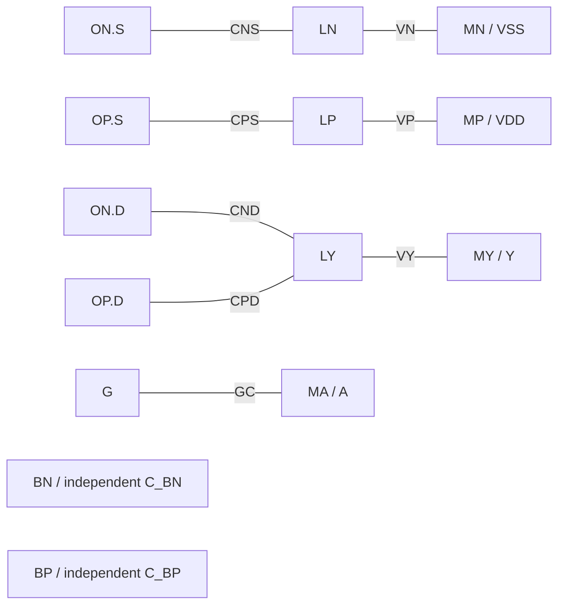

# W004 新版修订与验证入口

本页对应正式派发后的修订版。准备提交为9f6735d，当前实物身份由[W004执行记录](../W004-fixture-revision.md#w004-execution)及完整证据包绑定。原[人工MR](manual-verification.md)、W003 E/R和W004 E1/E2/RP1保持历史原文；下述是新版辅助检查，产品未运行，PM尚未最终验收。

## 要求与验证覆盖

| 要求 | 新版实物 | 实测范围 / 限制 |
| --- | --- | --- |
| R1 | fixture sources.json、tech.json及六owner、独立设计答案 | 所有本地与外部尺寸来源、规则条件、精确单位与原XY；owner实际消费及9类声明/重复字段冲突见证；全部toy，生产规则/PCell未知 |
| R2 / D1 | 40本地图形、body/context.json、两域oracle、special/cut_islands | 14导体/8本地边/6本地分量；六外部形状支持2关联；无本地BTAP有效；类型/接续/唯一性/enclosure/target rail分别检查 |
| R3 | 9raw、requests、dialect、4normalized、header | calibre_like_synthetic/2；2/4/2/8记录；metadata和tuple未知语义保留opaque；具名坐标/顶点/单位/quality与实际owner/source回链；生产方言未验证 |
| R4 / D2 / D3 | policy、reports、contracts、coordinate example | 32×16仅专例；L为channel length；classification只标synthetic；MR-040机制后置；所有真实工具deferred/none/requires_review；未消歧virtuoso_readback保留 |
| R5 | 下表29输入见证、20正常记录及8失败变体、图/合同/导航 | 原22目的全迁移；另7body见证；引用/hash/request重绑；旧W003技术结论不当新版证据 |
| V1 | 实现前独立整数/Fraction设计答案、KLayout与独立stream/CDL读回 | 原40图形与expected语义、全CDL、14导体/8边/6组件/2body、T01–T10；unit encoder共享范围显式披露 |
| V2 | 实际17叶closure、9raw及逐字段backlinks、记录/报告refs | 包括实际body/六owner/选定dialect及requests；cache比较不替代几何证明；声明冲突不得被正确hash掩盖 |
| V3 | 每例真实copy + replacement/remove | 29独立目录、每例对应issue与phase、binding先验；仅C06/C07/C21保留指定故意漂移；下表phase是未来产品预期 |
| V4 | records/failures/schema/report.expected.md/json | 20正常记录、8失败世界、3核心artifact的size/hash、typed refs/JSON pointers、人机报告scope/check表；无产品执行 |
| V5 F1 | 27实际输入选择与完整pre-context descriptor | operation/run/head/lineage/key敏感性；逐个实际文件bytes改变重算，旧摘要拒绝；不提前canonical context |
| V6 F2 | 缺END OF RESPONSE的device_info_Q17 | 坏raw实际hash→坏header→独立fixture-read ToolRun→ParseResult→StageFailure/localized→failure RunRecord completed refs全部同源 |
| V7 | 独立再生成目录、图、snapshot、binary patch、SHA-256、commands/env/output | byte-clean只证明可重复；新版独立review结论单列在W004；重建含新增/移除，不只保存HEAD |

本轮辅助的normal/no_defect仅表示上述固定fixture检查。任何表中reject、0 ECO、无normal export manifest都是未来产品义务，不能误报为已执行typed failure管线。

## 本地 physical graph



## Context-supported body association

```mermaid
graph LR
  BN[local BN] -.90 nm boundary edge.-> BNE[external BODY_N]
  BNE -.typed TN.ext / enclosure.-> MNE[external M1]
  MNE -.10 nm boundary edge.-> MN[local MN / VSS]
  BP[local BP] -.100 nm boundary edge.-> BPE[external BODY_P]
  BPE -.typed TP.ext / enclosure.-> MPE[external M1]
  MPE -.10 nm boundary edge.-> MP[local MP / VDD]
```

两图作用域不同；虚线不是本地physical edge。每段输入身份、类型、唯一性与geometry先成立，再比较语义rail。外部body之间不允许异型正面积重叠。错rail见证只改context所声明的目标rail，几何保持正常，使失败不被其他几何错误遮住。

## 全部原目的迁移及新增body见证

完整替换/移除映射见[实际cases.json](../../../tests/fixtures/w003_m1/failures/cases.json)。下表列每个真实应用的路径；所有case都在独立目录按该映射实际复制和删除，支持日志逐项记录观察结果。P=pre_context，S=sealed_no_publication，E=export；不新增产品enum。

| 原目的 / case | replacement路径（相对正常fixture） | remove路径 | 观察见证 / 未来phase |
| --- | --- | --- | --- |
| C01 unit_mismatch | `body/context.json`<br>`query/header.json`<br>`source.gds` | 无 | UnitScaleMismatch / P |
| C02 missing_terminator | `query/header.json`<br>`query/raw/device_info_Q17.txt` | `query/normalized/device_regions.yaml` | MissingTerminator / P |
| C03 wrong_count | `query/header.json`<br>`query/raw/net_names.txt` | `query/normalized/net_xref.yaml`<br>`query/normalized/net_regions.yaml` | CountMismatch / P |
| C04 dialect_drift | `query/header.json`<br>`query/raw/device_info_Q17.txt` | `query/normalized/device_regions.yaml` | UnsupportedGeometryToken / P |
| C05 unknown_unit | `query/header.json`<br>`query/raw/net_shapes_n_a.txt` | `query/normalized/net_regions.yaml` | UnitBindingMismatch / P |
| C06 raw_byte_drift | `query/raw/nXref.temp` | 无 | RawHashMismatch / P |
| C07 header_top_mismatch | `query/header.json` | 无 | TopBindingMismatch / P |
| C08 mapping_many_to_one | `query/header.json`<br>`query/normalized/device_regions.yaml`<br>`query/normalized/instance_xref.yaml`<br>`query/raw/iXref.temp` | 无 | UnsupportedDeviceCardinality / P |
| C09 multifinger | `query/header.json`<br>`source.cdl` | 无 | UnsupportedFingerCount / P |
| C10 device_reduction | `query/header.json`<br>`query/normalized/device_regions.yaml`<br>`query/normalized/instance_xref.yaml`<br>`query/raw/iXref.temp` | 无 | UnsupportedDeviceReduction / P |
| C11 cdl_expression | `query/header.json`<br>`source.cdl` | 无 | UnsupportedCdlExpression / P |
| C12 cdl_include | `query/header.json`<br>`source.cdl` | 无 | UnsupportedDependencyDirective / P |
| C13 unsupported_target | `query/header.json`<br>`target.cdl` | 无 | UnsupportedTargetAxis / S |
| C14 count_correct_rule_wrong | `body/context.json`<br>`geometry_change.json`<br>`query/header.json`<br>`query/normalized/net_regions.yaml`<br>`query/raw/net_shapes_n_y.txt`<br>`source.gds` | 无 | MandatoryRuleViolation:T07.m1_spacing / S |
| C15 via_enclosure | `body/context.json`<br>`geometry_change.json`<br>`query/header.json`<br>`source.gds` | 无 | MandatoryRuleViolation:T05.contact_enclosure / S |
| C16 extraction_mismatch | `body/context.json`<br>`geometry_change.json`<br>`query/header.json`<br>`query/normalized/device_regions.yaml`<br>`query/raw/device_info_Q17.txt`<br>`source.gds` | 无 | ExtractionCountMismatch / S |
| C17 gds_text | `body/context.json`<br>`query/header.json`<br>`source.gds` | 无 | UnsupportedGdsElement:TEXT / P |
| C18 gds_nonrectangle | `body/context.json`<br>`query/header.json`<br>`source.gds` | 无 | UnsupportedNonrectangle / P |
| C19 output_nonrepresentable | `export_policy.json`<br>`query/header.json` | 无 | OutputCoordinateNotRepresentable / E |
| C20 output_overflow | `export_policy.json`<br>`query/header.json` | 无 | OutputCoordinateOverflow / E |
| C21 normalized_cache_drift | `query/normalized/net_xref.yaml` | 无 | NormalizedCacheMismatch / P |
| C22 missing_body_operator | `query/header.json`<br>`tech/physical.json` | 无 | RequiredBodyOperatorUnavailable / P |
| 新增body missing_body_context | `query/header.json` | `body/context.json` | RequiredBodyContextUnavailable / P |
| 新增body body_wrong_binding | `body/context.json`<br>`query/header.json` | 无 | BodySourceBindingMismatch / P |
| 新增body body_wrong_type | `body/context.json`<br>`query/header.json` | 无 | BodyTypeMismatch / S |
| 新增body body_disconnected | `body/context.json`<br>`query/header.json` | 无 | BodyContinuationMismatch / S |
| 新增body body_ambiguous | `body/context.json`<br>`query/header.json` | 无 | BodyUniqueMatchFailure / S |
| 新增body body_enclosure | `body/context.json`<br>`query/header.json` | 无 | BodyTapEnclosureFailure / S |
| 新增body body_wrong_rail | `body/context.json`<br>`query/header.json` | 无 | BodyTargetRailMismatch / S |

## 8类失败样张

| 变体 | 保留 / 禁止 / 结果 |
| --- | --- |
| pre_context | 坏raw完整链、最小failure RunRecord；无canonical context/geometry/Manifest/ValidationResult |
| sealed_no_publication | stable baseline/context、失败RunRecord；无ECO/正常导出，仅diagnostic |
| run_record_freeze | 唯一无RunRecord例外；Stage5Closure显式freeze failure；不伪造正常export/check |
| export_failure | frozen no_change RunRecord/snapshot保留；core不全无成功Manifest/validation |
| check_fail | 已完成发现违例，required reject，不由golden覆盖 |
| check_error | 执行/解析error单列，coverage none，required reject |
| reporting_failure | 不改变既有checks，加ReportingResult/StageFailure，required report reject |
| terminal_storage_failure | best-effort diagnostic；不虚构terminal pointer/accept/持久恢复 |

## 未运行与待人工闭合

没有产品parser/runtime、Stage1–6、publication/CAS/持久恢复、完整grid/CSP/DTO/codec、真实Calibre/LVS/PDK、production独立downstream open/syntax、Virtuoso/SKILL dry-run或生产上传。Synthetic数学和局部reader不构成production pass。

PM应基于新版同一身份关闭MR-002/004/020/030.2/034/046及受影响A/B/C/D结论；MR-051经052收窄后的坐标样张范围、MR-074-Q1检查身份与未消歧旧义务另行闭合。保留既有用户确认，不能把新版技术通过替用户确认。MR-040机制继续后置；不自行验收W004、关闭W003或进入M1 parser。提交/推送未获本session新增授权，当前以完整snapshot/patch交回。
