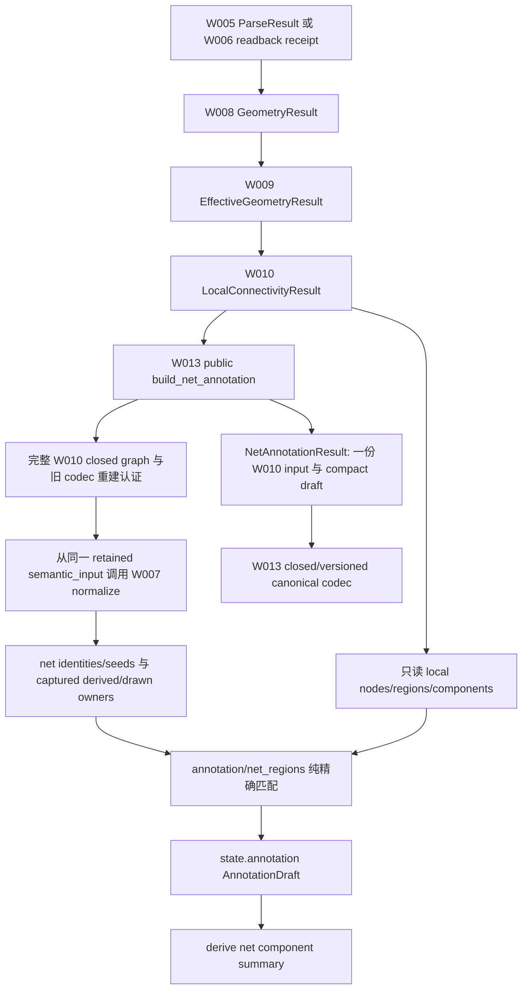
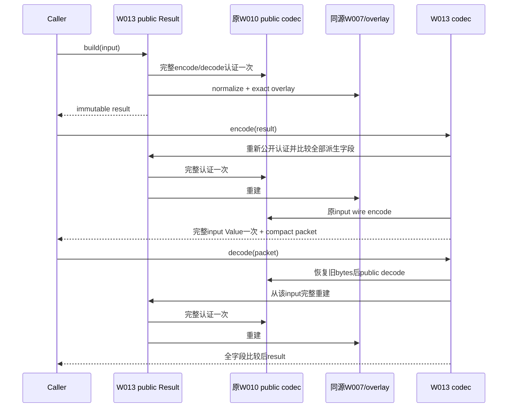

# W013 具体方案候选与实施门

执行者：`/root`，2026-11-12。受调查基线：`d6182fe6893c26490f9d58c6b808a5ce9910384b`。
这是待独立 review 的内部候选，不是新输入格式、生产使用预期或已实现产品。
**存在 PM 未决项 P01；未关闭前不修改关键产品合同，不声称 A1–A8 完成。**

## 恢复与原合同

- 远端 `main` 和 `codex/w013-net-annotation-coverage` 均核得上述完整 SHA。
  从原 `work` 切到原名 W013 本地分支；原工作区 staged/unstaged/untracked 为空。
  A1 `2489b4609ae97d8211bf450d55cac9392492ac71` 为祖先，二者间 `layauto_v2/`、
  `tests/`、`pyproject.toml` 无 diff。未取用 `6045d8f` 或其 codec/测试。
- 已读根 AGENTS、README、docs 导航、collaboration/rules、local-setup、remote-development、
  W013 全部要求/prompt，以及 architecture §3.3、3.5–3.8、5.3–5.9、11.2/3/5/9/14/15。
  `rg --files -g AGENTS.md` 查得仅根 AGENTS。
- W007 `identity.py` 真实 join `net_xref` → cell-scoped `NetId`、`QueryKey`、
  `NetAnnotationSeed`；`contracts.py` 成功结果认证完整 xref/seeds、source backlinks、
  query header/run/database 和 owner。不得从文件名、数值相等或网名相似重新 join。
- W009 `ExactRegion` 保留 record、role、contributors、unit/operator refs 和 canonical cover。
  W010 的 OD S/D、CUT 后 LI 独立为节点；POLY/M1/local BODY 形成各自精确 region，
  channel/connector 不另作导体节点。W010 公开入口先 closed graph 再完整 codec 重建，
  成功聚合重新生成 graph/audit。异常仍按原 object/cause/context/suppression 传播。
- 当前 registry：toy_poly→POLY/identity、toy_li→LI/cut_effective_intersection、
  toy_m1→M1/identity；均 carries `net_id`、rectangle/exact、tolerance 0、reject_ambiguous。
  gate 两项仅 carries device_id，不能用作网络证据。drawn refs 与 derived registry 双向认证。
  query raw `(y,x)` 坐标每 tick 为 1/20 nm；匹配必须用 Fraction nm，不能截为整数 DBU。

## P01：现行捕获无法产生 007

详见 [PM 待决材料](pm-decision.md) 与 [实跑探针](input-boundary-probe.stdout.json)。
现行 dialect 明定一基 NET NAMES ordinal，实际 seeds 的 index 是字符串 1/2/3/4；
QueryKey 拒绝 007，完整捕获认证也拒绝把 7 改成 007。MR-034 与 W004 明确不得为了
保留旧 007 伪造字段/前导零。因此不能靠放宽一个 regex 或在 W013 重写身份解决。
本候选的以下部分适用于现行真实支持子集；P01 的输入范围与 A1 验收解释由 PM 决定。

另一个明确限制：W007 seed 构造器只承载 rectangle/exact/nm。
approximate_bbox/untrimmed 来源在上游已失败；W013 不能声称它们实际进入成功 seeds。
保留上游 located failure 和 completed facts，不升级 quality。当前合法 exact 数据正常处理。

## 调用、所有权与序列化边界



不调用/嵌入完整 W011 Result。W011 保持独立 sibling 能力；若调用者已持有 W011，
只显式选择其同源 W010 input；不得把 W011 再嵌入 W013。Result 只捕获一次 W010 input，
不再存第二份完整 NormalizationResult、layout/effective/local draft 或 parse receipt。
W013 中立 draft 仅保留必要 target/evidence/binding 值与 typed content refs。
公开 Result 必须能从完整 input 重建并逐字段核验，不能只信 digest。
旧 W007–W011 codec 的 wire/ref/认证保持逐字节不变。

### PR-02 修订：公开认证与新 wire 的具体展开

初审方案与原 findings 固定在 `0794d2dc90baaf8d3180e9ce4f4d91683fe90dc7`，不回写为已通过。
以下是修后候选，不是资源实测或已交付格式。

先明确成本陷阱：`domain.codec._wire(bytes)` 使用 **hex**，不是base64。若直接按旧
typed-pack习惯把 `W010_codec.encode_record(input)` 作为bytes字段塞进W013，设其长度为B10、
compact新增值为D13，则新wire为约 `2*B10 + D13 + wrapper`。input逻辑上只出现一次，
仍会新增一次完整hex包装；不能仅靠“只存一份input”声称成本没有增长。

本候选使用新W013独立envelope，**将旧canonical wire的完整Value作为子树**承载，
不将该完整wire作为bytes再hex一遍。设 `old_bytes = W010_codec.encode_record(input)`，
`old_value = domain.codec.decode(old_bytes)`，新envelope的 `captured_input_wire` 为old_value。
反向取 `domain.codec.canonical_bytes(captured_input_wire)` 必须逐字节恢复old_bytes，
然后调用**未改的**W010 public decode完整认证。必须包含完整子树，不能只放ref。
旧wire内部已有的bytes/hex封装全部原样保留；不重写它、不改旧wire_schema或任何旧ref。
这是新codec自身的布局选择，不引入通用flatten/pack重构，不修改A1/A2任何旧codec。

```text
W013 canonical envelope
  wire_schema = layauto-net-annotation-wire/1（候选新版本）
  captured_input_wire = [完整W010 canonical Value一次]
    W010 Result + local draft + W009 captured input
      ...旧W009/W008/W007/publication的原bytes封装仍在原位置...
  annotation = [compact W013 binding/targets/evidence/fragments/coverage/issues一次]
  component_summary = [只读摘要一次]
```

预期新packet长度为 `B10 + D13 + wrapper`，而不是2*B10；其完整captures字段只出现一次，
W011完整captures字段0次，第二个完整NormalizationResult字段0次。这个公式不承诺D13微小，
更不承诺峰值/耗时改善：额外exact Value解析、重建认证与canonical化会消耗CPU和瞬时内存。
最早组合必须分别记录B10、D13、总wire与执行time/RSS；若结构偏离或成本解释不清，先交PM。

为避免builder先计算再让public Result重复计算，候选 `NetAnnotationResult` 的公开构造参数
仅为typed W010 input与schema；status/draft/issues由其完整认证和同源计算派生，不能由调用者
任填success。中立draft仍有完整公开构造与canonical roundtrip。wire保存全部派生字段，
decode不能忽略它们：重建后将每一字段与wire给定值做exact/canonical比较，拒绝任何篡改。

| 新公开操作 | 具体次序 | 新增的完整W010 decode认证（顶层调用次数） |
| --- | --- | --- |
| build_net_annotation(input) / Result(input) | closed graph→旧W010 encode/decode/equality→同源W007 normalize→owner/target/overlay→冻结派生字段 | 1 |
| 新encode_record(Result) | 原对象closed graph→重进上述public Result完整认证→比较全部compact派生字段→旧W010 encode得原bytes→domain.decode成完整Value→pack/canonical | 1 |
| 新decode_record(packet) | domain.decode新envelope并校验closed/字段→canonical_bytes恢复旧input bytes→旧W010 public decode→Result(input)完整认证/计算→比较**全部**wire派生字段与canonical compact编码 | 2 |
| 一次build+encode+decode | 上述三步，完整input存在packet一次，认证工作仍重复发生 | 4 |

表中的次数仅计新增W013直接触发的W010 public decode；每次旧W010 decode内部仍按原代码
递归认证W009/W008/W007/publication并做其canonical重建，**没有**声称整个链总共仅四次解析。
新codec的完整Value解析/旧encode也要单列测量。decode末尾使用已验证值的纯compact pack比较，
不再调用会重新认证的public encode；这不删认证，完整输入已经过旧public decode与Result重建，
所有派生字段也已逐一比较。不引入可由调用者伪造的认证标志或跨调用认证缓存。



实际代码若改变构造方式、调用次数、字段出现次数或新packet承载方式，必须更新这份边界并
独立复核；不能将上述预计次数当作已经观测的profile证据。

`annotation/` 生成 proposed draft，不拥有几何或拓扑；`state.annotation` 是草稿表 owner；
component summary 是 `derive/` 可重算只读 view。不得调用 repository mutation/pipeline
publication，不 seal attempt、发布 baseline 或 terminal，不赋予新 LVS/mandatory/body assurance。

## 中立 DTO 候选

以下是内部字段候选，正式字段冻结须待方案 review；不是用户报告或新 raw schema。

| 对象 | 必要字段与校验 |
| --- | --- |
| AnnotationBinding | schema、source-evidence/local、完整 local/effective/geometry/input content 身份、unit/top/scope、query header/run/database、可空 W006 run/attempt refs、captured derived/drawn owners、source semantic digest；不造直接路径的 run id |
| NetEvidence | canonical NetId、原 QueryKey、完整 seed record 与 xref provenance、防御冻结；全部字段与同源 W007 重建核对，不能把相同名字当作相同 query 身份 |
| AnnotationTargetId | binding ref、layer、record id、ExactRegion ref/role；一个 CUT 后 region 一个 target，不用 bare cell 或 shape 替代 |
| TargetEvidence | target、W010 node/component ref、Fraction nm canonical target cover、原 record source、unit/operator refs；target 集合必须完整等于本地 node 集合 |
| MatchEvidence | evidence/target refs、候选关系、精确交集、被 trim 部分、seed 未匹配部分、quality/tolerance/trim owner；保留零面积接触作为诊断而不计覆盖 |
| AnnotationFragment | target 内按 evidence 边界形成的 canonical disjoint rect cover、全部 evidence refs/NetIds、validity/source-evidence、unknown/annotated/conflict；不得跨 target 合并 |
| LayerCoverage | drawn record/cell/target 数、target multiset 面积、covered/uncovered/direct-conflict 面积、component-conflict 另列、全部来源 refs；非 target 分类独立列 |
| NetComponentSummary | 原 component ref/全部成员、全部 observed NetIds 与直接 evidence refs、unknown/associated/conflict、directly covered targets；不把关联写回每个 region 的直接 coverage |
| AnnotationIssue | typed code/category、affected target/component/layer、NetIds/QueryKeys/source backlinks、severity/recommended action；无最后写覆盖 |

精确原生 scalar/closed DTO 校验在任何复制/编码前执行。外来 subclass、bool 充 int、可写嵌套
alias、未知/缺字段、外源 ref、伪造聚合与不完整来源均拒绝。构造器对 sequence 防御转 tuple，
payload 使用既有 immutable Value algebra；不从 alias 保留 backing。Neutral draft 验证完整
内部 coverage/refs/summary，捕获 Result 另外认证实际来源。不得把 neutral 一致性冒作捕获认证。

codec 使用独立版本/schema、显式 closed registry、精确 Fraction、确定顺序与 typed ref。
decode 重进全部公开构造器，并检查 canonical bytes。需要中立小矩形时复用既有
`domain.channel_identity.RationalRect` 的纯 Fraction 表示；不引入 channel/W011 Result。
不得修改通用旧 codec 或继续 A2。

## 匹配、coverage、冲突

1. 从 W010 本地 nodes 建完整 target 集合；W009 的 CUT 后 LI、OD S/D 均保持独立。
   W008 occupancy 仅作候选 broad phase；CUT/query 边界不一定在旧 axes 上，须对照
   exact region 验证候选无遗漏，最终以 Fraction nm 正面积交集裁定。禁止 cell-center stamp。
2. carries 包含 net_id 且 target_layer 与 drawn derived_layer_refs 唯一一致才可匹配。
   只支持 registry 已声明的 rectangle/exact、tolerance 0；identity 直接裁交，
   cut_effective_intersection 用 seed 与每个既有 effective region 的交集，CUT gap 不计。
   不将 gate device seed、marker metadata 或名字解释为网络。
3. 对每个 target 按所有 exact evidence 边界拆成 disjoint atoms，再按完全相同 evidence set
   canonical 合并。相同 NetId 多证据保留全部 backlink，面积用 union 去重；不同 NetId
   同 atom 保留全部并报 direct conflict。多个 exact target 候选逐个保留，不随机择一；
   同层重复 record 保留为不同 occupants。若 mapping/quality/tolerance 不能区分，报 ambiguous，
   不把“有多个候选”本身伪装成唯一匹配。当前范围不靠 tolerance 推断目标。
4. region uncovered = target cover minus exact matched union。query unmatched = seed cover minus
   所有合法 target 交集 union；CUT trim 移除部分单独记录，不混为 query 指向不存在导体的缺口。
   边/点接触面积0，不能 stamp。partial 保留覆盖、缺口及所有 unmatched evidence。
5. component summary 收集该原 component 成员直接观察的 NetIds；0=unknown，1=associated，
   多于1=conflict（即使证据在不同成员或不重叠）。不 union components，不添删 edge。
   component-conflict 与 direct-overlap-conflict 分列，未覆盖 region 仍 unknown direct coverage。
6. 每层分母为该层本地 target 的带 record multiplicity 面积之和（nm²、Fraction）；
   重复 drawn occupant 各占一份 target 分母。同 target 重叠 query 不重复计量。
   covered 包含 conflict 区域，uncontested=covered−direct-conflict，uncovered=total−covered；
   component conflict 单独列，不混成另一种面积口径。另列 drawn shapes/cells/target 数。
   FIN/CUT/connectors/channel/C1/MARKER 按 actual role 单独分类并完整引用保留。
   MARKER 是非导体/未注释 marker，不计入导体覆盖分母；BODY 是本地 unknown conductor，
   不从外置 body association 补直接网络证据。
7. success 仅表示支持的 overlay 已计算；coverage gap 不自动决定整轮成功/失败。
   component/direct conflict、unsupported/ambiguous 产生显式 issues；保留完整 diagnostic draft。
   上游身份/owner admission error 可无 draft，带原 located issues/completed evidence。

异常边界只捕获专用 expected AnnotationProblem；原上游 typed error 不重解释为成功。
Result/codec 认证失败 ValueError 与 unexpected Exception/KeyboardInterrupt/SystemExit 传播；
在 expected handler 完全退出后再构造 Result，保持原异常 object/cause/context/suppression。

## 小输入与独立判据

这些是手算测试候选，不加载进产品，不修改已验收 fixture/答案。

- target LI `[0,0,10,2]` 面积20；A evidence `[0,0,6,2]` 和 `[4,0,8,2]`：
  覆盖16，缺口 `[8,0,10,2]` 面积4，重叠区域保留两证据但不加倍，direct-conflict=0。
  再加 Y `[5,0,7,2]`：direct-conflict=4、covered仍16，component summary conflict A/Y。
- 同 target evidence `[10,0,12,2]`：边界接触、direct-covered=0、query未匹配面积4。
  seed 边界 x=1/20 nm 的交集仍 Fraction，不 snap/round。
- 实际 cut 专例：LB `[130,20,150,24]` 减 CUTB `[139,18,141,26]`：
  左右各36 nm²，A_REMOTE40 nm²；三分量0边，即使同 NetId A 仍各自保存。
  左右同粗 bucket 也不能补回2nm gap。专例无完整query/CDL；端到端见证只能在临时副本
  构造明确 synthetic captures 并完整重绑 header/cache/provenance，不假称其原本有 receipts。
- 正常现有手工 oracle：14 nodes/8 edges/6 components，四个分量关联 VSS/VDD/Y/A，BN/BP未知。
  直接query仅覆盖G、LN/LP/LY、MN/MP/MA/MY八targets：POLY720、LI1110、M1 1340 nm²。
  全部node分母35090 nm²（OD9120、BODY22800无直接query）。OD可读分量关联但coverage仍0。
  外置 body_associations 不进入本地 graph 或网络直接覆盖。MARK面积25 nm²另列 marker。
- MR-020 已迁 A 孤岛到 standalone special；MR-022.1 不补 MARK 网/边；MR-033.1 认可R00–R07。
  旧16/10、44图形或“加回正常例”建议不能当当前正常判据。

Legacy `io_adapters/parser.py` 的单值 bbox字典、int coercion、中心/整格 stamp 和后写 net_id，
以及 `core/data_model.py` 整 shape coverage，均不符合本任务，拒绝迁入。
取用现行 Fraction/set union、canonical region 数学即可，不 import legacy runtime。

## 候选最小文件清单与验证节点

待 P01 关闭并通过方案 review 后才创建以下产品/测试文件：

| 路径 | 职责 |
| --- | --- |
| `layauto_v2/domain/net_annotation.py` | 中立 binding/target/fragment/evidence/coverage/issue/summary DTO与refs |
| `layauto_v2/state/annotation.py` | compact不可变草稿表及完整内部不变量 |
| `layauto_v2/annotation/net_regions.py` | 纯 Fraction 精确匹配、分片、缺口和冲突 |
| `layauto_v2/derive/net_annotation.py` | 原本地component的可重算摘要 |
| `layauto_v2/normalization/net_annotation.py` | 同源完整认证、入口、result与异常边界 |
| `layauto_v2/normalization/net_annotation_codec.py` | 新closed/versioned canonical wire/ref |
| `layauto_v2/normalization/__init__.py`、`pyproject.toml` | 最小公开入口和typing目标 |
| `tests/unit/test_w013_net_annotation.py`、`tests/contracts/test_w013_contracts.py` | 手算空间/身份/immutable/wire/异常/禁IO与发布边界 |
| `tests/contracts/test_w013_composition.py` | 实际direct/readback/mismatch和本地oracle；临时副本反例 |
| `docs/tasks/W013/` | 新证据、独立review、资源probe/冻结/安装smoke工具 |

不改 architecture/current-work/任务PM要求与阶段、已验收fixture/答案、旧finding/报告/codec。
若 P01 的决定需要上游新增输入语法/identity能力，须重新列出影响与独立review，不能将其藏进此清单。

最早完整组合使用固定三路 fresh process；沿用旧输入 URI、readback RunRequest、cache、roots/GC：
normal `/workspace/Layauto/tests/fixtures/w003_m1`，mismatch `/workspace/w012-inputs/extraction-mismatch`，
`w012-investigation-run` / `w012-investigation-lineage` / `create-w012`。
旧mismatch目录缺失，仅按既有preflight的35项文件/字节hash重建副本，不改路径或重造新答案。
acquisition前一次gc.collect，此后默认GC。

### PR-03 修订：roots与比较条件

W013三路主probe保留的roots明确为
`(parsed, geometry, effective, local, net_result, net_restored, net_wire,
repository, ready, checkpoint, parse, tool, audits, attempt)`。
direct/mismatch的readback-only项为None。旧probe中的W011
`result/restored/wire` **由W013对应值替换**，并非额外构造W011对象；主路径W011实例0个。
同样保留实际输入、上游对象与codec两个输出直到峰值计量完成；不在中途gc/free旧roots换取数字。

如需同机W011基线，另起fresh process按旧probe原始三路、原全部W011 roots运行；其time/RSS/wire
只作为单独workload的参考，不与W013新主路径冒称端到端等工作量。URI、RunRequest、cache、
开始前一次GC及默认GC条件相同；终端产品不同这一不等条件必须披露。W013未改上游阶段的
分阶段成本可对照；新增模块成本看新build/encode/decode与实际packet字段，不从两个不同终端
workload的总耗时直接推断性能收益。若不需同机重测，不默认运行该完整W011链。

分别记录W005/W008/W009/W010未改上游、W013 build、encode/decode的time/RSS/wire；
对比同机同条件W010/既有W011路径，跨环境历史秒数仅参考。
本轮只读库存：16GiB/4CPU，3.12.14可用，3.10及mypy/build当前缺失，需实施获准后准备。
明显重复序列化增长、资源阻塞或解释不清时，先保存三路日志/身份/结构对比交PM，再决定最终矩阵；
不默默扩大链、删认证或重开A2/B。

| 时点 | 实跑/采信/未覆盖/触发 |
| --- | --- |
| 当前调查 | 实跑真实reader→W007和007反例、环境库存与旧263文件hash核验；采信仅同身份上游历史；无W013产品、无新组合/矩阵 |
| 开发 | 新增W013、W007身份/输入、W009region、W010合同/异常、边界依赖测试；不为每轮改动跑双全量 |
| 最终冻结 | 新runtime/tests/config/input/dependency/interpreter完整manifest；双3.10/3.12 full pytest、typing、build、wheel/sdist字节核验、双fresh安装源码外组合smoke |
| 独立review | 核实际diff/完整manifest与原日志身份，独立关键反例/组合/资源探针；session变化不触发重跑双全量 |
| 补跑触发 | 源码/测试/配置/依赖变更、证据或输入身份不闭合、新风险/组合变化；产品再冻结必须新最终矩阵；仅文档补记只核范围/链接 |

旧 A1 1656项矩阵不等于新 W013 最终矩阵。旧工具包含硬编码100 runtime、旧baseline以及
无net字段断言，不可原样作为W013验证。须在W013目录建新工具与新证据，保留任何原失败。
