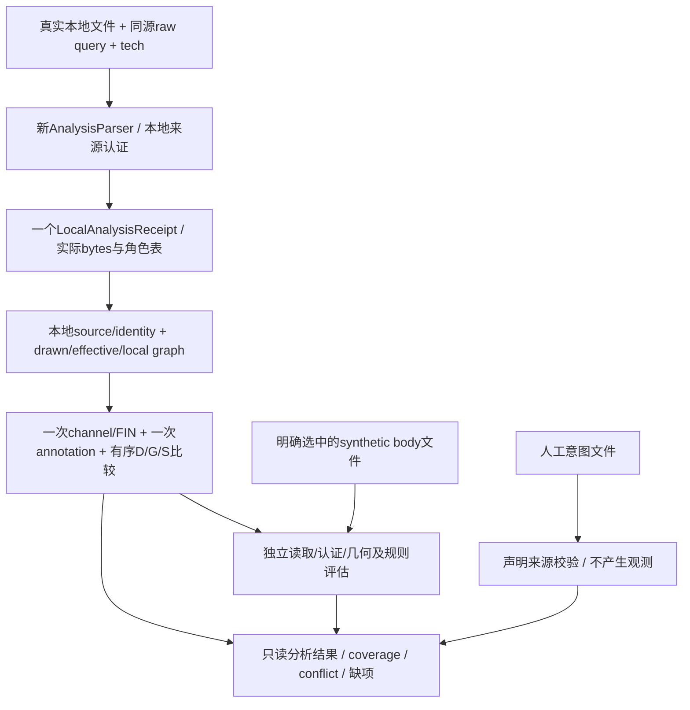

# W015 推荐方案（候选，尚未实施）

基线：`e7c92c03d0b48aa143259da4fc9fbedc382efee0`，产品 main
`3b8d78902591bca32ec9b8ee5d3167d115e1a974`。只交方案，不改变当前运行合同。
接口/状态见 [入口合同](entry-contract.md)，具体请求和输出见
[样张](interface-examples.md)，代码拆分和首包验收见
[实施方案](implementation-proposal.md)，下一执行入口见
[实施 prompt 草案](implementation-prompt.md)。

## 调查依据与调用图（A1）

下列路径均相对仓库根，符号绑定上述基线；不是从任务摘要推断。

| 生产者/符号 | 消费者、当前失败位置 | 本地计算与 body 的实质关系 |
| --- | --- | --- |
| `tech/schema.py::SCHEMAS['site']` | `importers/config.py::validate_document`，body key 缺少即 `MissingField`，尚无 config completed | 完整运行的 schema 耦合，不表示几何错误 |
| `importers/reader.py::_parse_inputs`、`_Files` | 依次读 site→六 owner tech→export/validation/limitations→GDS/source/target/header bytes→必填 body；body 缺文件为 `RequiredBodyContextUnavailable` | 失败时 GDS bytes 已读，但尚未 parse，不能称本地几何已认证 |
| 同文件 `_header_status`、`_binding`、closure/raw loops | 验 header synthetic/tool/unit/status、layout/source/target hash、完整 closure（含 site/policies/body/target）、四类 raw capability；然后才 parse GDS/CDL | query 来源不能因分析目的放松；其中 target/export/body 属于整包闭包，不是 raw query 算法所需物理事实 |
| 同文件 `_body` | GDS/source/top parse 后检查 body 的 GDS/top/profile/unit/角色/ref；随后 `parse_query`，最后 cache 检查 | 文件身份/关联检查不是几何路径证明；enclosure 错可通过 reader |
| `domain/results.py::ParseResult` | success 必须有 value 且无 issues，error 必须无 value；`completed/sources`是诊断证据 | 不能把 error.completed 改造成旧 success |
| `normalization/contracts.py::NormalizationInput`；`_validation.py::KINDS/validate_parse/request_decoder_input` | 要求九种完整记录、十个 value key；source/target、query字段位置、raw/closure与角色全部检查 | 不能仅删 body 并调用 `from_parse_result`；会破坏完整 receipt |
| `normalization/semantic.py::build_source/_cells/build_target`、`identity.py::admit_source/join_identities`、`component.py::normalize` | 构造 source 与独立 target，差异必须完整；join 使用 source/tech/header/query | `_cells`、source-only admission 和 join 的内核不依赖外部 body；包装签名/结果依赖完整输入及 target |
| `normalization/geometry_input.py::_verify/GeometryInput` | 重新认证 site/六 owner/policy/header/GDS；body 必须二 source 角色（body文档、GDS）；保留第一次获取URI；body版本/单位/状态再核 | 是受信输入的整包耦合，不能 monkeypatch。新链必须另有等强度 local 认证 |
| `normalization/geometry.py::_evidence/build_geometry/GeometryResult.body_evidence` | 构建只取 GDS/drawn/formats，body 属性从完整 parse 找记录 | `state/layout_store.py::build_layout`、`coordinate.py::build_partition`、`occupancy.py::build_occupancy`只需本地证据 |
| `normalization/effective.py::build_effective_geometry/_require_input` | 完整 W008 闭合图检查与wire编码（不decode重建）；转交 `body_evidence` | `state/regions.py::build_effective_draft`消费 base+physical；本地 CUT/OD/channel 计算不需外部 body |
| `normalization/local_connectivity.py::_require_input/_rules/build_local_connectivity` | 完整 W009 roundtrip，再用 rules；body 属性沿链传递 | `state/local_connectivity.py::build_local_connectivity_draft`只消费 effective+rules；本地BODY仍是独立node，不能删 |
| `normalization/channel_identity.py::_require_input/_evaluate`（W011） | 完整 W010 roundtrip，再 `normalize`；`derive/channel_identity.py::build_channel_identity_draft` | local/source/ChannelSeed/derived 足够；FIN mismatch 是观测差异，不能因无 body 清空 |
| `normalization/net_annotation.py::_require_input/_evaluate/_capture_binding`（W013） | W010 roundtrip+`normalize`，绑定旧 normalization digest/readback | `annotation/net_regions.py::build_net_annotation_draft`消费 local/source/NetEvidence/derived/capture_binding；新链需自己的 binding，不冒充旧readback |
| `normalization/terminal_relations.py::_require_input/_evaluate`（W014） | W010完整重建、source/seeds，调用中立 terminal builder 并传必需body | 不能直接用于无body分析 |
| `derive/terminal_relations.py::_require/_binding/_relations/TerminalRelationsDraft` | 二source body强制；每source器件必须恰一body path；内部各建一次 channel/annotation，再 evaluate_body | D/G/S映射内核可分拆；B分支真正依赖外部证据。旧 draft、旧 ref、旧 wire均保持 |
| `derive/body_relations.py::evaluate_body` | GDS对象精确关联、同型body、frame边、外部BTAP与rail连接及enclosure、网络观察比较 | 真实body语义依赖。缺上下文不能调用并注入空body；有资料必须认证和执行，违例保持 |
| `pipeline.py::prepare_inputs` / W006 `InputParser` | repository审计、重试、失败terminal及unsealed InputsReady | 新分析入口不调用，不制造run、snapshot、终结或修改许可 |

此表中的现有符号已逐文件核对；新增 refactor 名称均为候选，非现产品API。
代码核对清单与只读探针身份见
[evidence/README](evidence/README.md)。

旧链保持：`read_inputs / prepare_inputs → ParseResult → NormalizationInput →
GeometryInput → W008 → W009 → W010 → W011/W013/W014`。新链不构造旧成功receipt，
也不把原链异常转换成 unknown。分析新链仍用真实文件，不是只交内存DTO。

## 探针与 legacy 结论

[探针](evidence/coupling_probe.py)只在临时目录复制 reader 已捕获的输入，未读
expected/spec/oracle/helper。当前实测：无key→MissingField；缺文件→RequiredBodyContextUnavailable；
坏格式→InvalidDocumentSyntax；错GDS绑定→BodySourceBindingMismatch；
缺body同时坏GDS仍先报body缺失；enclosure反例reader成功，尚未证明body规则。
正常 geometry 来自单一本地GDS，body文档不成为 drawn source。未跑新分析入口，
样张不是探针输出。首轮探针把缺key代码错写为SchemaValidationError，断言失败；
实际观测为MissingField，失败及脚本原版保留，修正后exit0。

已读 `legacy_mvp/io_adapters/cdl_parser.py` 和 `calibre_query.py`：前者混合IO、diff及
float数值解码，后者把命令执行与parser并置。只可参考token/header格式测试思路，
本包优先复用现v2 exact parser，不移植legacy runtime或convenience JSON，也不依赖
legacy来补body/global。符合架构§11.14的纯逻辑若将来需要迁入，需独立parity测试。

## 推荐决定与架构建议（A2/A4）

| 决定 | 推荐及理由 | 状态 |
| --- | --- | --- |
| 分析入口 | `layauto_v2.analysis.analyze_cell(AnalysisRequest)`，固定只读目的 | 候选，交PM接收 |
| 必需输入 | 独立manifest、GDS/source CDL、tech六owner、limitations、同源raw query/header/requests/dialect | 首包有限synthetic；不承诺生产格式 |
| target/export/validation | 新入口不接受，也不读，不构造默认target；保留旧完整入口义务 | 需独立schema/receipt，不能放宽旧schema |
| query header | 新local header保留完整本地来源/状态/units；旧header不能删字段后假称原证据 | 新版本且旧接口拒绝，迁移规则见合同 |
| body | 显式未选择 vs 所选错误；选中时旧synthetic格式可复用，作用域独立 | 不重新决定D1 |
| manual intent | 首包接收窄声明文件，只有预期字段；不能补父级观测和body证明 | 不接收可执行操作意图 |
| 生产替代资料 | 首包一律unsupported；后续可信LVS冻结/窗口分别定义证明 | 不实现验证器 |
| 持久化 | 首包只输出新诊断report；不新增可喂回runtime的分析wire | 单一捕获集合，旧wire不变 |

建议PM在产品实施获准时，将架构§2.2/12.1补充“只读分析manifest区别于完整run”，
§11.13补充无publication的分析facade，§3.6/5.9补充分scope缺项报告。建议写入正规
owner并链接实施任务；本轮不改正文，不以本方案覆盖完整Stage1/mandatory合同。
用户既定方向内的实现选择无须重新询问；若后续要支持真实query方言、可信生产
assurance或实际修改，必须先具体验证资料/影响并交PM，不从当前候选推广。
